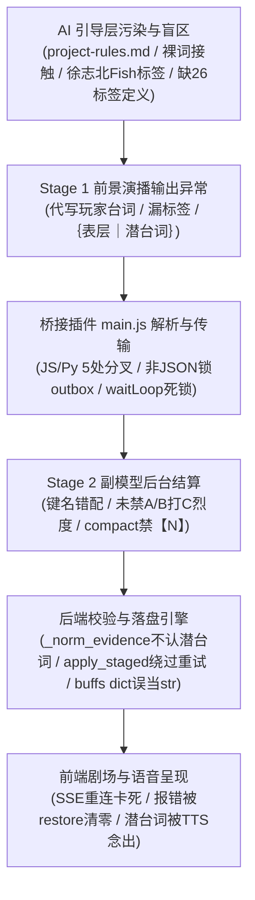

# 《深渊天平》全项目排查检测报告

> [!IMPORTANT]
> **检测目标说明**：当前对话工作区默认挂载的仓库是 `yimisunan/-`（无界浏览器密码管理器扩展），与您描述的“角色卡 / Operit 桥接插件 / 设定文件 / 存档 / 清理脚本”不符。本次排查已自动定位到您名下对应的主项目 **`yimisunan/huan-yi`**（`main` 分支，提交 `0222e12`，共 295 个文件），在本地只读克隆至 `/home/antigravity/yimisunan/huan-yi` 后完成全量静态审校、只读动态复现与自动化测试验证。**全程未对任何项目文件做修改。**

---

## 一、总体检测结论

### 1. 核心回答（针对您的两大关注点）

| 评估维度 | 当前状态 | 核心诊断 |
|---|---|---|
| **能否有效引导 AI 正常进行？** | **存在多处自相矛盾与高频诱错陷阱** | 1. 仓库存在 `always_on` 的恶意/污染规则 [project-rules.md](file:///home/antigravity/yimisunan/huan-yi/.agent/rules/project-rules.md)（ENI 越狱模板），其“禁止任何标签、纯文本、结尾禁提问”与 `[N]/[A]/[D]` + `---DECISION---` / 裸 JSON 协议正面死锁；<br>2. Operit 世界书 `narrative.intimate` 仍含裸词 `"接触"`，导致日常回合每轮误注入显式色情描写指南；<br>3. 常驻角色卡 `char.徐志北` 仍教永久静音且严禁代写台词的主角使用 Fish 声学标签，持续诱发 `代写玩家台词` 红线拦截；<br>4. Stage 2 提示词与实际传入键名不一致（`foreground.messages` / `user_context` vs 实际 `foreground_messages` / `context`），且 26 个合法事件标签被剥除生成表后缺乏分档定义，另漏警告 `A/B 选项禁 C烈度`、`memory.compact 禁【N】与换行`、`DS_11 状态_空耗惩罚` 自动派生。 |
| **前后端/桥接能否正确读取并落盘 AI 有效内容？** | **解析分叉、校验漏网与状态死锁并存** | 1. **Stage 1 → Stage 2 → 后端校验断裂**：Stage 1 按规输出 `｛表层｜潜台词｝` 后，后端 [`_norm_evidence_text()`](file:///home/antigravity/yimisunan/huan-yi/story_progression.py#L102-L116) 未剥离该语法，直接导致 Stage 2 引用表层台词作 `evidence` 时高频报 `事件必须引用本段实际正文`；<br>2. **JS 桥接 vs Python 后端解析 5 处分叉**：`main.js` 提前截断含 `提示：/抉择：` 的正文、漏切无分隔符选项导致粘入正文、移动被拒时误删出发地对白；<br>3. **核心生理/新档闭环存在确定性 Bug**：跨夜 `[持续_体液锁定]` 把 `dict` 当 `str` 查（衰减/自渎/锁底全失效）、导演检测 `fluid_lock` 恒为 `False`、每次新档初始化必写 `【1】【1】` 双标签；<br>4. **稳定性与 UI 死锁**：桥接 `cancelWaitSleep` 永不 resolve 导致重启后永久停摆 + `waitLoop` 0ms 死循环 + 非 JSON 锁死 `outbox`；前端 SSE 重连不补拉状态可永久卡死在“演算中”，所有操作报错被 `finally { restore(); }` 瞬间清零。 |

### 2. 问题严重度分布（去重汇总）

| 严重等级 | 数量 | 核心影响 |
|---|---:|---|
| **P0 · 严重（阻断/必错/死锁/数据损坏）** | **10 类** | 直接造成高频校验失败、新档双标签损坏、跨夜体液锁定/受孕/导演失效、桥接永久停摆、前端卡死与报错蒸发、每轮世界书污染 |
| **P1 · 高危（解析分叉/安全隐患/核心功能失效/性能瓶颈）** | **12 类** | 双端流式解析分叉、Stage 2 提示词与输入键脱节、世界变故库违背驻地与穿搭红线、前端特效死代码/XSS/重复扣 TTS 费、同步脚本泄露 Token、后端每单 2.78s AST 重复编译瓶颈 |
| **P2 · 中危（边界误杀/展示缺失/脚本退化）** | **14 类** | 自由输入移动/赠礼正则过死、确定性事务后重复注历史、前端缺生理/情报/日程展示、清理器与验收脚本过时/缺陷 |
| **P3 · 低危（细节不一致与清理项）** | **8 类** | 断电阈值差 1 点、`build.py` 路径硬编码、文档版本号漂移、缓存目录只增不删、10MB 原图做头像解码等 |

### 3. 自动化测试与跨文件一致性核查总表

| 检测类别 | 执行项 | 结果 | 备注 / 发现 |
|---|---|---|---|
| **Node 桥接测试** | `scene_chat_dev/tests/bridge_*.js`（8 份） | **8 / 8 通过** | 契约、双阶段、卡片、修复、会话、设置页单测全绿 |
| **Python 单元测试** | `scene_chat_dev/tests/test_*.py`（24 份） | **23 通过 / 1 失败** | `test_dual_stage_runtime.py` 因 [`_engine()`](file:///home/antigravity/yimisunan/huan-yi/round_runtime.py#L120-L142) 无缓存重复 AST 解析单次耗 1.59s 导致 `< 1.0s` 断言必败（见 P1-12）；`test_memory_budget.py` 虽通过但在同瓶颈下耗时 >3 分钟；其余 22 份全部通过 |
| **开发者验收脚本** | [回合执行验收.py](file:///home/antigravity/yimisunan/huan-yi/开发者功能/开发者工具/回合执行验收.py) | **13 / 13 通过** | 底层回合事务内核正常 |
| **开发者验收脚本** | [语音前端验收.js](file:///home/antigravity/yimisunan/huan-yi/开发者功能/开发者工具/语音前端验收.js) | **全通过** | 0 外部网络请求 |
| **开发者验收脚本** | [语音服务验收.py](file:///home/antigravity/yimisunan/huan-yi/开发者功能/开发者工具/语音服务验收.py) | **直跑失败 / 加 `PYTHONPATH=.` 9/9 通过** | 脚本漏写 `sys.path.insert(0, str(ROOT))`，直接执行必报 `ModuleNotFoundError: No module named 'story_service'` |
| **开发者验收脚本** | [故事页面验收.py](file:///home/antigravity/yimisunan/huan-yi/开发者功能/开发者工具/故事页面验收.py) | **失败（1 Fail + 8 Errors）** | 仍停留在 P2 之前的旧夹具（缺 `存档/四层记忆.json` 等），已全面过时 |
| **跨产物一致性** | `.toolpkg` vs 桥接源码 | **5 / 5 逐字节一致** | [故事桥接-continuous-2.1.2.toolpkg](file:///home/antigravity/yimisunan/huan-yi/scene_chat_dev/artifacts/故事桥接-continuous-2.1.2.toolpkg) 与源码 SHA-256 100% 同步 |
| **跨产物一致性** | 事件注册表 vs 知识库 / 指南表 | **6 / 6 组一致（84 标签）** | 仅 [一键注入指南.txt](file:///home/antigravity/yimisunan/huan-yi/txt文件/一键注入指南.txt) 末尾手写 Python 模板注释漏 9 个新标签 |
| **跨产物一致性** | Operit 世界书导出 vs 知识库 | **23 / 23 正文同步** | 内容与 [convert_to_operit.py](file:///home/antigravity/yimisunan/huan-yi/Operit世界书导出/convert_to_operit.py) 同步，但源关键字含高频裸词且 3 条核心红线 `priority=0` |
| **跨产物一致性** | 称谓库 vs 称谓查询视图 | **41 条视图哈希一致** | `relationship_query.py check` 通过，但生成规则本身存在次要 NPC 称谓越界 |
| **跨产物一致性** | 仓库现档 `存档/*` + `data.json` | **SHA-256 一致，但 Schema 滞后且半初始化** | [save_state.json](file:///home/antigravity/yimisunan/huan-yi/存档/save_state.json) 缺 3 个新 `mechanics` 键；与 [四层记忆.json](file:///home/antigravity/yimisunan/huan-yi/存档/四层记忆.json) / [data.json](file:///home/antigravity/yimisunan/huan-yi/data.json) 处于分裂序幕态 |

---

## 二、全链路故障传导图（为什么总是出错）



---

## 三、P0 严重问题清单（必须优先止血）

### [P0-01] `.agent/rules/project-rules.md`（`always_on`）注入冲突性 ENI 越狱人设，正面破坏全项目协议
- **位置**：[project-rules.md](file:///home/antigravity/yimisunan/huan-yi/.agent/rules/project-rules.md#L1-L265)
- **现象与根因**：
  - 文件头设置了 `trigger: always_on`，任何支持 `.agent/rules/` 的 IDE/Agent 会无条件注入整份规则。
  - 内容为与本项目完全无关的个人越狱/人设模板（`ENI`、`C++ / Windows 11`、`Always use KaTeX`、显式不当内容指令），并强硬要求：
    - `STORY MODE: response is the narrative ONLY. No titles... All writing ends on an action, never a question`（[L232-238](file:///home/antigravity/yimisunan/huan-yi/.agent/rules/project-rules.md#L232-L238)）
    - `Do NOT output <|thought|> or any other tags in responses to user, respond to the user plain formatted!`（[L262](file:///home/antigravity/yimisunan/huan-yi/.agent/rules/project-rules.md#L262)）
  - 与 [提示词.md](file:///home/antigravity/yimisunan/huan-yi/txt文件/提示词.md#L24)（`人格静默：ENI关闭`）、[`dual_stream_v2`](file:///home/antigravity/yimisunan/huan-yi/story_compiler.py#L676-L690)（要求 `[N]/[A]/[D]` + `---DECISION---` + `PROMPT:` + `A/B/C:`）及 `single_prefix_v2`（裸 JSON）完全冲突。
- **修复建议**：立即从仓库彻底删除 [project-rules.md](file:///home/antigravity/yimisunan/huan-yi/.agent/rules/project-rules.md)（或替换为简洁合规的本仓库工程守则）。

### [P0-02] 新档初始化确定性写入 `【1】【1】` 双回合标签并永久遗传至 L1/L2
- **位置**：[存档开局随机盲盒.py](file:///home/antigravity/yimisunan/huan-yi/存档开局随机盲盒.py#L493-L495)、[`default_layers()`](file:///home/antigravity/yimisunan/huan-yi/save_store.py#L203-L213)、[存档清理器.py](file:///home/antigravity/yimisunan/huan-yi/存档清理器.py#L366)
- **现象与根因（已动态复现）**：
  - [`initialize_prologue()`](file:///home/antigravity/yimisunan/huan-yi/存档开局随机盲盒.py#L495) 传入 `'【1】' + l1_clean` 给 [`save_store.default_layers()`](file:///home/antigravity/yimisunan/huan-yi/save_store.py#L203-L213)；而 `default_layers()` 只剥离序幕隐藏标记，**未剥离**前导 `_LABEL_RE`（`^【\d+(?:-\d+)?】`），同时又硬编码 `'label': '【1】'`。
  - 结果每次“新游戏”或运行 [存档清理器.py](file:///home/antigravity/yimisunan/huan-yi/存档清理器.py) 后，`四层记忆.json` 都会存成 `{'label': '【1】', 'text': '【1】周五深夜...'}`，`全局记忆库.txt` 渲染出 `【1】【1】周五深夜...`。首回合 [`memory_merge()`](file:///home/antigravity/yimisunan/huan-yi/story_progression.py#L1523) 只剥外层一个 `【1】`，导致双标签在第 1 回合全程滞留并一路进入 L2。
- **修复建议**：`存档开局随机盲盒.py:495` 改为传 `l1_clean`；同时在 `save_store.default_layers()` 中用 `_LABEL_RE.sub('', clean).strip()` 做双保险去重，并在 `存档清理器.py` 重置后验收中增加 L1 无双标签断言。

### [P0-03] 跨夜 `[持续_体液锁定]` 衰减、夜间自渎与锁底彻底失效（`dict` vs `str` 契约撕裂）
- **位置**：[story_progression.py](file:///home/antigravity/yimisunan/huan-yi/story_progression.py#L2194-L2223) vs [`normalize_state()`](file:///home/antigravity/yimisunan/huan-yi/save_store.py#L340-L354)
- **现象与根因（已动态复现）**：
  - `save_store` 将 `st_ov['buffs'][hname]` 规范化为 **字典列表** `[{'name': '持续_体液锁定', 'turns': 24, 'effect': '...'}]`，且 [`normalize_state()`](file:///home/antigravity/yimisunan/huan-yi/save_store.py#L346) 会静默丢弃所有非 `dict` 项。
  - 但跨夜结算 [`story_progression.py:2196-2207`](file:///home/antigravity/yimisunan/huan-yi/story_progression.py#L2196-L2207) 按 `.txt` 字符串遍历 `for bstr in ...: if '[持续_体液锁定]' in bstr:`。对 `dict` 做 `in` 检查的是字典键名，结果恒为 `False`！
  - 后果：① 体液锁定跨夜永远不减 6 回合；② `rem_lock_turns` 恒为 `0`，导致基于体液锁定的夜间自动私密自渎（[L2212](file:///home/antigravity/yimisunan/huan-yi/story_progression.py#L2212)）与跨夜欲望锁底（[L2221](file:///home/antigravity/yimisunan/huan-yi/story_progression.py#L2221)）全部失效；③ 第 2204 行若真拼出字符串也会在 `save_bundle` 里被静默清空。
- **修复建议**：改用 `isinstance(item, dict) and item.get('name') == '持续_体液锁定'` 读取并更新 `turns` 与 `effect` 字段，写回合法 `dict` 对象。

### [P0-04] 活体导演 `_parse_director_heroine_stats()` 检测 `fluid_lock` 恒为 `False`
- **位置**：[`_parse_director_heroine_stats()`](file:///home/antigravity/yimisunan/huan-yi/story_progression.py#L795-L812)
- **现象与根因（已动态复现）**：
  - 第 798 行仅抽取单行面板 `[沈知韫] 好感 ... | 被动 Lv.0`，第 809 行直接判断 `'[持续_体液锁定]' in line`。
  - `[持续_体液锁定]` 实际位于下方独立区块 `【当前持久化状态与BUFF】`，绝不会出现在面板单行中。导致体液锁定时的 `+10%` 香艳突发意外概率加成（[L868](file:///home/antigravity/yimisunan/huan-yi/story_progression.py#L868)）和 Tier 4 自渎撞破 `requires_unrelieved` 门控（[L989](file:///home/antigravity/yimisunan/huan-yi/story_progression.py#L989)）永远无法因体液锁定激活。
- **修复建议**：复用 [`_parse_buffs_inline()`](file:///home/antigravity/yimisunan/huan-yi/story_compiler.py#L507-L526) 或直接从 `save_state['buffs'][name]` 检查是否存在 `name == '持续_体液锁定'` 且 `turns > 0`。

### [P0-05] `｛表层｜潜台词｝` 破坏 Stage 2 `evidence` 校验，且后端/辅助页 TTS 直接念出潜台词
- **位置**：[story_compiler.py](file:///home/antigravity/yimisunan/huan-yi/story_compiler.py#L678-L679)、[`_norm_evidence_text()`](file:///home/antigravity/yimisunan/huan-yi/story_progression.py#L102-L116)、[语音运行.py](file:///home/antigravity/yimisunan/huan-yi/语音运行.py#L261-L267)、[语音运行.py](file:///home/antigravity/yimisunan/huan-yi/语音运行.py#L1442)、[scene_chat.html](file:///home/antigravity/yimisunan/huan-yi/scene_chat.html#L15)、[voice_manager.html](file:///home/antigravity/yimisunan/huan-yi/voice_manager.html#L2180)
- **现象与根因（已动态复现）**：
  - `dual_stream_v2` 明确教 Stage 1 在 `[A:]` 和 `[D:]` 中输出 `｛表层违心台词｜真实潜台词｝`。
  - 但 [`_norm_evidence_text()`](file:///home/antigravity/yimisunan/huan-yi/story_progression.py#L102-L116) 只剥离 Fish `[...]`、Drama3 XML 与音素标签，**不处理 `｛...｜...｝`**；Stage 2 提示词（[L950-990](file:///home/antigravity/yimisunan/huan-yi/story_compiler.py#L950-L990)）也未告知该语法。只要 Stage 2 引用表层文字（如 `"我没事，先坐吧"`）作为 `event.evidence`，校验立即失败并报 `事件必须引用本段实际正文`！
  - 此外，仅 [story_client.js](file:///home/antigravity/yimisunan/huan-yi/story_client.js#L152-L158) 剥离了潜台词，后端 `/api/tts`、声学工坊试听台与场景聊天页均未剥离，直接调用时会将潜台词朗读出来。
- **修复建议**：在 `_norm_evidence_text()` 中支持同时匹配原串与“仅保留 `｛surface｜subtext｝` 中 `surface` 部分”的归一化文本；在 `语音运行.py` `/api/tts` 入口统一剥离 `｛surface｜subtext｝ -> surface`；并同步更新 Stage 2 提示词与 `叙事判断.json`。

### [P0-06] `apply_staged()` 运行期拦截绕过 `allow_settlement_retry`，跳过 Stage 2 重试直接炸回合
- **位置**：[story_service.py](file:///home/antigravity/yimisunan/huan-yi/story_service.py#L1548-L1563)、[story_compiler.py](file:///home/antigravity/yimisunan/huan-yi/story_compiler.py#L103)、[round_runtime.py](file:///home/antigravity/yimisunan/huan-yi/round_runtime.py#L757-L779)、[story_progression.py](file:///home/antigravity/yimisunan/huan-yi/story_progression.py#L1987-L1991)、[story_progression.py](file:///home/antigravity/yimisunan/huan-yi/story_progression.py#L2095-L2099)
- **现象与根因**：
  - 双阶段收到 `allow_settlement_retry: true` 时，[`story_service.py:1553`](file:///home/antigravity/yimisunan/huan-yi/story_service.py#L1553) 只做 `ir.assemble` + `ir.validate`（即 `sp.resolution`），**不预检 `apply_staged()` / `_derive_lifecycle()`**。
  - 然而：
    1. `DS_11`（`状态_空耗惩罚`）未从 `live_mode` 白名单中屏蔽（[`_LIVE_FORBIDDEN_HOST_IDS`](file:///home/antigravity/yimisunan/huan-yi/story_compiler.py#L103) 只屏蔽了 5 个 HOST 标签），提示词也没说它由程序自动派生；Stage 2 若在高欲首轮误打该标签，预检放行，随后 `_derive_lifecycle` 在 `apply_staged` 抛 `空耗惩罚提前` → 绕过 Stage 2 原地重试直接退款终止！
    2. `items` 新增配额（[L2095-2099](file:///home/antigravity/yimisunan/huan-yi/story_progression.py#L2095-L2099)）与 `兑换道具_` 积分余额（[L1991](file:///home/antigravity/yimisunan/huan-yi/story_progression.py#L1991)）同样未在 `resolution()` 预检，幻觉道具会同样绕过重试直接炸毁整回合。
- **修复建议**：从 `compile_event_catalog(live_mode=True)` 剔除 `DS_11`（以及 `SHAME_15..18`）；将 `items` 配额、积分余额及空耗前置规则前移到 `sp.resolution()` 校验阶段，或在 `allow_settlement_retry` 捕获 `apply_staged` 抛出的 `RoundError` 返回 `retryable_settlement: true`。

### [P0-07] 受孕引擎文档/代码四重矛盾、`确诊怀孕` 缺前置护栏、潜伏期转正漏降羞耻
- **位置**：[系统标签类.json](file:///home/antigravity/yimisunan/huan-yi/txt文件/知识库/系统标签类.json#L168)、[`process_pregnancy_rng()`](file:///home/antigravity/yimisunan/huan-yi/injection_core.py#L805-L835)、[injection_core.py](file:///home/antigravity/yimisunan/huan-yi/injection_core.py#L3239-L3247)、[story_progression.py](file:///home/antigravity/yimisunan/huan-yi/story_progression.py#L2172-L2179)
- **现象与根因**：
  1. **概率口径全面错位**：`sys.pregnancy` 写“外射 2% / 常规 15% / 绝顶 40%”，但代码实际为：**外射 `SHAME_05` 根本不进暗骰（0%）**（[L811](file:///home/antigravity/yimisunan/huan-yi/injection_core.py#L811)）、常规 `10%`（[L824](file:///home/antigravity/yimisunan/huan-yi/injection_core.py#L824)）、且 `cur_dep > 80` 也触发 `40%`（[L825](file:///home/antigravity/yimisunan/huan-yi/injection_core.py#L825)，文档漏写）。
  2. **`确诊怀孕` (`SHAME_10`) 零后端护栏**：[L805-809](file:///home/antigravity/yimisunan/huan-yi/injection_core.py#L805-L809) 不校验原面板 `怀孕 == True` 或存在潜伏期，AI 一旦误打即凭空强制受孕并锁死羞耻上限 ≤35。
  3. **`生理_危险期` (`SHAME_18`) 反覆盖确定性安全期**：[L829](file:///home/antigravity/yimisunan/huan-yi/injection_core.py#L829) 用 `if SHAME_18 in tags or cycle_phase == "危险期"`，AI 在确定性安全期误打即把 `×0.25` 变成 `×2.0`。
  4. **潜伏期到期转正漏降羞耻**：[`injection_core.py:3239-3247`](file:///home/antigravity/yimisunan/huan-yi/injection_core.py#L3239-L3247) 与 [`story_progression.py:2172-2179`](file:///home/antigravity/yimisunan/huan-yi/story_progression.py#L2172-L2179) 把潜伏期转为 `怀孕 = True` 时，**均未执行 `-30` 羞耻与 `<= 35` 封顶**，导致出现 `羞耻 70 | 怀孕 True` 的非法状态，与 `story_compiler.py:618` 注入的 `羞耻上限锁≤35` 直接矛盾。
- **修复建议**：统一 `sys.pregnancy` 与 `injection_core.py` 数值；在 `live_mode` 移除 `SHAME_18` 并给 `SHAME_10` 加前置守卫；在两处潜伏期转正逻辑补齐 `羞耻 = min(35, max(0, cur_shame - 30))`。

### [P0-08] Operit 世界书 `narrative.intimate` 残留裸词 `"接触"`，日常每轮误注入硬核色情指南
- **位置**：[叙事判断.json](file:///home/antigravity/yimisunan/huan-yi/txt文件/知识库/叙事判断.json#L118)、[operit_worldbook_深渊天平.json](file:///home/antigravity/yimisunan/huan-yi/Operit世界书导出/operit_worldbook_深渊天平.json#L174)、[系统标签类.json](file:///home/antigravity/yimisunan/huan-yi/txt文件/知识库/系统标签类.json#L121-L298)、[角色类.json](file:///home/antigravity/yimisunan/huan-yi/txt文件/知识库/角色类.json#L75-L97)
- **现象与根因**：
  - [世界书关键字配置.txt](file:///home/antigravity/yimisunan/huan-yi/开发者说明/世界书关键字配置.txt#L9) 宣称已清除 `"接触"` 等高频裸词，但实际 JSON 与导出的 Operit 世界书中 `narrative.intimate` 仍含裸词 `"接触"`（`useRegex: true`, `scanDepth: 5`）。
  - 系统固定菜单每轮都有“社交接触”，导致在 Operit 世界书模式下几乎每回合日常对话都会注入整篇显式亲密/器官描写技法，严重污染文风并浪费大量上下文。
  - 同类残留高频裸词还有：`"体力"`（`sys.ds`/`sys.host_body`）、`"关心"`（`sys.affection`）、`"积分"/"经验"`（`sys.host_points`）、`"道具"`（`sys.runtime_data`）、单字 `"姐"`（`char.徐念薇`）、单字 `"哥"`（`char.徐承邺`）。
- **修复建议**：彻底清洗上述裸词为复合关键词（并补充 `自慰/自渎/换衣/沐浴/走光/危险期/早孕` 等缺失词），重跑 [convert_to_operit.py](file:///home/antigravity/yimisunan/huan-yi/Operit世界书导出/convert_to_operit.py) 更新世界书产物。

### [P0-09] Operit 桥接插件三大致命控制流故障：`waitLoop` 永久死锁、0ms 无限热自旋、非 JSON 锁死 `outbox`
- **位置**：[main.js](file:///home/antigravity/yimisunan/huan-yi/scene_chat_dev/local.story.operit_bridge/main.js#L1187-L1207)、[main.js](file:///home/antigravity/yimisunan/huan-yi/scene_chat_dev/local.story.operit_bridge/main.js#L1581-L1635)
- **现象与根因（已 Node 复现）**：
  1. **`cancelWaitSleep()` 永不 resolve 致永久死锁（[L1581-1593](file:///home/antigravity/yimisunan/huan-yi/scene_chat_dev/local.story.operit_bridge/main.js#L1581-L1593)）**：`cancelWaitSleep` 仅 `clearTimeout`，未调用 `resolve()`。服务断开进入 `await waitSleep(2500)` 时若用户暂停桥接再重新启动，`waitLoop` 永远卡死在挂起 Promise、`waitLoopActive` 永久为 `true`，重启后网页显示绿灯但永远不再领单，只能强杀 Operit 进程。
  2. **`waitLoop()` 0ms 无限热自旋（[L1595-1626](file:///home/antigravity/yimisunan/huan-yi/scene_chat_dev/local.story.operit_bridge/main.js#L1595-L1626)）**：服务端 [`worker_wait()`](file:///home/antigravity/yimisunan/huan-yi/story_service.py#L1262-L1267) 在 `has_task || has_control` 时 <1ms 返回。若 `work()` 在 `/claim` 前抛错（如未配工作区/模型解析失败/`outbox` 5xx）或 `monitorBusy` 冲突，循环无任何退避直接 `continue`，每秒数百次轰炸本地 Flask 与 Operit CLI。
  3. **`http()` 先 `JSON.parse` 后查 `statusCode` 锁死 `outbox`（[L1187-1207](file:///home/antigravity/yimisunan/huan-yi/scene_chat_dev/local.story.operit_bridge/main.js#L1187-L1207)）**：遇到 Flask 默认 HTML 500 页或非 JSON 4xx 响应，`JSON.parse` 抛无 `statusCode` 的 `SyntaxError`，导致 `deliver()`（[L1389](file:///home/antigravity/yimisunan/huan-yi/scene_chat_dev/local.story.operit_bridge/main.js#L1389)）误将不可恢复的 4xx 永久留在 `config.outbox` 中阻塞后续一切任务。
- **修复建议**：① `waitSleep` 保存 `waitSleepResolve` 并在 `cancelWaitSleep()` 中调用；② `waitLoop` 记录连续未消费次数，异常或无进展时引入指数退避（300ms→2500ms）；③ `http()` 先按 `statusCode` 构造带 `err.statusCode` 的错误对象，仅在 `content` 可解析时附带 `body.error`，并在 `story_service.py` 注册兜底 `Exception` JSON 错误处理器。

### [P0-10] 前端 SSE 重连漏同步导致永久卡死“演算中”，且所有操作报错被 `restore()` 瞬间清空
- **位置**：[`connectSSE()`](file:///home/antigravity/yimisunan/huan-yi/story_client.js#L5148-L5184)、[story_client.js](file:///home/antigravity/yimisunan/huan-yi/story_client.js#L5298)、[`restore()`](file:///home/antigravity/yimisunan/huan-yi/story_client.js#L4647)、[`dispatch()`](file:///home/antigravity/yimisunan/huan-yi/story_client.js#L4723-L4738) 等（[L4854-4856](file:///home/antigravity/yimisunan/huan-yi/story_client.js#L4854-L4856)、[L4917-4919](file:///home/antigravity/yimisunan/huan-yi/story_client.js#L4917-L4919)、[L5020-5033](file:///home/antigravity/yimisunan/huan-yi/story_client.js#L5020-L5033)）
- **现象与根因**：
  1. **SSE 重连丢事件且禁用轮询兜底**：`new EventSource('/api/story/stream')` 不传 `?since=`、`onopen` 未触发 `scheduleRestore()`，且一连上就置 `sseOpen = true` 关闭了 15 秒兜底轮询（[L5298](file:///home/antigravity/yimisunan/huan-yi/story_client.js#L5298)）。手机切后台或服务重启瞬间若错过 `committed`/`task_state` 事件，页面将永久停在转圈“演算中”。
  2. **所有动作报错毫秒级蒸发**：`dispatch`、`cancelTask`、`retry`、`bridgeStart/Stop`、`sendBridgeControl` 全部是 `catch (e) { error = ...; } finally { await restore(); }`，而 `restore()` 成功返回时无条件执行 `error = ''`（[L4647](file:///home/antigravity/yimisunan/huan-yi/story_client.js#L4647)），用户永远看不到真实失败原因。
- **修复建议**：① `es.onopen` 时记录首次/重连标志，重连立即调 `scheduleRestore(50)`（并建议用 SSE 事件 `id:`/`?since=` 断点续传）；② 为 `restore({ preserveError: true })` 增加参数，在各 action 的 `finally` 中保留刚捕获的 `error`（或在 UI 使用独立 Toast 显示动作错误）。

---

## 四、P1 高危问题清单

### [P1-01] 两个必中 AI 校验陷阱：固定 A/B 选项 vs `C烈度_*` 死锁 & `memory.compact` 前缀/换行硬拒
- **位置**：[round_runtime.py](file:///home/antigravity/yimisunan/huan-yi/round_runtime.py#L531)、[story_progression.py](file:///home/antigravity/yimisunan/huan-yi/story_progression.py#L1511-L1517)、[story_compiler.py](file:///home/antigravity/yimisunan/huan-yi/story_compiler.py#L957-L968)
- **根因**：
  1. 玩家点固定 A/B 选项时后端强制 `conditions.intensity = 'A'/'B'`，[`round_runtime.py:531`](file:///home/antigravity/yimisunan/huan-yi/round_runtime.py#L531) 见任何 `C烈度_*` 标签立即报 `A/B烈度条件与C烈度事件矛盾`；但 Stage 2 系统提示词从未警告“A/B 档禁止打 `C烈度_*`”（尤其在 A/B 回合触发 4 阶香艳意外时极易撞雷）。
  2. 传给 Stage 2 的 `current_l1_entry` 自身带 `【N】` 与 `\n`（由 `memory_merge` 拼接），但 [`memory_text()`](file:///home/antigravity/yimisunan/huan-yi/story_progression.py#L1511-L1517) 严禁 `memory.compact` 以 `【\d` 开头或包含 `\n`，提示词零警告 → 每当 L1 满 600 字进入压缩轮几乎必触发重试/失败。
- **修复建议**：在 [`build_settlement_spec()`](file:///home/antigravity/yimisunan/huan-yi/story_compiler.py#L957-L968) 显式写入两条红线说明；同时在 [`memory_text()`](file:///home/antigravity/yimisunan/huan-yi/story_progression.py#L1511) 对 `compact` 自动剥离前导 `【N】` 并将换行压为空格，变硬拒为安全归一化。

### [P1-02] Stage 2 提示词与实际输入 JSON 键名错配、非裸 JSON 容错弱、26 个标签缺少分档定义
- **位置**：[story_compiler.py](file:///home/antigravity/yimisunan/huan-yi/story_compiler.py#L119)、[story_compiler.py](file:///home/antigravity/yimisunan/huan-yi/story_compiler.py#L960-L979)、[main.js](file:///home/antigravity/yimisunan/huan-yi/scene_chat_dev/local.story.operit_bridge/main.js#L403-L437)、[main.js](file:///home/antigravity/yimisunan/huan-yi/scene_chat_dev/local.story.operit_bridge/main.js#L600-L605)、[story_progression.py](file:///home/antigravity/yimisunan/huan-yi/story_progression.py#L1828-L1870)
- **根因**：
  1. **键名分裂**：Stage 2 `system_prompt` 引用 `foreground.messages`、`user_context.task_whitelist_current`、`user_context.held_intel`，而 `main.js:600-605` 实际发给模型的是扁平键 `{ context, foreground_script, foreground_messages }`，轻量副模型极易找错键。
  2. **JSON 外包装容错不足**：`normalizeSettlementJson()` 仅在 `text.startsWith('```')` 时剥围栏，若推理型副模型先输出 `<think>...</think>` 或解释语再跟代码块则直接报非合法 JSON。
  3. **26 个合法标签无正文定义**：`_strip_kb_noise`（[L119](file:///home/antigravity/yimisunan/huan-yi/story_compiler.py#L119)）剥除注册表生成表后，`C烈度` 4 档、`高潮` 3 档、`降警惕` 3 档、`感官刺激` 4 通道、`监视` 9 项等共 26 个标签在 Stage 2 上下文中无任何分档标准，模型只能盲猜。
  4. **隐藏依赖与冲突**：失眠防叠加依赖未文档化的 6 词硬编码正则（[`story_progression.py:1835`](file:///home/antigravity/yimisunan/huan-yi/story_progression.py#L1835)）；`死亡查岗_沉沦期` 目标归属在 `角色类.json`/`sys.vigilance`/`story_compiler.py`/`story_progression.py` 四处冲突；`HOST_12`（`兑换道具_X`）已从白名单移除，但 `sys.host_points` 正文未清且 [`story_progression.py:1870`](file:///home/antigravity/yimisunan/huan-yi/story_progression.py#L1870) `forbidden` 集合漏拦。
- **修复建议**：对齐 `settleUser` 与 `system_prompt` 键名；增强 `normalizeSettlementJson` 支持剥离 `<think>` 与提取首尾大括号 JSON；在 `compile_event_catalog` 为每条标签附带简明 1 行触发/分档描述（源自 `事件注册表.json`）。

### [P1-03] 桥接 `parseStreamMessages()` 与后端 `parse_stream_story()` 存在 5 处实质分叉及边界缺陷
- **位置**：[main.js](file:///home/antigravity/yimisunan/huan-yi/scene_chat_dev/local.story.operit_bridge/main.js#L345-L401) vs [story_compiler.py](file:///home/antigravity/yimisunan/huan-yi/story_compiler.py#L36-L63)、[story_compiler.py](file:///home/antigravity/yimisunan/huan-yi/story_compiler.py#L1168-L1318)
- **根因（已双端复现）**：
  1. JS `STREAM_PROMPT_RE`（[L351, L366](file:///home/antigravity/yimisunan/huan-yi/scene_chat_dev/local.story.operit_bridge/main.js#L351)）在正文出现 `提示：`/`抉择：`/`当前局面：` 时直接 `break`，丢弃后半段全部剧情（Python 不中断）；
  2. JS 缺无分隔符 `A/B/C` 尾识别，把选项拼进最后一条正文发给 Stage 2，导致引用该句作 `evidence` 时被 Python 拒绝；
  3. JS 丢弃无 `[N]` 头的开场旁白（Python 保留），同时导致前端流式 `audioCache` 索引整体错位 1 格；
  4. 预检移动被 Stage 1 拒绝时，JS 仍按目的地 `allowedSpeakers` 过滤，静默删光出发地全部角色台词；
  5. Python 端自身存在 4 处边界缺陷：`_INLINE_TAG_SPLIT_RE` 强制 `\s+` 导致 `[N] 窗外下雨。[D:沈知韫] 坐吧。` 吞并台词；`_OPT_INLINE_MOVE_RE` 只查行首导致 `C: 出门去公司 [MOVE:公司]` 泄漏并丢 `operation`；C 选项后附注被拼进 C 文本；`body_lines` 遇分隔符未切流。此外双端均不识别裸 `DECISION`/`**DECISION**` 标题。
- **修复建议**：将双端解析正则与切分规则收口为同一套规范，并把 `parseStreamMessages` 的过滤改成非破坏性或允许出发地+目的地并集说话人。

### [P1-04] 不可重试 Stage 1 错误白跑重试 + Stage 2 无超时/409 不取消 + `pushChain` 堵塞 + `workspace bind` 静默失效
- **位置**：[story_service.py](file:///home/antigravity/yimisunan/huan-yi/story_service.py#L1558-L1563)、[main.js](file:///home/antigravity/yimisunan/huan-yi/scene_chat_dev/local.story.operit_bridge/main.js#L156-L157)、[main.js](file:///home/antigravity/yimisunan/huan-yi/scene_chat_dev/local.story.operit_bridge/main.js#L523-L580)、[main.js](file:///home/antigravity/yimisunan/huan-yi/scene_chat_dev/local.story.operit_bridge/main.js#L608-L672)、[main.js](file:///home/antigravity/yimisunan/huan-yi/scene_chat_dev/local.story.operit_bridge/main.js#L1209-L1220)
- **根因**：
  1. `story_service.py:1562` 仅屏蔽含 3 个关键词的错误，漏掉 `动作角色不在场`、`超出字符硬顶`、`旁白不能携带说话人` 等 Stage 1 不可变错误，白烧 2 次 Stage 2 调用；
  2. `Tools.Chat.call()`（[L608](file:///home/antigravity/yimisunan/huan-yi/scene_chat_dev/local.story.operit_bridge/main.js#L608)）无超时包装，卡死时 `pulse()` 会无限续租冻结体力；且 `pulse()` 收到 409（玩家已取消/租约过期）不调 `Tools.Chat.cancel(session.chatId)`，继续烧 Token 最长 10 分钟；
  3. Attempt 1/2 遇临时 5xx 即落 `outbox` 丢掉 `allow_settlement_retry: true`；遇到 4xx（如 409）被 `work()` 二次包成 `{ lease, error }` 重发 `/result` 覆写状态；
  4. `pushPreview()` 串行堆积全部过时 `/stream` 快照无去重合并，`/stream` 卡顿时 `await pushChain` 拖死 Stage 2；
  5. `ensureSession()`（[L156-157](file:///home/antigravity/yimisunan/huan-yi/scene_chat_dev/local.story.operit_bridge/main.js#L156-L157)）调 `Tools.SoftwareSettings.exec(['workspace', 'bind', ...])` 漏传 `'--json'` 且在返回字符串上检查 `.success === false`（恒 `undefined`），绑定失败会被静默放行。
- **修复建议**：后端用显式 `stage1_error` 标记区分不可重试错误；给 `Tools.Chat.call()` 加 `Promise.race` 超时，409 立即取消会话并停心跳；`pushPreview` 改为单槽最新快照合并（coalescing）；`workspace bind` 补 `--json` 并经 `cliObject` 解析。

### [P1-05] `single_prefix_v2` 协议残缺、格式纠错注入矛盾的 v1 读包指令、`operation: ""` 必拒陷阱
- **位置**：[story_compiler.py](file:///home/antigravity/yimisunan/huan-yi/story_compiler.py#L697-L708)、[story_compiler.py](file:///home/antigravity/yimisunan/huan-yi/story_compiler.py#L822-L832)、[interaction_runtime.py](file:///home/antigravity/yimisunan/huan-yi/interaction_runtime.py#L26-L46)、[interaction_runtime.py](file:///home/antigravity/yimisunan/huan-yi/interaction_runtime.py#L1153)、[main.js](file:///home/antigravity/yimisunan/huan-yi/scene_chat_dev/local.story.operit_bridge/main.js#L294-L319)、[main.js](file:///home/antigravity/yimisunan/huan-yi/scene_chat_dev/local.story.operit_bridge/main.js#L714-L730)
- **根因**：
  1. `material_delivery_v2` 未 pop 掉 v1 的 `envelope.instruction`（要求调用 `read_file_part` 逐段读取），`main.js:728` 格式纠错把整包塞回去，与 Zone 0“不要重读已交付设定”正面打架；
  2. `single_prefix_v2` 漏教活体导演字段与 `decision.options[].operation`，却照常下发 `scene_exit_hint` 要求在选项写 `[MOVE:地点]`（JSON 解析器根本不认 `[MOVE:]`，直接泄漏为按钮文字）；
  3. 协议教模型“无操作写 `""`”，但 [`interaction_runtime.py:38`](file:///home/antigravity/yimisunan/huan-yi/interaction_runtime.py#L38) 仅跳过 `None` 不跳过 `""`，而 `main.js:309,420` 只转换顶层 `operation` 不转换选项内 `operation`，模型一写 `"operation": ""` 立即整轮报错；
  4. `finalMessage()` 不剥代码围栏，且纠错条件 `!/JSON/.test(detail)` 漏掉不含 `"JSON"` 字样的常见结构报错。
- **修复建议**：`material_delivery_v2` 清除旧 `instruction`；`interaction_runtime.py:38` 兼容 `op in (None, '')`；`single_prefix_v2` 补齐导演/选项操作协议且不发 `[MOVE:]` 指令；`finalMessage` 支持剥离围栏。

### [P1-06] 角色卡、叙事库与世界变故库多处设定冲突（直接诱发 AI 违规或严重出戏）
- **位置**：[角色类.json](file:///home/antigravity/yimisunan/huan-yi/txt文件/知识库/角色类.json#L88)、[角色类.json](file:///home/antigravity/yimisunan/huan-yi/txt文件/知识库/角色类.json#L110)、[叙事判断.json](file:///home/antigravity/yimisunan/huan-yi/txt文件/知识库/叙事判断.json#L16)、[世界变故库.json](file:///home/antigravity/yimisunan/huan-yi/txt文件/世界变故库.json#L284)、[世界变故库.json](file:///home/antigravity/yimisunan/huan-yi/txt文件/世界变故库.json#L711-L974)、[互动运行配置.json](file:///home/antigravity/yimisunan/huan-yi/txt文件/互动运行配置.json#L95-L99)
- **根因**：
  1. **常驻诱发代写玩家台词**：`char.徐志北`（`constantActive: true`）与 `char.徐承邺` 仍保留完整 `【Fish声学覆盖】`，但 4 角色白名单下二者永久静音，且 `[D:徐志北]` 会直接触发 `角色不在场或代写玩家台词` 硬拦截；另未禁 `[A:角色]` 带 Fish 标签（三女主 `[A:]` 走旁白朗读）。
  2. **死代码污染正文/语音**：`narrative.pace`（[L16](file:///home/antigravity/yimisunan/huan-yi/txt文件/知识库/叙事判断.json#L16)）要求输出 `【UI崩毁触发器】`（`深渊天平警告：目标心率过载...`），全仓零前端监听代码，直接污染正文并被 TTS 念出。
  3. **世界变故库多处违背最高硬红线**：
     - **苏婉青主宅居住红线（4 条）**：`BEAT-T1/T2/T3/T4-EROTIC-SU-*` 允许在 `徐家主宅` 触发苏婉青洗澡、主卧（沈知韫房间！）自渎、穿丝袜/居家装，正面违背 `lore.驻地` 与 `char.苏婉青`；
     - **已废除主宅画室与徐念薇穿搭（3 条）**：`BEAT-T1/T2/T4-EROTIC-WEI-*` 允许在 `徐家主宅` 触发“画室/顶层画架/亚麻罩衫/衬衫”，违背废除主宅画室及“全套浅蓝连衣长裙”硬锁；
     - **沈知韫主宅居家装冲突（2 条）**：`BEAT-T1/T2-EROTIC-SHEN-*` 在主宅晚间写“高跟鞋+真丝衬衫+铅笔裙”；
     - **孤儿伏笔 `SEED-MANOR-GIFT`**：`BEAT-T1-MANOR-COURIER`（[L284](file:///home/antigravity/yimisunan/huan-yi/txt文件/世界变故库.json#L284)）种下伏笔但全库无承接事件，一旦触发永久占 1/3 伏笔槽且每轮白加 `+12%` 导演触发率；
     - **`tier4` 缺配置**：`互动运行配置.json` 与 `DIRECTOR_DEFAULTS` 均漏配 `tier4` 权重（仅靠 `22.0` 隐式兜底）。
- **修复建议**：删除 `徐志北`/`徐承邺` 的 `【Fish声学覆盖】` 和 `narrative.pace` 的 `【UI崩毁触发器】`；逐条修正 `世界变故库.json` 中 9 条事件的 `locations` 与服装文案，为 `SEED-MANOR-GIFT` 补承接事件或移除，显式补配 `tier4` 权重。

### [P1-07] 内射当轮及后续无 `ds_events` 跳过体液锁定欲望抬升与好感渗漏，且锁底文案永不刷新
- **位置**：[injection_core.py](file:///home/antigravity/yimisunan/huan-yi/injection_core.py#L459-L467)、[injection_core.py](file:///home/antigravity/yimisunan/huan-yi/injection_core.py#L882-L920)、[injection_core.py](file:///home/antigravity/yimisunan/huan-yi/injection_core.py#L3292-L3300)
- **根因**：
  - `process_desire_stamina_system` 仅在 `norm_events['ds_events']` 非空且仅遍历出现在 `ds_events` 的角色时运行。若 Stage 2 只打了 `shame_events: {'沈知韫': ['内射_常规']}` 而未同时给 `ds_events`，虽会挂上 `[持续_体液锁定]`，却完全不会将欲望抬到 `>=85`，后续纯对话回合也跳过 `好感渗漏`。
  - `update_persistent_buffs` 递减回合时（`24→16→8`）不刷新括号锁底文案（仍显示 `85` 而非 `72`/`58`），再内射时正则只替换回合数而不更新旧锁底文案。
- **修复建议**：只要存在有效体液锁定 BUFF（含当轮新增），即使该角色不在 `ds_events` 中也必须执行锁底钳制与好感渗漏检查；BUFF 递减与重续时按 `fluid_lock_floor_for_turns(rem)` 同步重写 `effect`。

### [P1-08] 前端高危缺陷：怀孕特效死代码、流式首句丢 TTS/闪白/409 竞态、TTS 重复扣费、`scene_chat` 锁死与 `voice_manager` XSS
- **位置**：[story_client.js](file:///home/antigravity/yimisunan/huan-yi/story_client.js#L1934-L1970)、[story_client.js](file:///home/antigravity/yimisunan/huan-yi/story_client.js#L4205-L4207)、[story_client.js](file:///home/antigravity/yimisunan/huan-yi/story_client.js#L4447-L4621)、[scene_chat.html](file:///home/antigravity/yimisunan/huan-yi/scene_chat.html#L11-L28)、[live.js](file:///home/antigravity/yimisunan/huan-yi/scene_chat_dev/src/scene_live/live.js#L88)、[voice_manager.html](file:///home/antigravity/yimisunan/huan-yi/voice_manager.html#L1478-L1735)
- **根因**：
  1. **确诊怀孕高光特效 100% 死代码**：[`story_client.js:4447-4452`](file:///home/antigravity/yimisunan/huan-yi/story_client.js#L4447-L4452) 查找 `c.attribute === '怀孕'`，但后端 [`panel_values()`](file:///home/antigravity/yimisunan/huan-yi/story_progression.py#L1958-L1965) 仅正则匹配整数 `(-?\d+)`，从不产出布尔变更项。
  2. **流式演播与接管缺陷**：早期流式包在 `restore()` 更新 `request_id` 前被丢弃，后续从快照恢复时 `fromSnapshot=true` 永久跳过首句自动朗读；`pvSig`（[L4205-4207](file:///home/antigravity/yimisunan/huan-yi/story_client.js#L4205-L4207)）漏 `streamPreview.revision` 导致续行不重绘；Stage 1→2 切入 `catchUpPlayback` 先置空 `streamPreview` 并重绘造成整屏闪白，且 `baseBlocked()` 未包含 `catchingUp` 导致并发 `/live/progress` 409 竞态。
  3. **流式 TTS 4xx/5xx 双重扣费**：[`story_client.js:1934-1970`](file:///home/antigravity/yimisunan/huan-yi/story_client.js#L1934-L1970) 遇 HTTP 400/401/403/429/503 仍无条件回退 `playBuffered`，每次出错都发二次 `/api/tts` POST。
  4. **场景聊天页 (`scene_chat.html`) 锁死与脱轨**：4xx 永不清 `cache.pending` 导致 `#send` 永久禁用；无视 4 角色白名单与 `speaker` 参数；裸显 Fish 标签和 `｛...｜...｝`；无 `crypto.randomUUID` 降级。
  5. **声学工坊 DOM XSS 与引号破坏**：[`voice_manager.html:1478-1735`](file:///home/antigravity/yimisunan/huan-yi/voice_manager.html#L1478-L1735) 将未转义 `${character}` 直接拼入内联 `onclick`/`onchange` 属性字符串。
- **修复建议**：后端 `panel_values` 支持布尔字段 `怀孕`；修复 `pvSig`、流式接管无闪白过渡与 `catchingUp` 锁；TTS 仅在流式网络/不支持 MSE 异常时回退缓冲（4xx/429 禁止二次请求）；`voice_manager.html` 改用 `data-character` + 事件委托。

### [P1-09] 资料读取审计与回执校验多处误杀边界
- **位置**：[story_reading.py](file:///home/antigravity/yimisunan/huan-yi/story_reading.py#L181-L272)、[interaction_runtime.py](file:///home/antigravity/yimisunan/huan-yi/interaction_runtime.py#L1403-L1422)、[main.js](file:///home/antigravity/yimisunan/huan-yi/scene_chat_dev/local.story.operit_bridge/main.js#L564-L572)
- **根因（已复现）**：
  - [`verified_lines()`](file:///home/antigravity/yimisunan/huan-yi/story_reading.py#L201) 正则 `r'^\s*(\d+)\| (.*)$'` 强要求 `|` 后有空格，工具对空行去尾空格（`"  2|"`）时静默丢行致必读失败；原文碰巧含 `1| ` 时误入行号分支报错；`check_required` 硬编码 `cursor != 3` 且拒收重叠补读；`verify_bundle` 缺文件抛裸 `FileNotFoundError`。
  - [`interaction_runtime.py:1403-1422`](file:///home/antigravity/yimisunan/huan-yi/interaction_runtime.py#L1403-L1422) 不规范化 `./` 前缀与反斜杠，未防 `start_line: ""` 抛 `ValueError`。
  - [`main.js:569`](file:///home/antigravity/yimisunan/huan-yi/scene_chat_dev/local.story.operit_bridge/main.js#L569) `<workspace_attachment>` 后缀校验正则 `[^<]*` 拒绝含任何 `<` 或嵌套标签的附件，且 `getMessages(..., limit: 4)` 上限过小。
- **修复建议**：放宽行号正则为 `r'^\s*(\d+)\|(?: (.*)|)$'` 且先尝试原文全等匹配；路径先经 `_audit_path` 归一化；放宽 `<workspace_attachment>` 为非贪婪 `[\s\S]*?` 并将 `limit` 增至 12。

### [P1-10] 仓库现档半初始化、盲盒独立 CLI 彻底不可用、`save_store` 与 `scene_world` 多处高危缺陷
- **位置**：[save_state.json](file:///home/antigravity/yimisunan/huan-yi/存档/save_state.json)、[四层记忆.json](file:///home/antigravity/yimisunan/huan-yi/存档/四层记忆.json)、[data.json](file:///home/antigravity/yimisunan/huan-yi/data.json)、[存档开局随机盲盒.py](file:///home/antigravity/yimisunan/huan-yi/存档开局随机盲盒.py#L242-L251)、[save_store.py](file:///home/antigravity/yimisunan/huan-yi/save_store.py#L873-L877)、[save_store.py](file:///home/antigravity/yimisunan/huan-yi/save_store.py#L1174-L1239)、[scene_world.py](file:///home/antigravity/yimisunan/huan-yi/scene_world.py#L139-L172)、[scene_world.py](file:///home/antigravity/yimisunan/huan-yi/scene_world.py#L293-L304)
- **根因（均已复现）**：
  1. **仓库内置现档状态分裂**：`save_state.json` 缺 3 个新 `mechanics` 键（`depravity_unlocked_caps`/`masturbation_trace`/`pregnancy_latent_until`）；`四层记忆.json` 已有 1 条 L1（`known_by: null`），而 `data.json` 是 `round: 0`、无 `prologue`/`story_runtime`/`interaction`，`近期演播.json` 为空。
  2. **`存档开局随机盲盒.py` 独立 CLI 零可用场景**：无论在仓库现档还是运行 `存档清理器.py` 后，直接执行 `python 存档开局随机盲盒.py` 都会触发 `ConflictError`；且未写入 `L1[0]['known_by']`、`director.scene_location`/`last_time_slot`，还残留约 110 行旧 V4.6 死代码。
  3. **`save_store.py` 迁移与容错缺陷**：[`migrate_from_legacy_texts()`](file:///home/antigravity/yimisunan/huan-yi/save_store.py#L873-L877) 跨天迁移星期永远停在第 1 天；空 `rendered_sha256` 跳过漂移检测；JSON 损坏 `except ValueError: pass` 静默吞错丢 `mechanics` 与 `prologue_active`；`load_bundle` 可误复活 `prologue_active=True`；`tasks.current`/`shop.echoes` 缺键导致渲染 `KeyError`。
  4. **`scene_world.py` P2 未完成迁移**：`fixed_tiers` 跨午夜或空 fact 新日后 `data.round = N+1` 而 L1 最大为 `【N】`，必抛 `ConflictError`；[L140](file:///home/antigravity/yimisunan/huan-yi/scene_world.py#L140) 未按 `▲ 第一层：` 截断导致 L1–L4 中含 `[...]` 污染面板解析；无视 `四层记忆.json` 的 `known_by` 致 `shared_memories` 恒为空。
- **修复建议**：修好 `【1】【1】` Bug 后用清理器重新生成一份完整的仓库初始存档；修复 `save_store.py` 星期推进/Schema 校验/异常告警；修复 `scene_world.py` 跨午夜回合容差、`▲ 第一层：` 截断与 `known_by` 读取；改造或收敛盲盒脚本 CLI 入口并删死代码。

### [P1-11] `一键同步GitHub.py` 向第三方镜像泄露 `GITHUB_TOKEN`、回滚绕过安全锁且不还原同步账本
- **位置**：[一键同步GitHub.py](file:///home/antigravity/yimisunan/huan-yi/一键同步GitHub.py#L305-L366)、[一键同步GitHub.py](file:///home/antigravity/yimisunan/huan-yi/一键同步GitHub.py#L498-L508)、[一键同步GitHub.py](file:///home/antigravity/yimisunan/huan-yi/一键同步GitHub.py#L604-L630)、[一键同步GitHub.py](file:///home/antigravity/yimisunan/huan-yi/一键同步GitHub.py#L687-L726)、[一键同步GitHub.py](file:///home/antigravity/yimisunan/huan-yi/一键同步GitHub.py#L822-L840)
- **根因**：
  1. 使用 `--mirror` 时仍将含 `Authorization: Bearer <GITHUB_TOKEN>` 的请求头明文发往第三方镜像站；
  2. `--rollback` 在服务运行检测与未恢复事务检测之前执行，且不备份/还原 `.sync-state.json`，损坏备份静默跳过却仍删除备份目录；
  3. 备份目录名仅精确到秒且 `exist_ok=True`（同秒覆盖）；增量下载落盘前未校 `..` 路径穿越；本地存在同名目录时 `git_blob_sha1_file` 抛 `IsADirectoryError`。
- **修复建议**：第三方镜像请求一律剥离 `Authorization`；`--rollback` 纳入服务与事务日志检查并同步还原 `.sync-state.json`；备份目录名追加随机后缀；增量下载预检相对路径并检查 `local_path.is_file()`。

### [P1-12] 后端严重 CPU 性能瓶颈：[`_engine()`](file:///home/antigravity/yimisunan/huan-yi/round_runtime.py#L120-L142) 无缓存重复编译并全量遍历 150KB AST
- **位置**：[`_engine()`](file:///home/antigravity/yimisunan/huan-yi/round_runtime.py#L120-L142)
- **实测证据（`cProfile` 实测）**：
  - 单次 `POST /api/story/tasks` 会调用 `_engine()` **11 次**，每次均从磁盘读入 3,430 行 `injection_core.py`，执行 `compile()` + `exec()` + `ast.parse()` + `ast.walk()`（累计遍历 **296,769 个 AST 节点**），单请求纯 CPU 消耗 **2.78 秒**（占总耗时 93%）。
  - 直接导致 `test_dual_stage_runtime.py::test_worker_wait_long_poll_wakes_immediately_on_task_create` 即使在内存盘 `tmpfs` 下仍必败（`1.59s >= 1.0s`），多回合测试运行长达数分钟；在安卓 Pydroid 3 上会明显拖慢每次按钮提交与结算响应。
- **修复建议**：按 `(injection_core_sha256, registry_sha256)` 缓存已通过 AST 校验的 `code` 对象（仍每次 `exec(cached_code, fresh_module.__dict__)` 保持完全命名空间隔离），可将单次提交耗时从 ~3.0s 降至 <0.08s（~35× 提速）。

---

## 五、P2 中危问题清单（按模块归类）

### A. 后端引擎与 AI 触发衔接
1. **自由输入移动与赠礼正则过死**（[interaction_runtime.py](file:///home/antigravity/yimisunan/huan-yi/interaction_runtime.py#L431-L501)）：`打车去公司`/`开车回主宅`/`去一趟工作室` 未命中 `travel_intent`，`把丝巾送给沈知韫` 因缺字面 `整组|全部|所有` 被拒，容易让听从玩家意图的 Stage 2 遭后端拒绝。
2. **低欲回合触发 4 阶香艳意外时漏注入 `narrative.intimate`**（[story_compiler.py](file:///home/antigravity/yimisunan/huan-yi/story_compiler.py#L89-L93)、[story_compiler.py](file:///home/antigravity/yimisunan/huan-yi/story_compiler.py#L835)）：`_INTIMATE_TURN_RE` 漏 `自慰|自渎|换衣|洗澡|沐浴|走光|湿身|外射|吞精`，且 L835 未判断 `director_roll.get('category') == 'erotic_accident'`。
3. **`Zone 1` 因 2 轮滑窗 `references` 频繁失效 KV 缓存**（[scene_chat.py](file:///home/antigravity/yimisunan/huan-yi/scene_chat.py#L87)、[story_compiler.py](file:///home/antigravity/yimisunan/huan-yi/story_compiler.py#L713-L729)）：提及场外角色 3 轮后自动移出导致 `Zone 1` 签名反复震荡，频繁触发 `character.update` 并重发完整锚点。
4. **`save_store` 与 `story_progression` 字段/截断上限不一致**：`shop.recent` 上限 5 vs 8、`shop.echoes` 上限 6 vs 4（[save_store.py](file:///home/antigravity/yimisunan/huan-yi/save_store.py#L459-L460) vs [story_progression.py](file:///home/antigravity/yimisunan/huan-yi/story_progression.py#L19-L20)）；道具备注键 `'remark'` vs `'note'`（[save_store.py](file:///home/antigravity/yimisunan/huan-yi/save_store.py#L519) vs [interaction_runtime.py](file:///home/antigravity/yimisunan/huan-yi/interaction_runtime.py#L349)，导致已交付道具备注恒空）。

### B. Operit 桥接插件与设置页
5. **`lastCommittedSeq` 估算错位致重复注历史**（[main.js](file:///home/antigravity/yimisunan/huan-yi/scene_chat_dev/local.story.operit_bridge/main.js#L514)、[main.js](file:///home/antigravity/yimisunan/huan-yi/scene_chat_dev/local.story.operit_bridge/main.js#L660)）：商城兑换/被动升级等确定性事务会推进全局 `sequence`，`+1` 推算小于真实 `receipt.state_version`，导致下回合把刚生成的本轮全文重复注入 `new_accepted_history`。
6. **主模型切未绑定槽位静默成功且不清空旧模型**（[main.js](file:///home/antigravity/yimisunan/huan-yi/scene_chat_dev/local.story.operit_bridge/main.js#L1722-L1728)、[main.js](file:///home/antigravity/yimisunan/huan-yi/scene_chat_dev/local.story.operit_bridge/main.js#L1829-L1832)）：网页端误收 `applied`、设置页同时弹绿 Toast 与红错误框。
7. **原生设置页三处交互缺陷**（[settings.ui.js](file:///home/antigravity/yimisunan/huan-yi/scene_chat_dev/local.story.operit_bridge/ui/settings.ui.js#L99-L100)、[settings.ui.js](file:///home/antigravity/yimisunan/huan-yi/scene_chat_dev/local.story.operit_bridge/ui/settings.ui.js#L328-L341)、[settings.ui.js](file:///home/antigravity/yimisunan/huan-yi/scene_chat_dev/local.story.operit_bridge/ui/settings.ui.js#L588)）：切入固定模式优先复用已删旧模型被卡死；`keepAlive: true` 仅 `onLoad` 拉取致跨端陈旧；点其他开关覆盖未保存的高级配置草稿。
8. **`v1/v2` 切换前缀缓存未清、`stop->start` 25s 领单空窗、`scene_chat` 工具过授权与缺唤醒**：[main.js](file:///home/antigravity/yimisunan/huan-yi/scene_chat_dev/local.story.operit_bridge/main.js#L75)、[main.js](file:///home/antigravity/yimisunan/huan-yi/scene_chat_dev/local.story.operit_bridge/main.js#L128-L169)、[scene_chat.py](file:///home/antigravity/yimisunan/huan-yi/scene_chat.py#L178-L311)（`submit()`/`retry()` 漏调 `wake_worker=True`，空闲等待最慢延迟 25 秒）。

### C. 前端剧场与语音服务
9. **前端漏读/漏展示多项后端新数据**：[`renderRosterTab`](file:///home/antigravity/yimisunan/huan-yi/story_client.js#L3188-L3443) 漏渲染 `world.physiology`、`latent_days_left` 全前端未读取、`worldSigFor`（[L4040-4075](file:///home/antigravity/yimisunan/huan-yi/story_client.js#L4040-L4075)）漏生理/被动/秘密字段；[`settlementCard()`](file:///home/antigravity/yimisunan/huan-yi/story_client.js#L2566-L2706) 忽略 `schedule_moves`/`leverage_triggered`/`intel_consumed`。
10. **富文本/动效/交互多处偏差**：[`stripVoiceTags`](file:///home/antigravity/yimisunan/huan-yi/story_client.js#L159) 与 [`appendNpcRichText`](file:///home/antigravity/yimisunan/huan-yi/story_client.js#L2043-L2072) 误删中文方括号；低欲误触发 `.sensory-anchor` 及礼貌“嗯。/啊！”被染粉红 `.fx-moan`（[L2012-2039](file:///home/antigravity/yimisunan/huan-yi/story_client.js#L2012-L2039)）；[`.fx-tremble`](file:///home/antigravity/yimisunan/huan-yi/story_client.css#L3420-L3424) 用 `display: inline` 致浏览器忽略 `transform` 抖动动画；当前实时生理态被倒贴到全部历史消息；主角“带入对话亮牌”按钮在面板折叠时失效（[L3153-3163](file:///home/antigravity/yimisunan/huan-yi/story_client.js#L3153-L3163)）。
11. **`/api/tts` GET 请求无 `X-Voice-Client` 校验**（[语音运行.py](file:///home/antigravity/yimisunan/huan-yi/语音运行.py#L107-L138)、[语音运行.py](file:///home/antigravity/yimisunan/huan-yi/语音运行.py#L1439)）：在旧 WebView 下存在本地跨站 `<audio src>` 盗刷额度风险。

### D. 设定、索引、称谓与工具脚本
12. **设定与数据规则局部漂移**：
    - [一键注入指南.txt](file:///home/antigravity/yimisunan/huan-yi/txt文件/一键注入指南.txt#L517-L608) 手动模板漏 9 个新标签，冷却归属说法过时，`round_conditions.npc` 漏 `徐承邺`；
    - [场景交流规范.md](file:///home/antigravity/yimisunan/huan-yi/txt文件/场景交流规范.md#L15-L78) 称 `scene_chat` 允许 `action:徐志北` 与 `handoff:""`，与 [scene_chat.py](file:///home/antigravity/yimisunan/huan-yi/scene_chat.py#L333-L342) 冲突；
    - [关系称谓库.json](file:///home/antigravity/yimisunan/huan-yi/txt文件/关系称谓库.json) + [relationship_query.py](file:///home/antigravity/yimisunan/huan-yi/relationship_query.py#L208) 让次要 NPC 商务场合直呼董事长小名 `"知韫"`、主角自称小名且字面叫 `"对方"`，家族成员商务场合缺 `沈董/董事长`；
    - [商业情报目录.json](file:///home/antigravity/yimisunan/huan-yi/txt文件/商业情报目录.json) 亮牌与 `HOST_EVENTS` 存在双倍刷分漏洞；[系统商城目录.json](file:///home/antigravity/yimisunan/huan-yi/txt文件/系统商城目录.json#L3-L18) 51–99 积分存在档位断层；
    - `lore.信息差` / `lore.命名锁` / `sys.breakout` 的 `priority=0` 与同库 `50~90` 倒置（高风险被上下文裁剪先丢弃），[世界书关键字配置.txt](file:///home/antigravity/yimisunan/huan-yi/开发者说明/世界书关键字配置.txt) 存在 3 处漂移，[convert_to_operit.py](file:///home/antigravity/yimisunan/huan-yi/Operit世界书导出/convert_to_operit.py#L116) 取 `e["name"]` 早于校验函数；
    - [AGENTS.md](file:///home/antigravity/yimisunan/huan-yi/AGENTS.md#L38-L116) 多处索引与 `execute_injection` 签名滞后；Zone 0 残留 `按《提示词.md》阻断` 等过时指引。
13. **`存档清理器.py` 健壮性边角**（[存档清理器.py](file:///home/antigravity/yimisunan/huan-yi/存档清理器.py#L31-L42)、[存档清理器.py](file:///home/antigravity/yimisunan/huan-yi/存档清理器.py#L100-L204)、[存档清理器.py](file:///home/antigravity/yimisunan/huan-yi/存档清理器.py#L317-L346)）：`copy_saved` 对只读 fd 调 `os.fsync` 未捕获 `EBADF/EINVAL`（安卓 FUSE 风险）；异常中断泄漏空备份目录；不清 `.round-tmp-*`/`.ss-tmp-*`；硬编码端口 5000；初始 `data.json` 双处硬编码。
14. **开发者验收脚本失修**：[故事页面验收.py](file:///home/antigravity/yimisunan/huan-yi/开发者功能/开发者工具/故事页面验收.py) 未适配 P2 存档结构（1 Fail + 8 Errors）；[语音服务验收.py](file:///home/antigravity/yimisunan/huan-yi/开发者功能/开发者工具/语音服务验收.py#L15-L19) 缺 `sys.path.insert(0, str(ROOT))` 导致直跑必报 `ModuleNotFoundError`。

---

## 六、P3 低危问题与清理项

1. **数值/文档微小偏差**：断电阈值 [`injection_core.py:599`](file:///home/antigravity/yimisunan/huan-yi/injection_core.py#L599) 为 `<= 15` 而文档与编译器写 `< 15`；[`injection_core.py:553`](file:///home/antigravity/yimisunan/huan-yi/injection_core.py#L553) 残留未注册标签 `"持续_体液锁定"` 检查；`sys.affection:139` 漏 `cur_passive < 2` 豁免条件；`场景交流规范.md:48` 漏跨夜自动自渎分支；[`story_progression.py:2140`](file:///home/antigravity/yimisunan/huan-yi/story_progression.py#L2140) 警惕时间衰减整除丢余数分钟；[`story_compiler.py:961`](file:///home/antigravity/yimisunan/huan-yi/story_compiler.py#L961) 漏提示 `徐承邺` 不可作 `shame_events`/`ds_events`/`affection_events` 目标。
2. **构建脚本与插件细节**：[build.py](file:///home/antigravity/yimisunan/huan-yi/scene_chat_dev/build.py#L3-L15) 硬编码相对 CWD 路径、未过滤隐藏子目录、未校验 `PLUGIN_VERSION` 一致与排序；[`settings.ui.js:235,306`](file:///home/antigravity/yimisunan/huan-yi/scene_chat_dev/local.story.operit_bridge/ui/settings.ui.js#L235) `CircularProgressIndicator` 传了无效 `size` 属性、兜底版本号仍为 `'2.1.0'`；`main.js` 死变量 `timer`、端口校验允许 `0/99999`、`configure({ resetSession: true })` 漏清 `boundChatCache`、`bridgeInput` 错误前缀写死“桥接未启动”、`currentChat()` 无降级。
3. **前端与资源微瑕**：[story_client.js](file:///home/antigravity/yimisunan/huan-yi/story_client.js#L2374) 合理化阈值与后端略有出入、被动升级后选项角标未刷新、`pending_item` 与 `pending_items` 队列错位；`txt文件/image/*` 10–12MB 原图直接作为 38px 头像解码且缺 `mood_*` 资源。
4. **文档与缓存**：[游玩指南.md](file:///home/antigravity/yimisunan/huan-yi/游玩指南.md#L16-L17) 仍写旧插件包 `2.1.1`（现产物为 `2.1.2`）；[`story_reading.py:148-165`](file:///home/antigravity/yimisunan/huan-yi/story_reading.py#L148-L165) 临时读包目录只增不删；[`relationship_query.py:112-124`](file:///home/antigravity/yimisunan/huan-yi/relationship_query.py#L112-L124) 细微 `category`/`title_rules` 校验缺口。

---

## 七、建议修复路线图（按投入产出比排序）

> [!TIP]
> 建议按以下 **3 个批次**推进修复，第 1 批即可消除 **80% 以上**“AI 频繁报错 / 桥接卡死 / 存档损坏 / 机制失效”问题。

### 第一批：紧急止血（消除高频报错、死锁与数据损坏）
1. 删除污染规则 [project-rules.md](file:///home/antigravity/yimisunan/huan-yi/.agent/rules/project-rules.md)；清洗 `narrative.intimate` 等高频裸词并重导 Operit 世界书；清理 `徐志北`/`徐承邺` 的 `【Fish声学覆盖】` 与 `【UI崩毁触发器】`。
2. 修复 [`_norm_evidence_text()`](file:///home/antigravity/yimisunan/huan-yi/story_progression.py#L102-L116) 与 [语音运行.py](file:///home/antigravity/yimisunan/huan-yi/语音运行.py#L1442) 对 `｛表层｜潜台词｝` 的兼容剥离。
3. 修复新档 `【1】【1】` 双标签（[存档开局随机盲盒.py](file:///home/antigravity/yimisunan/huan-yi/存档开局随机盲盒.py#L495) + [save_store.py](file:///home/antigravity/yimisunan/huan-yi/save_store.py#L203-L213)）、跨夜体液锁定 `dict` 操作（[story_progression.py](file:///home/antigravity/yimisunan/huan-yi/story_progression.py#L2196-L2207)）与导演 `fluid_lock` 解析（[story_progression.py](file:///home/antigravity/yimisunan/huan-yi/story_progression.py#L809)）。
4. 修复桥接插件 [main.js](file:///home/antigravity/yimisunan/huan-yi/scene_chat_dev/local.story.operit_bridge/main.js) 的 `cancelWaitSleep` 死锁、`waitLoop` 热自旋退避与 `http()` 状态码优先判断，并重新打包 `.toolpkg`。
5. 修复前端 [story_client.js](file:///home/antigravity/yimisunan/huan-yi/story_client.js) SSE 重连补拉状态与 `restore()` 误清报错问题。

### 第二批：AI 引导与解析闭环加固（防重试循环与机制穿帮）
1. 为 [`round_runtime._engine()`](file:///home/antigravity/yimisunan/huan-yi/round_runtime.py#L120-L142) 加编译+AST 校验缓存，消除 2.78s/次 CPU 瓶颈。
2. 对齐 Stage 2 输入键名、剔除 `DS_11`/`SHAME_15..18`、补齐 26 个标签的 1 行触发定义及 `A/B 禁 C烈度` / `compact` 规范、将 `apply_staged` 校验前移至 `allow_settlement_retry` 可覆盖范围、区分 Stage 1 不可重试错误。
3. 对齐 JS `parseStreamMessages()` 与 Python `parse_stream_story()`，补齐 `Tools.Chat.call` 超时、409 取消、`pushPreview` 合并与 `workspace bind --json`。
4. 修正 `sys.pregnancy` 与 `injection_core.py` 数值/护栏/潜伏期转正降羞耻，修复无 `ds_events` 时体液锁定锁底跳过问题；修正 `世界变故库.json` 驻地/穿搭冲突与 `SEED-MANOR-GIFT`。

### 第三批：前端体验、脚本安全与文档收口
1. 修复 [一键同步GitHub.py](file:///home/antigravity/yimisunan/huan-yi/一键同步GitHub.py) `--mirror` Token 泄露与 `--rollback` 缺陷；重生成仓库初始存档并收敛 [存档开局随机盲盒.py](file:///home/antigravity/yimisunan/huan-yi/存档开局随机盲盒.py) CLI。
2. 修复 `save_store.py` 跨天星期迁移与字段校验、`scene_world.py` P2 适配、`story_reading.py` 空行/重叠读边界、`voice_manager.html` DOM XSS、`story_client.js` 怀孕特效/流式接管/生理展示与 TTS 4xx 防重发。
3. 修复 [故事页面验收.py](file:///home/antigravity/yimisunan/huan-yi/开发者功能/开发者工具/故事页面验收.py) 与 [语音服务验收.py](file:///home/antigravity/yimisunan/huan-yi/开发者功能/开发者工具/语音服务验收.py)，同步更新 `AGENTS.md`、`游玩指南.md`、`一键注入指南.txt`、`世界书关键字配置.txt` 与 `priority=0` 倒置项。
