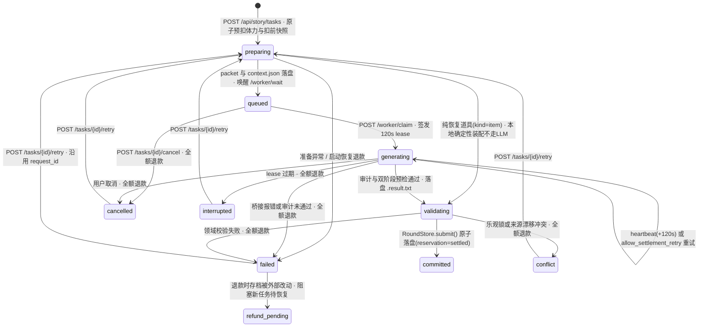

# 02 · 核心引擎与事务存储层

> **非数据源声明**：本文件为开发者架构参考文档，严禁作为 AI 剧情运行时提示词或世界书注入。
> **覆盖模块**：[`round_runtime.py`](../../round_runtime.py)、[`story_compiler.py`](../../story_compiler.py)、[`interaction_runtime.py`](../../interaction_runtime.py)、[`story_reading.py`](../../story_reading.py)、[`relationship_query.py`](../../relationship_query.py)。

---

## 1. `RoundStore` 单一原子事务引擎（`round_runtime.py`）

`RoundStore`（[`round_runtime.py:788-1053`](../../round_runtime.py#L788-L1053)）是整个项目**唯一的正式持久化写入门户**。不论来源是正式双阶段互动、旧完整回合桥接、手动 Python `execute_injection()` 还是演播进度更新，都必须经过 `RoundStore`。

### 1.1 `.round-runtime/` 物理目录结构

```text
.round-runtime/
├── lock                           # POSIX 记录锁文件（fcntl.LOCK_EX / LOCK_SH）
├── state.json                     # 提交账本 META：{version:1, sequence:int, receipts:{req_id:{payload_hash, receipt}}}
├── journal.json                   # 仅提交进行中存在：2PC WAL（base64 before/after 快照 + phase）
├── save-epoch.json                # 当前存档代际 UUID（新档重置时刷新，用于隔离旧窗口与旧任务）
├── reset-journal.json             # 仅新档重置进行中存在：存档清理器 2PC WAL（存在时熔断所有 API）
├── save-slots/<slot_id>/          # 轻量化可回档存档槽（meta.json + 存档/*.json + data.json + interaction/*.json + playback.json）
├── reset-backups/<ts>_<uuid>/     # 旧版全量重置备份兼容目录（新档重置默认已切为轻量 save-slots）
├── work-<random>/                 # 临时结算沙箱目录（提交或恢复时自动清理）
├── interaction/
│   ├── 000000000001.json          # 正式互动逐段归档（12位零填充序号，含原文、听众边界与审计）
│   └── playback.json              # 当前段落逐句演播游标：{version:1, segment_id, revealed, completed}
└── story/
    ├── bridge-key.json            # 桥接鉴权令牌（X-Story-Bridge）
    ├── tasks.json                 # 正式任务队列、桥接控制指令、租约与体力预扣记录
    └── <sha256(req_id)>.*         # 单任务凭证：.context.json / .delivery.json / .read-audit.json / .result.txt / .assembled.json
```

### 1.2 双层互斥锁与 2PC WAL 崩溃恢复

- **锁获取（[`_locked()`](../../round_runtime.py#L1120-L1149) + [`acquire_process_lock()`](../../round_runtime.py#L1049-L1104)）**：
  1. 先抢占按项目根路径索引的进程内 `threading.RLock`（超时 10s），并维护 `threading.local()` 按根路径隔离的重入深度计数。
  2. 仅最外层进锁时经 `acquire_process_lock()` 以非阻塞方式轮询 `fcntl.lockf(handle, fcntl.LOCK_EX | fcntl.LOCK_NB)` 加跨进程排他锁（超时 10s，步长 50ms），并执行一次 `self._recover()`：桌面/Linux 环境优先锁定 `.round-runtime/lock`，安卓共享存储 FUSE 路径（`/storage/emulated/`、`/sdcard/`、`/mnt/media_rw/`）优先在原生 ext4/f2fs 临时目录（`tempfile.gettempdir()/huan-yi-locks/<hash>.lock`）建锁（写入非空标记 `1\n`、主锁异常自动回退、`fcntl.lockf` 不支持时降级为进程内 `RLock`）；`存档清理器.py` 的 `reset_lock()` 复用同一锁入口。内层重入直接复用已持有的排他文件锁且不重复触发恢复，退出至最外层时统一释放。
  3. 同步维护 `save_store.load_bundle()` 常态直读 JSON 跳过 `.txt` 正则，仅当 SHA 漂移时经 `harvest_engine_txt_mutations()` 窄边界收割遗留引擎改动（绝不触碰 `memory_store.json` 或 JSON 原生子系统）；动态按 `prologue.weekday + clock.day` 推算实时 `weekday`，`append_recent_segment()` 落盘前剥离 `before_world`/`audit`/`resolution` 防止膨胀。
- **两阶段原子发布（[`_commit_files()`](../../round_runtime.py#L958-L975) + [`_publish()`](../../round_runtime.py#L844-L856)）**：
  1. 收集 `after` 中所有目标文件的当前磁盘字节作为 `before`，Base64 编码后以 `phase: "prepared"` 原子写入 `journal.json`（`_atomic()`：临时文件 `xb` → `flush` + `fsync` → `os.replace` → `_fsync_dir`）。
  2. 执行 `_publish(after)`：**强制把 `data.json` 排在最后一个写入**，避免读进程先看到新快照而旧记忆库未就位。
  3. 将 `journal.json` 原子覆写为 `phase: "committed"`。
  4. 删除 `journal.json` 并 `fsync` 目录。
- **崩溃恢复规则（[`_recover()`](../../round_runtime.py#L858-L900)）**：
  - 严格校验 `journal.json` 的版本、白名单路径正则（仅允许 `FILES`、`state.json`、`日志/Round_*`、`interaction/*`、`story/tasks.json`）及 Base64 合法性；任一不符抛 `RecoveryError` 并保留现场。
  - 若 `phase == "prepared"`：**回滚**（重新发布 `before` 全部文件）。
  - 若 `phase == "committed"`：**重做**（重新发布 `after` 全部文件）。
  - 清理所有残留 `.round-tmp-*` 文件与 `work-*` 沙箱目录。

### 1.3 乐观锁、幂等去重、$O(1)$ 存储瘦身与自动 GC（[`submit()`](../../round_runtime.py#L992-L1052)）

1. **体量与 JSON 严格解析**：`load_request()` 限制最大 4 MiB，拒绝重复键（`_pairs`）与 `NaN`/`Infinity`（`_bad_number`）。
2. **幂等回放与账本封顶**：计算 `payload_hash = sha256(canonical_json(request \ {'request_id'}))`。若 `request_id` 已在 `state.json.receipts` 中，内容哈希一致返回原回执，不同抛 `ConflictError`；每次提交后 `state.json.receipts` 自动裁剪至最新 **120 条**（`MAX_LEDGER_RECEIPTS`）。
3. **全局 revision 与源码防漂移**：
   - `revision = sha256(json({f: sha256(bytes) for f in FILES}))`，涵盖 `存档/全局记忆库.txt`、`存档/徐志北道具图鉴.txt`、`存档/save_state.json`、`存档/memory_store.json` 与 `data.json`（`存档/近期演播.json` 置于 `FILES` 之外，避免仅推进演播进度引发世界版本冲突；`.round-runtime/` 缺失时 `_ledger()` 自动从 `save_state.json['runtime']['last_sequence']` 单调续号）。
   - 结算前与结算后各校验一次 `definition_baseline`（`injection_core.py`、`txt文件/事件注册表.json`）与调用方传入的 `_source_baseline`（规则/知识库/补读源指纹）。
   - 结算前在 `work-*` 沙箱执行（[`_settle()`](../../round_runtime.py) 或 [`interaction_runtime.settle()`](../../interaction_runtime.py)），发布前再次逐字节核对 `FILES` 未被外部进程篡改；`_derive_lifecycle()` 仅对当前在场 `active_cast` 执行 C 烈度转换；`_round_conditions(..., intimate_mode=...)` 放行亲密续演模式下 `B` 档打 `C烈度_轻度/中度`，`_validate_scene_state()` 校验可选 `scene_state` 枚举（`sub_location` / `privacy` / `clothing_state` / `intimate_beat`）。
   - **AST 编译缓存（`_ENGINE_CODE_CACHE`）**：`_engine()` 按 `(source_sha256, registry_sha256)` 缓存已通过 `ast.walk` 静态门禁校验的 `code_obj`，命中缓存时仅新建隔离 `types.ModuleType` 执行 `exec(code_obj, module.__dict__)`，保持 100% 命名空间隔离的同时消除每请求重复 AST 编译的 ~2.78s 性能瓶颈。
4. **schema_version = 3 任务联锁、快照剥离与孤儿 GC**：正式付费互动提交时，同时校验 `tasks.json` 中对应任务处于 `validating`、`working_revision == base_revision` 且 `reservation.status == 'held'`，并在**同一笔 WAL 事务**中把任务置为 `committed`、预扣置为 `settled`、结果同步写入 `存档/*`（含 `save_state.json`、`memory_store.json`、`近期演播.json` 与单向 `.txt` 视图）+ `data.json` + `interaction/<seq>.json` + `playback.json` + `tasks.json`。提交与退款路径统一调用 `story_progression.prune_tasks_state()` 剥离所有非 `held` 任务的 `before_memory` / `before_save_state` 大快照并将终态任务封顶 **20 条**；`story_service._finish()` 触发 `_gc_runtime_artifacts(keep_recent=3)` 自动清理 `txt文件/.story-reading/<hash32>/` 与 `.round-runtime/story/<hash64>.*` 孤儿缓存，彻底消除 $O(N^2)$ 写放大。

### 1.4 任务生命周期状态机（协调 `story_progression.py` 与 `story_service.py`）



> **三种核心异常语义**（[`round_runtime.py:44-54`](../../round_runtime.py#L44-L54)）：
> - `RoundError`（HTTP `400`）：输入结构、契约字段、业务规则或校验不合法。
> - `ConflictError`（HTTP `409`）：乐观锁版本冲突、租约过期、并发任务冲突、源码/存档漂移。
> - `RecoveryError`（`RoundError` 子类，HTTP `400`）：WAL 损坏、存在未恢复 `reset-journal.json`、退款时外部篡改（`refund_pending`）。

---

## 2. 确定性只读精编器（`story_compiler.py`）

[`story_compiler.py`](../../story_compiler.py) 是 v2 降本增效架构的心脏：它**只读**消费全部权威源，在不修改任何原始文件、不制造第二份手写规则的前提下，将每轮高达 146 KB 的重复上下文重构为 **KV 缓存友好的三区投影（Zone 0 / Zone 1 / Zone 2）**。

### 2.1 三区上下文投影与降本机制

| 区域 | 生成函数 | 投递目标 | 变化频率 | 内容构成 | 实测压缩效果 |
|---|---|---|---|---|---|
| **Zone 0（全局冻结）** | `build_zone0_global()` | Operit 2 原生 Prompt Hook 冻结前缀 | 仅协议/法典/全局规则变更时同步 | 1) `dual_stream_v2`（含自然穿插节奏、Drama 3 中文导演语法、允许连续 `[D]` 快对白、亲密慢烧续演选项与独处 `[D:...]` 禁发规范）或 `single_prefix_v2` 输出协议<br>2) `compile_codex_runtime()` 切出的《全局执行法典》卷零（精简至 **1,820 字**，剔除冗余术语表与废止条款）<br>3) `世界观类.json` + `叙事判断.json`（含 `narrative.pace` 五条活人演法与建设性摩擦铁律，排除按场门控的 `narrative.vigilance` 与 `narrative.intimate`）+ 宿主 `char.徐志北` 设定 | **8,950 字**（`faithful`）/ **8,840 字**（`silent`），稳守 `< 9,200` 红线 |
| **Zone 1（场景冻结）** | `build_zone1_scene()` | Operit 2 原生 Prompt Hook 冻结前缀 | 仅换地点/阵容变化时同步（同场景 0 字节漂移） | 1) 场景冻结锚点（地点、动态 `【说话人白名单】` 与在场 `cast`；`徐承邺` 回宅在主宅时动态纳入 `cast`；**彻底剥离瞬态场外 `references`**）<br>2) `compile_characters(..., include_host=False)`：仅保留在场人物完整设定（含四人「活人骨相·主动/盲区/横向反应」，剔除交叉指针与重复页脚）<br>3) `compile_relationships()`：复用 `reg.verify_view()[1:]` 无损压缩在场人物关系事实、秘密隔离表与含 `intimate`（`i`）称谓<br>4) **会话级冻结门控（`frozen_flags = {vig, intl}`）**：会话首轮锁定 `narrative.vigilance`（`max_vigilance>=20`）与 `narrative.intimate`（`desire>=60`/`dep>=15`/`shame<=80`/`scene_active`/体液锁定），同会话内即使中段态跃迁也不改动 `Zone 1`（改由 Zone 2 单次补发指南），实现跨主流模型通用 100% 字节级 KV 缓存锁定<br>5) *仅 `single_prefix_v2`*：状态门控 `系统标签类.json` + `compile_event_catalog(live_mode=True)` | 单人场 **2,229 字** / 双女主 **3,982 字** / 3人同场 **6,564 字**（场外提及 **0 字节漂移**） |
| **Zone 2（轮次增量）** | `build_user_delta()` | 每轮 `user` 消息正文 | 每轮更新 | **Turn 1 (`full_scene_start`)**：编译期知情硬分区 `scoped_memory`（`save_store.retrieve_memory_view()` 附带内容指纹 `selected_fingerprints`，≤3600 字）+ 完整道具 `items` + `delivered_gifts_to_cast`（≤6条）+ **开窗回溯历史 `anchor_history_mode`**（默认 **`balanced`**：末 2 轮 100% 原文 + 至多 2 轮 6,000 字软预算；可切换 `full` 完整 6 轮）+ 新人进房连贯性 `recent_room_continuity` + **去数值化导演心理简报** + 在场人物暗箱心智 `cast_mind` + 非序幕新进场/转场 `scene_entry_residue` + 一次性 `milestone_echo`；首次提及场外角色时经 `referenced_offstage` 无损注入完整人设+双向称谓锁；`dual_stream_v2` 彻底零 `required_sources`<br>**Turn 2+ (`incremental_delta`)**：**指纹去重增量 `scoped_memory`**（`exclude_fingerprints` 跳过未变锚点/情景幕/编年史、永不跳过 `NOW`、`anchor_ops.update` 哈希变化自动重发）+ **`prev_state_hashes` 状态真差分**（未变化字段折叠为 `unchanged_from_prev_turn`）+ 回溯词门控 `optional_archive_lookup` + 精简 `output_format`（保紧凑 `[D:徐志北]` 发言锁）+ 场外已注去重 `referenced_offstage_active` + 中段单次 `vigilance_craft_guide`/`intimate_craft_guide` | 500 轮成熟档实测：Turn 1 **5,654 字**（-13.5%）、Turn 2+ **1,675 字**（**-58.1%**） |

### 2.2 关键编译策略细节

1. **无损关系压缩与场外增量关系（`compile_relationships` / `compile_relationships_delta`）**：
   - 调用 `RelationshipRegistry(root).verify_view()`（内置 `(mtime_ns, size)` 视图缓存）并直接复用返回的 `rows[1:]`，消除重复读取解析 225 KB `关系称谓查询.jsonl`。
   - `compile_relationships()` 仅编译在场 `cast` 之间的公开事实（`shared`）、秘密边界（`secret_boundaries.known_only_by` / `unknown_by_present`）与紧凑称谓映射（含 `intimate` `i` 层）；场外被提及角色经 `compile_relationships_delta(root, cast, new_ref_names)` 补算其与在场人物的双向称谓锁和关系事实，一次性随 `Zone 2` `referenced_offstage` 完整下发，既保护 Zone 1 零漂移，又保证场外人设/称谓锁/知情隔离 100% 不打折。
2. **事件表零公式化与热路径 `(mtime_ns, size)` 缓存（`compile_event_catalog` / `_load_kb_entries`）**：
   - 剥离 `事件注册表.json` 全部内部算分 `parameters`/`parameter_usage`/`description`，仅保留合法标签白名单与正则，将 29K+ 字压至 ~900 字（-97%）；正式互动 `live_mode=True` 自动过滤确定性接管项并纳入 `HOST_16`。
   - `story_compiler.py` 对 `_load_kb_entries`、`compile_event_catalog`、`compile_codex_runtime`、`build_zone0_global` 基座与 `build_settlement_spec` 静态基座统一实施线程安全 `(mtime_ns, size)` 缓存（联动 `relationship_query.py` 与 `scene_chat.py` 别名缓存），单轮上下文编译耗时由 **34.65 ms 降至 8.09 ms（提速 4.28×）**，任意源文件编辑即刻自动失效。
3. **会话冻结门控、自然感官穿插与 Stage 2 常驻策略（`_needs_vigilance_rules` / `_needs_intimate_zone1` / `_extract_recent_cliche_motifs`）**：
    - **Zone 1 会话级冻结门控（模型无关 KV 缓存锁定）**：
      - 监视规则与亲密技法在会话首轮由 `material_delivery_v2()` 计算 `zone1_flags = {vig, intl}` 并冻结传给 `build_zone1_scene(..., frozen_flags=zone1_flags)`；若会话中段发生高欲/亲密激活或监视警惕跃迁，**绝不改动 `Zone 1`**，而是由 `build_user_delta()` 经 `intimate_craft_guide` / `vigilance_craft_guide` 单次下发至 `Zone 2` 并在 `committed` 后记入 `session_meta.injected_guides` 去重。
      - 成人感官沉浸为默认全局取用色板，配合 `_extract_recent_cliche_motifs()` 防复读滑窗保持文风新鲜自然。
    - **Stage 2 结算常驻规则与纯算式剥离**：`compile_knowledge_rules(..., mode='settlement')` 始终常驻 `sys.pregnancy` 与 `sys.vigilance`；`_strip_kb_noise(..., mode='settlement')` 仅剥离 `sys.*` 中纯 Python 后端算式与分段数值表，**100% 保留全部 12 项核心 AI 打标触发条件**。
4. **去数值化导演心理简报、暗箱心智、进场生活余温与前台防劫持隔离**：
   - **去数值化导演心理简报（`compile_state_qualitative_brief`）**：统一经空安全 `_int_stat()` 读取底层精确数值并由 `_heroine_affection_desc()`（分角色 6–7 档）、`_heroine_shame_desc()`（5 档）、`_heroine_depravity_desc()`、`_heroine_passive_desc()` 实时翻译为自然人类心理与边界演法指令（叠加 `aff_delta_last` 近期好感微趋势）；彻底静默省略冷态 RPG 机制噪音，同时完整保留所有活跃态信号。
   - **分角色暗箱心智与进场即中途余温（`cast_mind` / `scene_entry_residue`）**：`build_user_delta()` 仅向 `Zone 2` 注入当前在场 `cast` 的未散余绪（`mood`）、手头牵挂（`preoccupation`）与主观印象（`impressions`），且该字段严格不进入前端 `ir.view()`（`story_progression._sanitize_director_echo()` 在 K01 未解锁时对非沈知韫执行 `_ECHO_WILL_SECRET_RE` 硬拦截）；非序幕首幕或刚转场注入 `scene_entry_residue`，同场 ≥2 人注入横向互动与正面演法锚点。
   - **动态变故与场景出口提示（`build_user_delta`）**：每轮注入紧凑的 `scene_turns_in_place`、公开常识日程版 `available_destinations`；仅当 `director_roll.triggered == True` 时经 `sp.format_surprise_directive()` 注入三轨纯叙事视角 `surprise_directive`。
   - **反劫持硬隔离（`dual_stream_v2`）**：前台默认 `include_tasks=False`、`include_points=False`，`user_delta` 不发 `tasks`，仅在特定时刻通过独立字段 `milestone_echo` 投递一次性微回响。
5. **后台 `SUMMARY` 结算规格与搭车编年归档（`build_settlement_spec`）**：
   - 将静态 JSON 输出骨架、魅力触发说明与 `channels_enum` 统一迁入跨轮可缓存的静态 `system_prompt`（**11,781 字**，配合纯后端公式剥离进一步压低总长度；规则 6 为 v2 三轨记忆契约、含多档标签判准速查、日常/亲密 B 档边界、监视目标防错铁律、Rule 12 `director_echo` 与 Rule 13 `fallback_decision`）。
   - 动态 `user_context` 压至 **2,408 字（-52.0%）**：`active_anchors` 经 `_format_anchors_compact_lossless()` 以紧凑单行 `"A-号|类型|D天|★权重|完整正文"` 格式覆盖全部活跃高优锚点且**零正文截断**；`intimate` 剔除后端计算矩阵字段、`items` 仅在非空时下发、已有未完成活跃任务时省略 `task_whitelist_current`、去除重复 `output_contract`。
   - 当 `memory_store.json` 的 `episodes` 达到 24 幕阈值时，`build_settlement_spec()` 与 `build_user_delta(..., is_single=True)` 自动下发 `chronicle_archive_request`（最旧 8 幕），搭车本轮结算零额外 LLM 调用生成分视角编年史章节。

### 2.3 流式剧场解析器与零成本红线守卫

- **`parse_stream_story(raw_text, allowed_speakers, partial=False, valid_destinations=None, location_aliases=None, current_location='', allow_player_dialogue=False, max_player_dialogue=3)`**：
  - 标准语法：`[N] 旁白`、`[A:姓名] 动作`、`[D:姓名] 对白`，后接 `---DECISION---`、`PROMPT:`、`A:`/`A[MOVE:地点]:`、`B:`/`B[MOVE:地点]:`、`C:`/`C[MOVE:地点]:`。
  - **显式转场选项解析（方案 2B）**：识别选项标签后、正文行首及句尾（`_OPT_TRAILING_MOVE_RE`）的 `[MOVE:地点]`，结合 `valid_destinations` 与 `location_aliases` 归一化生成 `option['operation'] = {'code': 'move_player', 'destination': dest}`；非法或同地静默丢弃标签保留干净正文。
  - **对白动作自动拆分与纯台词净化（`_normalize_stream_node` / `_split_mixed_dialogue_text`，Py/JS 双端对称）**：
    - `[D:角色名]` 行误混入动作前缀与引号台词时确定性无损拆分为独立 `[A:角色名]` + 纯台词 `[D:角色名]`；
    - 外层双引号自动剥离；`[N]` 与 `[A:角色名]` 误带的声学/XML 标签自动剥离；三女主 `[D:角色名]` 完整保留导演提示 `[...]` 与 Drama 3 词级成对标签；
    - **主角演绎模式（`protagonist_style`）**：默认「忠实演绎」（`faithful`），允许最多 2~3 句严格贴合玩家原意图的简短 `[D:徐志北]`（单句 ≤40 字、零标签）；切换「仅动作感官」（`silent`）时严禁输出 `[D:徐志北]`。
  - **容错加固与文字沉浸长段放宽**：剥离外层 Markdown 代码围栏与行首装饰符，`_INLINE_TAG_SPLIT_RE` 支持句末标点后紧接标签切分；单节点防呆上限 ≤4000 字。
  - **段末抉择双阶段解析**：`_DECISION_SEP_RE` 兼容折行/全角/裸标题等变体；`allow_missing_decision=True` 供 `normalize_dual_stage()` 交由 Stage 2 `fallback_decision` 兜底；`strip_preview_decision_leak()` 阻断抉择文本泄漏进流式预览气泡。
- **`guardrail_check(root, location, cast, messages, memory_text='', *, secrets_unlocked=())`**：
  - **硬拦截 1（主权与在场锁）**：`dialogue.speaker` 严格限定在场角色（`faithful` 允许 ≤3 句短 `[D:徐志北]`，`silent` 禁写，严禁场外对白）；`action.speaker` 必在 `cast ∪ {'徐志北'}`。
  - **硬拦截 2（全节点按人核查信息差秘密边界 + `secrets_unlocked` 联动）**：实时核查 `关系称谓库.json` 中私有事实（当前为 `K01` 遗嘱）；未解锁且在场存在非知情者时，对全员 `dialogue`/`action` 及非宿主独白 `narration` 拦截 `_WILL_SECRET_RE`，命中即抛 `RoundError` 阻断落盘。
  - **软告警 3（苏婉青驻地提示）**：在 `徐家主宅` 检测到疑似写成常住主宅的表述时附加告警写入 `audit['guardrail_warnings']`。

---

## 3. 正式连续互动运行时（`interaction_runtime.py`）

[`interaction_runtime.py`](../../interaction_runtime.py) 衔接 `save_store.py`、`story_service.py`、`story_compiler.py`、`story_progression.py` 与 `RoundStore`：

### 3.1 记忆知情硬分区、$O(1)$ 尾读、v2 懒跳过 `live.txt` 与房间级连贯性

- **三轨知情分区与指纹去重交付（`material_delivery_v2()`）**：直接读取 `存档/memory_store.json` 并调用 `save_store.retrieve_memory_view(..., exclude_fingerprints=...)` 产出 `scoped_memory`，返回 `session_meta`（`zone1_flags`/`injected_refs`/`injected_guides`/`memory_fps`/`state_hashes`），正式 v2 模式零 `required_sources` 死重。
- **v2 懒跳过 `live.txt` 写盘（`packet(..., lazy_live_txt=True)` + `story_progression._is_v2_bridge_active()`）**：检测到最近 600s 内有活跃 `2.x` 桥接心跳时，`packet()` 跳过构造与原子落盘 `169.6 KB` 的 `live.txt`（耗时由 `611.3 ms` 降至 `84.2 ms`），改在 `.context.json` 中存储 ~`2.1 KB` 的 `v2_packet_meta` 并配合 `_cached_digest()` 缓存静态文件哈希；`material_delivery_v2()` 冻结真实 `存档/全局记忆库.txt` 与 `txt文件/互动运行配置.json` 的 SHA-256，`verify()` / `verify_delivery()` 对真实源文件执行完整防篡改核验；v1 桥接路径保持 `lazy_live_txt=False` 100% 兼容。
- **$O(1)$ 尾读归档与零 500 冷启兜底（`recent_rows_tail()` / `recent_rows_page()` / `segment()` / `playback()`）**：`packet()` 仅尾读最新 24 幕归档；当 `.round-runtime/` 或 `data.json` 缺失时自动降级读取 `存档/近期演播.json` 与 `存档/save_state.json['runtime']`；`settle()` 归档前剥离 `audit.reservation` 大快照。
- **房间级在场与新人进房连贯性（`scene_cast()` / `recent_room_continuity`）**：历史听众交集与房内私密互动严格按 `intimate.present_actors` 隔离；新人刚入同房间时 `packet()` 自动附带无泄密近景衔接 `recent_room_continuity`。
- **快照视图、情欲态势、动态档费与远端体征（`view()` / `operation()`）**：前端 `/api/story/live` 透出完整世界态、v4 `intimate`/`active_costs`/`stamina_guard`/`host_charm_tier`/`body_zone_meta`/`keepsake_meta`、`items`/`deployed_items`/`delivered_items` 与 `visual_assets`；`operation()` 校验并放行 8 类登记操作，`_audit_path()` 统一规范 `./` 与 `\`。

### 3.2 v1 vs v2 资料交付与密码学核验

| 阶段 | v1 (`material_delivery`) | v2 (`material_delivery_v2`) |
|---|---|---|
| 交付记录 `.delivery.json` | `version: 1`，记录 `id`（48-hex）、`lease_sha256`、`context_sha256`、`input_sha256`、`chat_id`、`participant_id`、`sources[]` | `version: 2`，增加 `protocol_mode`、`zone0_sha256`、`zone1_sha256`、`settlement_system_sha256`；懒模式下 `sources[]` 冻结真实 `全局记忆库.txt` 与 `互动运行配置.json` 哈希 |
| 增量锚点判定与会话元信息 | 每次全量内联 packet + 补读源 | `include_full_anchor = is_fresh or synced_z0 != zone0_sha or synced_z1 != zone1_sha or last_seen_seq <= 0`；统一以预扣前 `before_memory`/`before_save_state` 为基线编译，接收并回传 `session_meta`（`zone1_flags` / `injected_refs` / `injected_guides` / `memory_fps` / `state_hashes`）与 `anchor_history_mode` |
| 容量硬顶 | 总 UTF-8 字节 > 2 MiB 直接拒收（不截断） | `zone0 + zone1 + user_delta` > 2 MiB 直接拒收（不截断） |
| 租约幂等 | 同租约重复请求须完全一致，否则抛 `ConflictError` | 同左 |
| 回执核验 (`verify_delivery`) | 核验 `delivery.id`、`input_sha256`、`user_message_timestamp` 与源文件磁盘 SHA 未漂移 | 额外强制核验 `zone0_sha256` 与 `zone1_sha256` 一致；懒 v2 模式跳过不存在的 `live.txt` 行核验，同时保持 `source_check`、`verify_delivery`、必要记忆/历史补读与工具白名单 100% 严格生效 |

### 3.3 听众知情隔离、回响/暗骰冻结、方案 2B 防篡改与逐句演播锁

- **双轨听众记录与可见性优先切片（`settle()` / `window_ids()`）**：在离场日程移动**之前**捕获 `_scene_known_by`（支持房间级 `present_actors`），分别记录 `input_known_by` 与 `messages_known_by`；`interaction_scope` 收窄为 `[location, cast]`。
- **一次性微回响与动态变故暗骰冻结（`packet()` & `assemble()`）**：仅普通付费行动冻结 `delivered_echo_ids` 与 `director_roll` 进 `.context.json`，同一 `request_id` 重试直接复用绝不重掷。
- **方案 2B 选项防篡改与演播单调锁（`decision()` / `selection()` / `validate()`）**：严格校验固定选项文本与转场操作，新段重置 `playback.json` 与 `存档/近期演播.json['playback']`，强制单调步进演播后才可消费本段抉择。

### 3.4 双阶段合并、机械预清洗与装配（`normalize_dual_stage` & `assemble`）

1. 若 `result.dual_stage_version == 1`，`normalize_dual_stage()` **首先执行 `_sanitize_settlement_mechanical_noise()` 机械预清洗**：将无歧义空串可选字段归一为 `None`、清除 `fallback_decision.options` 空 `operation`、清除 `SYSTEM` 或已有未完成活跃任务时误发的 `resolution.task`、剔除严格无害的 `vigilance_events(target='徐承邺', tags=['无异常回合'])`（**真实非空监视误标仍原样保留，交由严格校验器拒绝并触发重试**），并将清洗记录记入 `extra['settlement_sanitized']`。
2. 随后校验显式 `move_player` 是否因 Stage 2 漏填 `operation` 而缺位，按生效地点与 `scene_cast` 解析前台 `foreground_text`（含 `[MOVE:地点]` 与动作-引号拆分），与后台 `settlement` 合并为统一 6 键结果并校验 `quality_flags`。
   - **`fallback_decision` 兜底（Rule 13）**：前台缺完整 `---DECISION---` 时先跑 `sc.guardrail_check()`（红线优先），再采用 Stage 2 可选 `fallback_decision` 并记录 `decision_fallback: True`。
3. `assemble()` 核验 `decision`、4 项具体理由 `checks`、明确 `command`、传入 `secrets_unlocked` 执行 `sc.guardrail_check()`，封装为 `schema_version=3` 提交包。

---

## 4. 认证读回执（`story_reading.py`）与关系查询（`relationship_query.py`）

### 4.1 `story_reading.py`（300 行）
- **定位**：为旧完整回合桥接提供任务级原文提取包（`txt文件/.story-reading/<32-hex-nonce>/<key>.txt`），并为 `interaction_runtime.verify()` 和 `scene_chat.validate()` 提供共享的**真实行级核验器 `verified_lines()`**。
- **防截断欺骗机制（[`verified_lines()`](../../story_reading.py)）**：侦测平台截断尾标并主动剔除不完整末行，强制补读整行。
- **顺序读门禁（[`check_required()`](../../story_reading.py)）**：旧完整回合桥接强制前三份核心文件按序读完。

### 4.2 `relationship_query.py`（350+ 行）
- **单一事实源**：`txt文件/关系称谓库.json`（7 实体、12 关系类型、13 条事实 `R01–R12 + K01`、17 角色词表、5 条身份称谓规则、3 条人物信念；四档场合 `formal` / `relaxed` / `business` / `intimate`）。
- **核心算法、尊长锁与缓存**：
  - `_visible(fact, people)` 强制全听众知情隔离；`SENIOR_ADDRESS_ROLES` 锁定常规场合尊长称谓，不自动前置闺名/小名；`intimate` 场合专载失防私密称谓；多人自称取文字交集。
  - **进程内 `(mtime_ns, size)` 线程安全缓存（`_REG_CACHE` / `_VIEW_CACHE`）**：`RelationshipRegistry.__init__()` 按源文件 `(mtime_ns, size)` 缓存解析结果，`verify_view()` 按 `(view_stat, source_sha256, resolver_stat)` 缓存已校验的 42 行视图，任一文件变更即刻失效并重新逐字节核验。
  - **CLI 与一致性校验**：修改原库或 `relationship_query.py` 后须执行 `python3 relationship_query.py render > txt文件/关系称谓查询.jsonl && python3 relationship_query.py check` 保持 SHA-256 严格一致。
