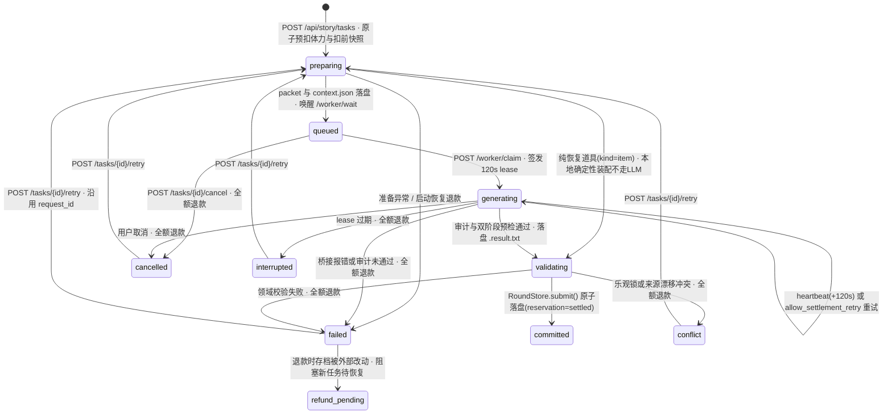

# 02 · 核心引擎与事务存储层

> **非数据源声明**：本文件为开发者架构参考文档，严禁作为 AI 剧情运行时提示词或世界书注入。
> **覆盖模块**：[`round_runtime.py`](../../round_runtime.py)、[`story_compiler.py`](../../story_compiler.py)、[`interaction_runtime.py`](../../interaction_runtime.py)、[`story_reading.py`](../../story_reading.py)、[`relationship_query.py`](../../relationship_query.py)。

---

## 1. `RoundStore` 单一原子事务引擎（`round_runtime.py`）

`RoundStore`（[`round_runtime.py:788-1053`](../../round_runtime.py#L788-L1053)）是整个项目**唯一的正式持久化写入门户**。不论来源是正式双阶段互动、旧完整回合桥接、手动 Python `execute_injection()` 还是演播进度更新，都必须经过 `RoundStore`。

### 1.1 `.round-runtime/` 物理目录结构

```text
.round-runtime/
├── lock                           # POSIX 记录锁文件（fcntl.LOCK_EX / LOCK_SH）
├── state.json                     # 提交账本 META：{version:1, sequence:int, receipts:{req_id:{payload_hash, receipt}}}
├── journal.json                   # 仅提交进行中存在：2PC WAL（base64 before/after 快照 + phase）
├── save-epoch.json                # 当前存档代际 UUID（新档重置时刷新，用于隔离旧窗口与旧任务）
├── reset-journal.json             # 仅新档重置进行中存在：存档清理器 2PC WAL（存在时熔断所有 API）
├── save-slots/<slot_id>/          # 轻量化可回档存档槽（meta.json + 存档/*.json + data.json + interaction/*.json + playback.json）
├── reset-backups/<ts>_<uuid>/     # 旧版全量重置备份兼容目录（新档重置默认已切为轻量 save-slots）
├── work-<random>/                 # 临时结算沙箱目录（提交或恢复时自动清理）
├── interaction/
│   ├── 000000000001.json          # 正式互动逐段归档（12位零填充序号，含原文、听众边界与审计）
│   └── playback.json              # 当前段落逐句演播游标：{version:1, segment_id, revealed, completed}
└── story/
    ├── bridge-key.json            # 桥接鉴权令牌（X-Story-Bridge）
    ├── tasks.json                 # 正式任务队列、桥接控制指令、租约与体力预扣记录
    └── <sha256(req_id)>.*         # 单任务凭证：.context.json / .delivery.json / .read-audit.json / .result.txt / .assembled.json
```

### 1.2 双层互斥锁与 2PC WAL 崩溃恢复

- **锁获取（[`_locked()`](../../round_runtime.py#L1120-L1149) + [`acquire_process_lock()`](../../round_runtime.py#L1049-L1104)）**：
  1. 先抢占按项目根路径索引的进程内 `threading.RLock`（超时 10s），并维护 `threading.local()` 按根路径隔离的重入深度计数。
  2. 仅最外层进锁时经 `acquire_process_lock()` 以非阻塞方式轮询 `fcntl.lockf(handle, fcntl.LOCK_EX | fcntl.LOCK_NB)` 加跨进程排他锁（超时 10s，步长 50ms），并执行一次 `self._recover()`：桌面/Linux 环境优先锁定 `.round-runtime/lock`，安卓共享存储 FUSE 路径（`/storage/emulated/`、`/sdcard/`、`/mnt/media_rw/`）优先在原生 ext4/f2fs 临时目录（`tempfile.gettempdir()/huan-yi-locks/<hash>.lock`）建锁（写入非空标记 `1\n`、主锁异常自动回退、`fcntl.lockf` 不支持时降级为进程内 `RLock`）；`存档清理器.py` 的 `reset_lock()` 复用同一锁入口。内层重入直接复用已持有的排他文件锁且不重复触发恢复，退出至最外层时统一释放。
  3. 同步维护 `save_store.load_bundle()` 在 `mem_drifted` 漂移合并时保留 `prologue_active`、`known_by` 与 `intimate` 态势、动态按 `prologue.weekday + clock.day` 推算实时 `weekday`，以及 `append_recent_segment()` 落盘前剥离 `before_world` 防止膨胀。
- **两阶段原子发布（[`_commit_files()`](../../round_runtime.py#L958-L975) + [`_publish()`](../../round_runtime.py#L844-L856)）**：
  1. 收集 `after` 中所有目标文件的当前磁盘字节作为 `before`，Base64 编码后以 `phase: "prepared"` 原子写入 `journal.json`（`_atomic()`：临时文件 `xb` → `flush` + `fsync` → `os.replace` → `_fsync_dir`）。
  2. 执行 `_publish(after)`：**强制把 `data.json` 排在最后一个写入**，避免读进程先看到新快照而旧记忆库未就位。
  3. 将 `journal.json` 原子覆写为 `phase: "committed"`。
  4. 删除 `journal.json` 并 `fsync` 目录。
- **崩溃恢复规则（[`_recover()`](../../round_runtime.py#L858-L900)）**：
  - 严格校验 `journal.json` 的版本、白名单路径正则（仅允许 `FILES`、`state.json`、`日志/Round_*`、`interaction/*`、`story/tasks.json`）及 Base64 合法性；任一不符抛 `RecoveryError` 并保留现场。
  - 若 `phase == "prepared"`：**回滚**（重新发布 `before` 全部文件）。
  - 若 `phase == "committed"`：**重做**（重新发布 `after` 全部文件）。
  - 清理所有残留 `.round-tmp-*` 文件与 `work-*` 沙箱目录。

### 1.3 乐观锁、幂等去重与来源基线防护（[`submit()`](../../round_runtime.py#L992-L1052)）

1. **体量与 JSON 严格解析**：`load_request()` 限制最大 4 MiB，拒绝重复键（`_pairs`）与 `NaN`/`Infinity`（`_bad_number`）。
2. **幂等回放**：计算 `payload_hash = sha256(canonical_json(request \ {'request_id'}))`。若 `request_id` 已在 `state.json.receipts` 中：
   - 内容哈希一致 → 返回原回执（`replayed=True`，附带 `is_current`）。
   - 内容哈希不同 → 抛 `ConflictError`（禁止复用请求 ID 提交不同内容）。
3. **全局 revision 与源码防漂移**：
   - `revision = sha256(json({f: sha256(bytes) for f in FILES}))`，涵盖 `存档/全局记忆库.txt`、`存档/徐志北道具图鉴.txt`、`存档/save_state.json`、`存档/四层记忆.json` 与 `data.json`（`存档/近期演播.json` 置于 `FILES` 之外，避免仅推进演播进度引发世界版本冲突；`.round-runtime/` 缺失时 `_ledger()` 自动从 `save_state.json['runtime']['last_sequence']` 单调续号）。
   - 结算前与结算后各校验一次 `definition_baseline`（`injection_core.py`、`txt文件/事件注册表.json`）与调用方传入的 `_source_baseline`（规则/知识库/补读源指纹）。
   - 结算前在 `work-*` 沙箱执行（[`_settle()`](../../round_runtime.py) 或 [`interaction_runtime.settle()`](../../interaction_runtime.py)），发布前再次逐字节核对 `FILES` 未被外部进程篡改；`_derive_lifecycle()` 仅对当前在场 `active_cast` 执行 C 烈度转换；`_round_conditions(..., intimate_mode=...)` 放行亲密续演模式下 `B` 档打 `C烈度_轻度/中度`，`_validate_scene_state()` 校验可选 `scene_state` 枚举（`sub_location` / `privacy` / `clothing_state` / `intimate_beat`）。
   - **AST 编译缓存（`_ENGINE_CODE_CACHE`）**：`_engine()` 按 `(source_sha256, registry_sha256)` 缓存已通过 `ast.walk` 静态门禁校验的 `code_obj`，命中缓存时仅新建隔离 `types.ModuleType` 执行 `exec(code_obj, module.__dict__)`，保持 100% 命名空间隔离的同时消除每请求重复 AST 编译的 ~2.78s 性能瓶颈。
4. **schema_version = 3 任务联锁**：正式付费互动提交时，同时校验 `tasks.json` 中对应任务处于 `validating`、`working_revision == base_revision` 且 `reservation.status == 'held'`，并在**同一笔 WAL 事务**中把任务置为 `committed`、预扣置为 `settled`、结果同步写入 `存档/*`（含 `save_state.json`、`四层记忆.json`、`近期演播.json` 与单向 `.txt` 视图）+ `data.json` + `interaction/<seq>.json` + `playback.json` + `tasks.json`。

### 1.4 任务生命周期状态机（协调 `story_progression.py` 与 `story_service.py`）



> **三种核心异常语义**（[`round_runtime.py:44-54`](../../round_runtime.py#L44-L54)）：
> - `RoundError`（HTTP `400`）：输入结构、契约字段、业务规则或校验不合法。
> - `ConflictError`（HTTP `409`）：乐观锁版本冲突、租约过期、并发任务冲突、源码/存档漂移。
> - `RecoveryError`（`RoundError` 子类，HTTP `400`）：WAL 损坏、存在未恢复 `reset-journal.json`、退款时外部篡改（`refund_pending`）。

---

## 2. 确定性只读精编器（`story_compiler.py`）

[`story_compiler.py`](../../story_compiler.py) 是 v2 降本增效架构的心脏：它**只读**消费全部权威源，在不修改任何原始文件、不制造第二份手写规则的前提下，将每轮高达 146 KB 的重复上下文重构为 **KV 缓存友好的三区投影（Zone 0 / Zone 1 / Zone 2）**。

### 2.1 三区上下文投影与降本机制

| 区域 | 生成函数 | 投递目标 | 变化频率 | 内容构成 | 实测压缩效果 |
|---|---|---|---|---|---|
| **Zone 0（全局冻结）** | `build_zone0_global()` | Operit 专用角色卡 `characterSetting` | 仅协议/法典/全局规则变更时同步 | 1) `dual_stream_v2`（含自然穿插节奏、Drama 3 中文导演语法、允许连续 `[D]` 快对白、亲密慢烧续演选项与独处 `[D:...]` 禁发规范）或 `single_prefix_v2` 输出协议<br>2) `compile_codex_runtime()` 切出的《全局执行法典》卷零（精简至 **1,820 字**，剔除冗余术语表与废止条款）<br>3) `世界观类.json` + `叙事判断.json`（含 `narrative.pace` 五条活人演法与建设性摩擦铁律，排除按场门控的 `narrative.vigilance` 与 `narrative.intimate`）+ 宿主 `char.徐志北` 设定 | **8,950 字**（`faithful`）/ **8,840 字**（`silent`），稳守 `< 9,200` 红线 |
| **Zone 1（场景冻结）** | `build_zone1_scene()` | Operit 专用角色卡 `otherContentChat` | 仅换地点/阵容变化/持久态门控切换时同步 | 1) 场景冻结锚点（地点、动态 `【说话人白名单】` 与在场 `cast`、背景提及 `offstage` 名单；`徐承邺` 回宅在主宅时动态纳入 `cast`）<br>2) `compile_characters(..., include_host=False)`：保留在场+被提及人物完整设定（含四人「活人骨相·主动/盲区/横向反应」，剔除交叉指针与重复页脚）<br>3) `compile_relationships()`：无损压缩并折叠相同称谓项，仅保留关系事实、秘密隔离表与含 `intimate`（`i`）称谓<br>4) **纯持久态门控** `narrative.vigilance` 与 `narrative.intimate`（不含瞬态微状态 `residual_tension`，保 KV 缓存不抖动）<br>5) *仅 `single_prefix_v2`*：状态门控 `系统标签类.json` + `compile_event_catalog(live_mode=True)` | 3人同场 **6,564 字**（稳守 `< 6,800` 红线） |
| **Zone 2（轮次增量）** | `build_user_delta()` | 每轮 `user` 消息正文 | 每轮更新 | **Turn 1 (`full_scene_start`)**：预算内私有记忆（≤6000字，头部经 `_project_memory_header` 脱敏压缩且 `dual_stream_v2` 剥离任务/商城/情报块）+ 完整道具 `items`（去除重复 `held_items`）+ `delivered_gifts_to_cast`（≤6条）+ 近期可见历史（≤6段/12000字）+ **去数值化导演心理简报** + 在场人物暗箱心智 `cast_mind` + 非序幕新进场/转场 `scene_entry_residue` 生活余温 + 一次性 `milestone_echo`；*`single_prefix_v2`* 额外附带满层转移 `source_bodies`、持有情报与导演上下文<br>**Turn 2+ (`incremental_delta`)**：仅发当前 L1 片段 + `recalled_memories`（≤3条/≤900字）+ `delivered_gifts_to_cast` + 精简 `held_items` + 新增已接受历史 + 本轮输入/选项/星期/去数值化简报/`cast_mind`（同场≥2人时注入横向互动提示与演法锚点） | 同场景第 2 轮起每轮 user 消息极轻量增量 |

### 2.2 关键编译策略细节

1. **无损关系压缩（`compile_relationships`）**：
   - 先调用 `RelationshipRegistry(root).verify_view()` 确保查询视图与原库同步。
   - 仅保留触及当前 `participants | references` 的公开事实（`shared`）；将受限事实严格按 `secret_boundaries.known_only_by` 与 `unknown_by_present` 显式拆分，杜绝跨人物泄密。
   - 称谓映射从 `关系称谓查询.jsonl` 压缩为 `{"发言人->听话者": {"f":{"s":[...],"a":[...]}, "r":..., "b":..., "i":...}}`（`i` 为私密失防 `intimate` 场合称谓，无损透传绝不截断），剔除平凡默认项 `""`/`"我"`/`"你"`；若各场合相同则折叠为单对象，体积减少 90%–96%。
2. **事件表零公式化与正式模式净化（`compile_event_catalog`）**：
   - 剥离 `事件注册表.json` 全部内部算分 `parameters`/`parameter_usage`/`description`，仅保留合法标签白名单与正则，将 29K+ 字压至 ~900 字（-97%）。
   - 正式互动调用传入 `live_mode=True`（由 `build_settlement_spec` 与 `build_zone1_scene` 启用），自动过滤已由确定性引擎接管的 `HOST_07/12/13/14/15`、`DS_11`（`状态_空耗惩罚`）与 `SHAME_15..18`（同质化免疫/首次/生理_危险期），并纳入新增 `HOST_16`（`情欲操控_温水攻心`）；结算端同时剔除旧版 `【动态体力代偿※填入HOST_EVENTS※】` 噪声。
3. **持久态门控、自然感官穿插与 Stage 2 常驻策略（`_needs_vigilance_rules` / `_needs_intimate_zone1` / `_extract_recent_cliche_motifs`）**：
    - **Zone 1 持久态门控**：
      - 监视规则仅依据持久态判断（`徐承邺位置 != '外地'`、或存在任何警惕/发现 > 0、或 `苏婉青` 在 `徐家主宅`、或 `徐承邺` 在 `徐家主宅`/`市中心顶层公寓`），**不依赖瞬态文本**，防止单句提及关键字击穿 KV 缓存；单轮提及监视词时改为在 `user_delta` 注入轻量 `vigilance_turn_note`。
      - 成人感官沉浸已设为默认全局取用色板（明确按距离与情境自然穿插，日常快节奏对话幕不必每幕强塞形体特写）；同时通过零成本 `_extract_recent_cliche_motifs()` 扫描最近两幕已提交正文，仅在连续重复命中高频舞台套词（如喉结、端杯、指尖微顿、合上文件、垂眸、锁骨等）时向 `delta` 注入 `fresh_detail_hint`；亲密与高压肢体场技法 **`narrative.intimate`** 采取按需激活：在场角色处于亲密持久态（`欲望 >= 30` 或 `堕落 >= 15` 或 `羞耻 <= 82` 或 `持续_体液锁定` 或 `scene_active`）时编入 `Zone 1`，平时若本轮命中亲密触发正则或导演命中 `sensual_hook`/`erotic_accident` 时经 `user_delta['intimate_craft_guide']` 临时注入。
    - **Stage 2 结算常驻规则**：`compile_knowledge_rules(..., mode='settlement')` 始终常驻 `sys.pregnancy` 与 `sys.vigilance`，避免单轮突发内射或监视暴露因前序未触发而被漏判；`user_context` 同步透传 `deployed_items`、`intimate` 与 `cast_mind` 状态。
4. **去数值化导演心理简报、暗箱心智、进场生活余温与前台防劫持隔离**：
   - **去数值化导演心理简报（`compile_state_qualitative_brief`）**：统一经空安全 `_int_stat()` 读取底层精确数值并由 `_heroine_affection_desc()`（分角色 6–7 档）、`_heroine_shame_desc()`（5 档）、`_heroine_depravity_desc()`、` _heroine_passive_desc()` 实时翻译为自然人类心理与边界演法指令（叠加 `aff_delta_last` 近期好感微趋势）；彻底静默省略 `被动Lv.0(凡人体质)`、`堕落0`、冷态 `好感天花板85未解锁` 与日常午宴 `生理周期：危险期` 等 RPG 机制噪音，同时完整保留所有活跃态信号（宿主商业嗅觉 5 档与 `80+` 深局棋手、情报与商业杠杆 `leverage_charges`、`Lv.1~4` 被动实际表现、高欲/高潮/`<=15` 断电锁、活跃 BUFF/微状态、`intimate` 空间隐私/衣着/痕迹/身体熟悉度/珍藏、眼线/高危暴露与远程窥视态势）。
   - **分角色暗箱心智与进场即中途余温（`cast_mind` / `scene_entry_residue`）**：`build_user_delta()` 仅向 `Zone 2` 注入当前在场 `cast` 的未散余绪（`mood`）、手头牵挂（`preoccupation`）与主观印象（`impressions`），且该字段严格不进入前端 `ir.view()`（`story_progression._sanitize_director_echo()` 在 K01 未解锁时对非沈知韫的 `mind_updates` 与 `new_thread` 执行代码级 `_ECHO_WILL_SECRET_RE` 防泄密硬拦截）；仅在非序幕首幕续演或刚发生 `move_player` 转场（`scene_turns <= 1` 且非亲密态）时注入 `sp.build_scene_entry_snapshot()` 生成的进行时生活余温（按 `present_actors` 房内隔离、联动推进中的 `offstage_clocks`、非常驻地点使用地点无关微动作绝不跨地借景），同场 ≥2 名角色时在 `output_format` 注入 NPC-to-NPC 横向互动提示与正面演法锚点。
   - **动态变故与场景出口提示（`build_user_delta`）**：每轮注入紧凑的 `scene_turns_in_place`（同地停驻达 `scene_exit_threshold=3` 时附 `scene_exit_hint`）、公开常识日程版 `available_destinations`（公司时段精确限定 `08:00–15:59`，主宅/校外画室标签统一为 `徐家主宅`/`工作室`）；仅当本轮冻结 `director_roll.triggered == True` 时统一调用 `sp.format_surprise_directive()` 注入三轨纯叙事视角 `surprise_directive`（`thread_spark` / `offstage_clock` / `preset_beat`，附带近期媒介禁区 `banned_channels` 与离场 `owner_in_scene=false` 禁瞬移锁）。
   - **反劫持硬隔离（`dual_stream_v2`）**：前台默认 `include_tasks=False`、`include_points=False`，`user_delta` 不发 `tasks`，且 `_strip_active_task_from_memory()` 仅在内存中剥离 `【任务状态】`、`【商城与回响状态】` 与 `【商业情报与杠杆状态】` 原文区块，防止前台模型围着进行中任务编造剧情；仅在特定时刻通过独立字段 `milestone_echo` 投递一次性微回响。
5. **后台 `SUMMARY` 结算规格与无条件跨层源正文（`build_settlement_spec` / `_extract_transfer_source_bodies`）**：
   - 为双阶段 Stage 2 生成独立静态 `system_prompt`（实测 **12,197 字 < 12,500**；内含结构化提取铁律，键名统一对齐 `context.*` / `foreground_messages` / `foreground_script`，含与 `事件注册表.json` 100% 逐字对齐的多档标签判准速查、日常 A/B 禁打 `C烈度_*` 而亲密续演模式 `intimate_mode=true` 允许 B 档轻/中度、可选 `scene_state` 空间与着装回传、禁 `徐承邺` 误入非 `DEPRAVITY_02` 组、规则 3 `⚠️【监视目标防错铁律】` 严禁填监视者徐承邺本人、`memory.compact` 禁带 `【回合号】` 前缀或换行、`｛表层｜潜台词｝` 双向 `evidence` 核验、Rule 12 `director_echo` 含可选 `mind_updates` 心智摘录与 Rule 13 `fallback_decision`）与紧凑 `user_context`（附只读 `director_context`、`cast_mind`、`intimate` 快照与 `deployed_items`）。
   - 当 L1→L2 / L2→L3 / L3→L4 任一跨层压缩被触发时，`_extract_transfer_source_bodies()` 在 `build_settlement_spec()` 与 `build_user_delta(..., is_single=True)` 两侧**无条件注入完整待转移源正文 `source_bodies`**，杜绝跨新窗或超预算时因缺源文本引发校验失败；同时当本轮 `memory.fact` 为空时，前端与预检自动忽略多余的 `transfers`，避免无谓崩溃。

### 2.3 流式剧场解析器与零成本红线守卫

- **`parse_stream_story(raw_text, allowed_speakers, partial=False, valid_destinations=None, location_aliases=None, current_location='', allow_player_dialogue=False, max_player_dialogue=3)`**：
  - 标准语法：`[N] 旁白`、`[A:姓名] 动作`、`[D:姓名] 对白`，后接 `---DECISION---`、`PROMPT:`、`A:`/`A[MOVE:地点]:`、`B:`/`B[MOVE:地点]:`、`C:`/`C[MOVE:地点]:`。
  - **显式转场选项解析（方案 2B）**：识别选项标签后、正文行首及句尾（`_OPT_TRAILING_MOVE_RE`）的 `[MOVE:地点]`，结合 `valid_destinations` 与 `location_aliases`（含 `画室/校外画室/念薇画室 → 工作室`）归一化生成 `option['operation'] = {'code': 'move_player', 'destination': dest}`；若目的地非法或等于当前地点，静默丢弃标签保留干净正文。
  - **101 实测防错 · 对白动作自动拆分与纯台词净化（`_normalize_stream_node` / `_split_mixed_dialogue_text`，Py/JS 双端对称）**：
    - 当 `[D:角色名]` 行误混入第三人称动作/神态前缀与引号台词（如 `[D:沈知韫] 她端起来抿了一口，没抬眼：“[calm low voice] 几点了……”`）时，确定性无损拆分为独立 `[A:角色名]` 动作节点 + 纯台词 `[D:角色名]` 节点；
    - 全句外层双引号 `“...”` 自动剥离；`[N]` 与 `[A:角色名]` 误带的英文 Fish 标签与 Drama 3 成对 XML 标签（`<whisper>`/`<soft>`/`<slow>` 等）自动剥离；三女主 `[D:角色名]` 完整保留中文/英文导演提示 `[...]` 与 Drama 3 词级成对标签；
    - **主角演绎模式（`protagonist_style`）**：默认「忠实演绎」（`faithful`），自然承接玩家意图且允许最多 2~3 句严格贴合玩家原意图的简短 `[D:徐志北]`（单句 ≤40 字、严禁越权新增承诺/决策或升级档位；徐志北永久静音，前端零 TTS 请求，`_normalize_stream_node` 自动剥离误落的中/英文方括号标签与 XML 标签）；切换「仅动作感官」（`silent`）时通过 `allow_player_dialogue=False` 严禁输出 `[D:徐志北]`。
  - **容错加固与文字沉浸长段放宽**（与桥接 `main.js:parseStreamMessages`、`story_service.stream_preview` 双端对称）：剥离外层 Markdown 代码围栏、行首列表/引用符号、粗体与中文引导前缀，`_INLINE_TAG_SPLIT_RE` 支持句末标点后无空格紧接标签的自动切分，同时保留 Fish 声学标签；单节点传输防呆上限 ≤4000 字。
  - **段末抉择双阶段解析**：`_DECISION_SEP_RE` 兼容折行 `---\nDECISION---`、`---\nDECISION\n---`、`---DECISION\n---`、裸 `DECISION` / `**DECISION**`、`### DECISION`、全角破折号与 `【段末抉择】`，并支持行内分隔符、无标记的末尾 `A/B/C` 块；选项行容忍 `A、`/`A)`/`[A]`/`【A】`、层级前缀与粗体 `**C[MOVE:公司]**：`；`PROMPT:` 不再跨行吞并选项。缺 `PROMPT` 时回落 `_DEFAULT_DECISION_PROMPT`（`此刻，你准备怎么回应？`）；仍缺失时报错携带具体缺项原因。
  - **`allow_missing_decision=True`**：仅供 `interaction_runtime.normalize_dual_stage()` 使用，允许前台缺抉择时由 Stage 2 `fallback_decision` 补全（见下）。
  - **`strip_preview_decision_leak(text)`**：流式预览剥离已泄漏进正文的分隔符/`PROMPT:`/`A/B/C`，由 `story_service.stream_chunk()` 调用，旧版 `.toolpkg` 客户端也不会在预览气泡闪现抉择文本。
  - **Zone 注入**：`build_zone0_global` 强化“`---DECISION---` 必须单行”、主角忠实演绎（或静音）与 `[D:]` 纯台词锁；`build_user_delta`（`dual_stream_v2`）在 Zone 2 追加精简 `output_format` 锚点，Zone 0/1 内容不变，KV 缓存不受影响。
- **`guardrail_check(root, location, cast, messages, memory_text='', *, secrets_unlocked=())`**：
  - **硬拦截 1（主权与在场锁）**：`dialogue.speaker` 必在 `cast ∪ ({'徐志北'} if allow_player_dialogue else set())` 内（`faithful` 模式最多 3 句短台词，`silent` 模式严禁代写 `徐志北`，任何模式绝对禁止场外角色对白）；`action.speaker` 必在 `cast ∪ {'徐志北'}`。
  - **硬拦截 2（全节点按人核查信息差秘密边界 + `secrets_unlocked` 联动）**：实时读取 `关系称谓库.json` 中私有事实的 `known_by` 集合（当前为 `沈知韫` 独知 `K01` 遗嘱）；若 `'K01'` 已写入本档 `save_state.json['mechanics']['secrets_unlocked']` 则自动放行；未解锁时，只要在场存在任何非知情者（`non_holders_present`，含宿主 `徐志北`），即对**包括 `沈知韫` 在内的全员 `dialogue`**、所有 `action`（含修复后的 `徐志北` 动作分支）及一对一或多人场景中非宿主内心独白的 `narration` 拦截 `_WILL_SECRET_RE`，命中即抛 `RoundError` 阻断落盘（不误杀公开事实 `R02`）。
  - **软告警 3（苏婉青驻地提示）**：在 `徐家主宅` 检测到疑似写成常住主宅的表述时，附加告警写入 `audit['guardrail_warnings']`。

---

## 3. 正式连续互动运行时（`interaction_runtime.py`）

[`interaction_runtime.py`](../../interaction_runtime.py) 衔接 `save_store.py`、`story_service.py`、`story_compiler.py`、`story_progression.py` 与 `RoundStore`：

### 3.1 记忆头部脱敏、6000 字分层预算、冷启兜底、倒序分页与房间级在场计算

- **头部脱敏压缩（`_project_memory_header()`）**：除剥离微状态/计数器/商城/情报/导演/生命周期等系统块外，对前台叙事视图进一步**屏蔽 `发现几率`、离场人物实时坐标与原始宿主积分/经验数值**，严守前台叙事防劫持与信息差边界。
- **6000 字预算严格分层优先级（`memory_context()`）**：严格按 **`L1 > L2 > L3 > L4`** 跨层排序，且同层内新近条目优先于陈旧条目，确保长局下始终保留最新即时运存与最近回想，不被远古 L3/L4 挤占。
- **零 500 冷启兜底与 `O(limit)` 倒序分页（`recent_rows()` / `recent_rows_page()` / `segment()` / `playback()`）**：当 `.round-runtime/` 或 `data.json` 缺失时，自动降级读取 `存档/近期演播.json` 与 `存档/save_state.json['runtime']`；`story_service.interaction_snapshot()` 经 `recent_rows_page()` 默认懒加载最新 **10 幕**并按需回溯更早 10 幕，避免长局首屏全量反序列化。
- **房间级在场与听众隔离（`scene_cast()` / `intimate.present_actors`）**：除按宏观地点（`presence[name]['location'] == location` 及动态回返的 `徐承邺`）推导在场名单外，若 `save_state.intimate.present_actors` 明确记录了当前细分房间内的独处/小范围参与者，则历史听众交集（`known_by`）与房内私密互动严格按房间级 `present_actors` 隔离，杜绝同宅隔墙人物隔空“偷听”私密戏份。
- **快照视图、情欲态势、动态档费与远端体征（`view()` / `operation()`）**：前端 `/api/story/live` 快照透出 `weekday`、`buffs`、`vigilance`、`passive_tiers`、`secrets_unlocked`、`intel`、`micro_states`、**`intimate`（含细分空间/隐私/着装/亲密拍及 v4 `host_phys`/`body_dev`/`keepsakes`）**、**`active_costs`（按亲密续演态动态切换 `5/10/15` 或 `1/2/3`）**、**`stamina_guard`（亲密体能双池与底线护盾态）**、**`host_charm_tier` / `body_zone_meta` / `keepsake_meta`**、`items`（含 `giftable`/`usage_mode`/`category`/`remaining_turns`）、独立 `deployed_items`（含 `detected_risk` 暴露风险）、`delivered_items` 与 `visual_assets`（`scan_visual_assets()` 排除 `txt文件/image/_thumbs/` 且按目录 `mtime` 缓存，同槽位按最新 `mtime` 优先并附 `?v=<mtime>`）；`operation()` 校验并放行 8 类登记操作：`move_player` / `transfer_item`（支持可选 `quantity`）/ `use_recovery_item` / `use_item` / `deploy_item` / `retrieve_item`（强制同地）/ `inspect_deployed`（自动经 `_describe_operation_context()` 注入 `remote_cast` 与 `remote_vitals_targets` 远端体征目标，并锁定远程镜头由 `[N]`/`[A:徐志北]` 叙述）/ **`keepsake_action`（私密珍藏盒 `sniff_play` / `confront` / `use_intimate` / `return_secret` 校验）**，`_audit_path()` 统一规范 `./` 与 `\`。

### 3.2 v1 vs v2 资料交付与密码学核验

| 阶段 | v1 (`material_delivery`) | v2 (`material_delivery_v2`) |
|---|---|---|
| 交付记录 `.delivery.json` | `version: 1`，记录 `id`（48-hex）、`lease_sha256`、`context_sha256`、`input_sha256`、`chat_id`、`participant_id`、`sources[]` | `version: 2`，增加 `protocol_mode`、`zone0_sha256`、`zone1_sha256`、`settlement_system_sha256`（清除遗留 v1 `envelope['instruction']`） |
| 增量锚点判定 | 每次全量内联 packet + 补读源 | `include_full_anchor = is_fresh or synced_z0 != zone0_sha or synced_z1 != zone1_sha or last_seen_seq <= 0`；统一以预扣前 `before_memory`/`before_save_state` 与 `mechanics` 为基线编译（避免预扣后状态污染简报），向 `build_user_delta` 透传实时 `weekday`、`breakout_hint`、`intel_catalog` 与冻结的 `director_roll`，且知识库只加载 `enabled is True` 条目 |
| 容量硬顶 | 总 UTF-8 字节 > 2 MiB 直接拒收（不截断） | `zone0 + zone1 + user_delta` > 2 MiB 直接拒收（不截断） |
| 租约幂等 | 同租约重复请求须完全一致，否则抛 `ConflictError` | 同左 |
| 回执核验 (`verify_delivery`) | 核验 `delivery.id`、`input_sha256`、`user_message_timestamp` 与首轮 `outcome.userMessageTimestamp` 一致，且所有源文件磁盘 SHA 未漂移 | 额外强制核验 `zone0_sha256` 与 `zone1_sha256` 与服务端颁发完全一致 |

### 3.3 听众知情隔离、回响/暗骰冻结、方案 2B 防篡改与逐句演播锁

- **双轨听众记录与可见性优先切片（`settle()` / `window_ids()`）**：在离场日程移动**之前**捕获 `_scene_known_by`（支持房间级 `present_actors` 精确收敛），分别记录移动前 `input_known_by` 与本幕 `messages_known_by`（及交集 `known_by`）；`packet()` 的 `window_ids()` 先按当前在场听众可见性过滤后再按 `history_turns` 切片，避免不可见段挤占近期可见上下文，提交期实时重算当前 `weekday`；`interaction_scope` 收窄为 `[location, cast]`。
- **一次性微回响与动态变故暗骰冻结（`packet()` & `assemble()`）**：
  - 仅普通付费行动（`cost_preview.kind == 'action'`）在 `packet()` 中读取待播回响（冻结 `delivered_echo_ids`）并**单次调用 `sp.roll_director_beat()` 冻结 `director_roll`** 进 `.context.json`；同一 `request_id` 重试时直接复用已冻结的 `director_roll` 绝不重掷，取消或失败退款绝不修改磁盘状态。
- **方案 2B 选项防篡改与演播单调锁（`decision()` / `selection()` / `validate()`）**：
  - `decision()` 允许选项携带合法 `operation: {"code": "move_player", "destination": <locations>}`，并对误填的 `operation: ""` 自动归一化清除。
  - `selection()` 对固定选项 `A/B/C` 严格校验 `text == item['text']` 且 `command == item.get('operation')`；`validate()` 兼容「原选项带转场、但现场被角色拦住退回 `operation=None` + 非空 `handoff`」的合法剧情分支。
  - 新段落落盘时 `playback.json` 与 `存档/近期演播.json['playback']` 同步重置为 `{revealed: 0, completed: False}`，`POST /api/story/live/progress` 强制 `revealed <= prev + 1`；`completed == False` 时隐藏未读句、`decision` 与 `settlement` 且拒绝消费本段抉择。

### 3.4 双阶段合并与装配（`normalize_dual_stage` & `assemble`）

1. 若 `result.dual_stage_version == 1`，`normalize_dual_stage()` 先校验显式 `move_player` 是否因 Stage 2 漏填 `operation` 而缺位（在说话人在场校验之前拦截，使之正确进入 `allow_settlement_retry` 后台重试而非误判前台在场错），再按生效后地点与 `scene_cast` 调用 `sc.parse_stream_story(..., valid_destinations=..., location_aliases=..., current_location=location)` 解析前台 `foreground_text`（含 `[MOVE:地点]` 与动作-引号拆分），与后台 `settlement` 合并为统一 6 键结果并校验 `quality_flags`（≤16 条，每条 ≤200 字，含可选观测 `option_stagnation`）。
   - **`fallback_decision` 兜底（Rule 13）**：前台缺完整 `---DECISION---` 时，`normalize_dual_stage()` 以 `allow_missing_decision=True` 解析，**先**对前台正文跑 `sc.guardrail_check()`（红线/主权/在场锁优先于任何补全），再采用 Stage 2 的可选 `fallback_decision`（`_normalize_fallback_decision()`：缺 `prompt` 取默认、选项 ID 大写、`move_player` 经 `_resolve_option_move` 解析别名），并在 `extra` 写入 `decision_fallback: True` 审计位；若 Stage 2 亦无该字段，抛出含 `可补充 fallback_decision` 的错误，触发后台原地重试。
2. `assemble()` 核验 `decision`（含选项转场地点合法性）、4 项具体理由 `checks`、明确 `command` 不可被篡改、从 `save_state.json['mechanics']` 读取 `secrets_unlocked` 传入 `sc.guardrail_check()`、透传 `delivered_echo_ids` / `director_roll` / `requested_operation`，并封装成 `schema_version=3` 提交包（单节点 `message.text` 保护上限 ≤4000 字）。

---

## 4. 认证读回执（`story_reading.py`）与关系查询（`relationship_query.py`）

### 4.1 `story_reading.py`（300 行）
- **定位**：为旧完整回合桥接提供任务级原文提取包（`txt文件/.story-reading/<32-hex-nonce>/<key>.txt`，每次 `build_bundle()` 自动淘汰保留最近 16 份并清理过期目录），并为 `interaction_runtime.verify()` 和 `scene_chat.validate()` 提供共享的**真实行级核验器 `verified_lines()`**。
- **防截断欺骗机制（[`verified_lines()`](../../story_reading.py)）**：
  - 优先尝试原文全等匹配，再解析 Operit 编号格式 `  12| 正文`（兼容空行无尾空格 `^\s*(\d+)\|(?: (.*)|)$`），逐行比对磁盘真实字节。
  - 侦测平台截断尾标 `\n\n... (file content truncated) ...`；若最后一行只显示了前缀而非完整行，**主动将该残行从已认证行集合中剔除**，强制模型缩小范围补读该整行。
- **顺序读门禁（[`check_required()`](../../story_reading.py)）**：旧完整回合桥接中，强制前三份核心文件按 `全局记忆库.txt → 一键注入指南.txt → 全局执行法典.md` 顺序读完（允许已读步内重叠补读，按 `cursor != len(steps)` 判定完成），再读取其余条目。

### 4.2 `relationship_query.py`（310+ 行）
- **单一事实源**：`txt文件/关系称谓库.json`（7 实体、12 关系类型、13 条事实 `R01–R12 + K01`、17 角色词表、**2 条身份称谓规则**、3 条人物信念；场合枚举已扩展至 `formal` / `relaxed` / `business` / **`intimate`** 四档）。
- **核心算法与隔离规则**：
  - `_visible(fact, people)`：`fact['known_by'] == '*' or set(people) <= set(fact['known_by'])` — 只要对话中存在任何一名无知情资格者，该秘密事实即不可见。
  - **长辈简称锁、类别自称剔除、`intimate` 失防称谓与 `title_rules.target`**：内置 `ELDER_ROLES` 在常规场合自动剔除长辈名讳简称（避免晚辈对沈知韫直呼「知韫」），而 `intimate` 场合专门承载高堕落/破防私密语境下的专属失防称呼与自称，由 `compile_relationships()` 以 `i` 字段无损编入 `Zone 1`；对 `status == "category"` 实体（如 `次要NPC`）不将 `short`（「对方」）并入自称候选；`title_rules` 支持可选 `target: "self" | "address"` 精准控制注入方向（`次要NPC → 苏婉青` 称 `少奶奶`、`次要NPC → 沈知韫` 称 `沈董`/`董事长`）。
  - **多人自称交集（[`query()`](../../relationship_query.py)）**：面对多名听话者时，说话者自称候选取所有 `(speaker, listener)` 方向的文字交集，避免在多人场合误用仅对某一人成立的亲属自称。
  - **信念与事实分离（[`knowledge()`](../../relationship_query.py)）**：单人物视角查询仅返回该角色可见秘密及标记为 `status: "belief_not_fact"` 的主观信念。
  - **CLI 与一致性校验**：`python3 relationship_query.py check` 校验 `txt文件/关系称谓查询.jsonl`（42 行：1 元数据头 + 36 方向称谓 + 5 人物知情）是否与原库和脚本自身 SHA-256 逐字节一致；修改原库后通过 `python3 relationship_query.py render > txt文件/关系称谓查询.jsonl` 重新生成。
