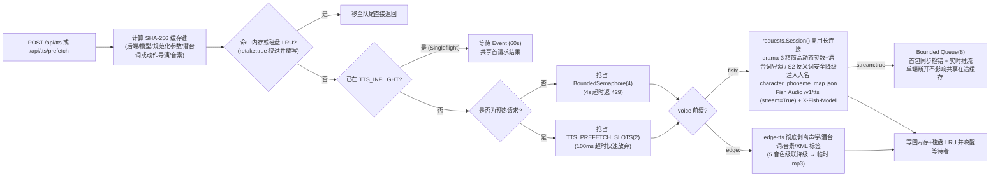

# 05 · 前端剧场与语音引擎架构

> **非数据源声明**：本文件为开发者架构参考文档，严禁作为 AI 剧情运行时提示词或世界书注入。
> **覆盖模块**：[`main_template.html`](../../main_template.html)、[`story_client.js`](../../story_client.js)、[`story_client.css`](../../story_client.css)、[`voice_client.js`](../../voice_client.js)、[`语音运行.py`](../../语音运行.py)（TTS 子系统）、[`voice_manager.html`](../../voice_manager.html)、[`scene_chat.html`](../../scene_chat.html)、[`scene_chat_dev/src/scene_live/`](../../scene_chat_dev/src/scene_live/)。

---

## 1. 正式剧场前端架构（`main_template.html` + `story_client.js` + `story_client.css`）

正式剧场采用零构建依赖的原生 HTML5 `<dialog>` + Vanilla ES2020 + CSS 自定义属性架构，单套页面自适应手机竖屏/横屏软键盘与桌面双栏布局。

### 1.1 DOM 分层与模态浮层

```text
<html data-theme="noir|ivory" data-time-of-day="dawn|day|dusk|night" data-font="normal|large" data-mood="calm|intimate|vigilance">
├── #ambientStage (z=0)          # 动态氛围层：当前场景空镜柔化幕布 + 氛围雨丝 (#ambientRain) + 建筑矢量 SVG (#sceneVectorLayer) + 光尘粒子
├── #tapRippleLayer (z=6)        # 点按星芒波纹层
├── header#topbar                # 顶部超薄 HUD（46px 移动 / 50px 桌面）：天平倾斜横梁 (#hudScalesBeam) / 地点与星期时钟 / 移动「凝视」胶囊 / 体力双环 / 档案室快捷入口 (#archiveQuickBtn) / 音浪 / 设置
├── #topPeekDrawer               # 移动端顶栏下滑微抽屉（快速窥视当前在场主角剧照或场景空镜，软键盘弹起自动收起）
├── .layout
│   ├── aside.scene-info         # 桌面侧边栏（>=860px，320px 宽，跨 1/5 行）：翻转焦点卡 (#sideFocusCard，有图展 3:4 剧照、无图/独处翻空镜档案卡)、零 404 在场人物表、快捷操作
│   ├── #sceneAtmospherePills    # 独立贴顶情景氛围细条（位于 #topbar 正下方、#stream 之外，桌面网格第 1 行；单行居中可横滑，实时显示细空间/隐私/着装/痕迹/亲密拍/同场暗流，绝不遮挡正文）
│   ├── main#stream              # 主阅读舞台（桌面网格第 2 行）：分页加载 (#older)、空档星盘卡 (#empty)、暗金沉浸星盘幕布 (#stageCurtain)、剧情消息流 (#messages，含 21:9 空镜/16:9 角色电影插页与焦点景深阅读)、未干墨迹撤回坞 (#inkCommitDock)
│   ├── section#settlement       # 悬浮非阻塞结算条（数值变动 / 体力退差 / 委托达成·领奖·新委托高亮胶囊）
│   └── footer#composer          # 情境底栏（折叠抉择舱含原位称重落印/550ms长按手势与亲密慢烧动态档费/标签 / #bracketChips 快捷括号、强势压迫授权、持有情趣道具与情报亮牌芯片 / 自由输入框 / 移动 5 键 Dock；移动端 `<860px` 聚焦直接拉起顶部锚定浮层 `#composerSheet` 彻底避开 Android 软键盘遮挡）
├── #composerSheetBackdrop & #composerSheet # 顶部锚定聚焦输入浮层（`position: fixed; top: 8px`；含最新剧情提示 `#sheetContextPeek`、道具操作挂载条 `#sheetAttachBar`、保留括号动作/内心想法/亮牌与背包·移动快捷键）
├── #gazeLens (z=90)             # 按住凝视 / 场景空镜 / 无图人物暗金档案卡浮层（按住速览、松手即回正文；轻触锁定细赏）
└── 原生 <dialog> 模态层
    ├── #worldDialog             # 六大档案中心（host | roster | map 含已部署装置 `📷 N` 徽标 | bag 三段式：随身持有+内联选择器 / 已部署装置远程查看与回收 / 已赠予纪念 | shop AI定制询货动态进货窗+分类门槛货架 | system）
    ├── #actionDialog            # 快捷行动抽屉（出行移动 move_player + 道具整组赠予 transfer_item）
    ├── #historyDialog           # 剧情编年史（全部 / 仅看对白 / 结算回执 三态过滤，纯紧凑文字不含插页）
    ├── #portraitDialog          # 全屏立绘查看器（#portraitOutfits 动态按后端 visual_assets 生成全部装束/情绪槽位按钮）
    ├── #connectionDialog        # 连接与桥接双端控制面板（主模型 / 副模型与功能槽改绑 / 思考自适应三档选择 / 切窗轮数 / 原始诊断 JSON）
    └── #newGameDialog           # 一体化「档案室」双标签弹窗（Tab 1「命运档案 · 存读档」：当前档摘要、手工建槽快照、轻量化历史档槽一键回档与删除；Tab 2「新启开局 · 10 剧本盲盒」：10 剧本预览卡片指定开局、随机盲盒与 `actions==0` 零备份原地重抽）
```

### 1.2 前端状态模型与同步生命周期（`story_client.js`）

- **持久化状态（`localStorage`）**：
  - `abyss_official_live_v1`：`{epoch, draft, pending, voice}`。`pending` 在发送前先落盘，用于断网/刷新后通过 `GET /api/story/tasks/<request_id>` 核对是否已入队（404 开放重发或修改，避免重复扣费）。
  - `abyss_ui_prefs_v1`：`{theme: "noir"|"ivory", font: "normal"|"large", haptics: true, backdrop: true, cinemaPlates: true, readingDof: true, displayMode: "curtain"|"stream", confirmMode: "inline"|"critical"|"off"}`（兼容旧 `cache.confirmCommit === false` 自动迁移为 `'off'`）。
- **服务端偏好持久化（`.round-runtime/story/prefs.json`）**：
  - 通过 `POST /api/story/preferences` 双端同步：`protagonist_style`（`faithful` 忠实演绎 / `silent` 仅动作感官）、`director_pacing`（`slow/standard/frequent`）以及 **「自定义系统级 Rule（主 / 副模型）」**折叠卡（内置主模型前景演播 `Zone 0` 与副模型后台结算 `Stage 2` 双切换栏、独立开关、置底/置顶位置与无字数上限多行编辑区，带未保存草稿防丢失保护）；桥接抽屉「主模型 · 前景演播」收口为直接改绑 Operit `CHAT` 槽，副模型独立配置与三档思考模式（`auto/off/on`）保持不变。
- **实时通道与降级（[`connectSSE()`](../../story_client.js)）**：
  - 启动建立 `EventSource('/api/story/stream')`（配 `initialSyncDone` 首连防抖避免冷启双拉）并后台预载 `loadVoiceConfig()`；收到 `story_stream` 直接调用 `applyStreamPreview()`，收到 `committed` / `task_state` / `bridge_state` / `save_reset` 防抖拉取 `GET /api/story/live`（默认 **10 幕** 倒序分页），收到 `shop_updated` 即时刷新 `loadShop(true)` 与最新状态。
  - SSE 断线自动指数退避重连，并启用 **15 秒降级轮询**（仅在 `!document.hidden && !sseOpen` 时触发）。
  - 监听 `visibilitychange`（切后台停语音并断开 SSE，回前台清空语音缓存、重载配置并重连刷新）与 `pagehide`（若正处于 `inkCommit` 未干缓冲期，自动把待发正文回填草稿箱后再释放全部 Blob Object URL）。
- **P1 长对话性能优化**：
  - `parsePanels()` 按文本签名记忆化缓存，消除单次渲染内重复正则切分；`timeline()` 通过 `segmentDomCache` 缓存已定稿历史回合 DOM 节点数组；`applyReadingFocus()` 改为 `O(1)` 尾部节点追踪；`updatePlateParallax()` 通过 `IntersectionObserver`（附缺失兜底）仅对视口可见插页计算滚动视差；滚动区移除 `backdrop-filter: blur` 与多余 `will-change: transform`，CSS 启用 `content-visibility: auto` 与 `.msg.is-historic` 动画冻结。
- **代际隔离三项闭环修复与零体力确定性交易**：检测到 `prevEpoch` 与新 `fresh.save_epoch` 变更（涵盖新档重置、原地重抽序幕及档案室一键回档）时：1) 同步对比 `prevEpoch` 而非覆盖后再判；2) 立即调用 `clearAudioCache()` 清空旧档音频 URL 池防止串音；3) 通过 `intentionalEpochSwitch` 标志位区分主动切档与被动外部重置，自动清空本地草稿、`pending`、`segmentDomCache`、历史列表、流式预览与商城缓存 `shopCatalog`；同步驱动档案室 API（`loadPrologues()` / `loadSaveSlots()` / `createManualSnapshot()` / `restoreSaveSlot()` / `deleteSaveSlot()` / `startNewGameWithOptions()`）与商城/委托/被动/情报全部零体力交易。

### 1.3 沉浸星盘暗金幕布、增量 DOM 补丁与零闪烁接管（`applyStreamPreview()` & `patchMessageTimeline()` & `absorb()`）

1. **暗金沉浸星盘幕布（`#stageCurtain`，默认开启）与沉浸偏离裁决态（`.is-review`，幕布/流式双模式统一）**：
   - 当任务进入 `settling` / `settling_retry` / `settling_failed` 时，`updateStageCurtain()` 自动升起带磨砂微光与旋转星盘的暗金帷幕，将正文舞台柔和遮罩并展示沉浸态势（如「命途结算中 · 正在编织因果」或重试提权提示「正在提权深度思考重试」）。
   - 当后端 Tier 2 守卫检测到未解锁暗线穿帮或 Stage 2 报出明显 OOC 进入 `awaiting_review` 时（无论当前处于幕布模式还是流式预览模式），`#stageCurtain` 自动切入琥珀金 `.is-review` 审校态（「天平察微 · 脉络待定」），展示动态原因、默认折叠防剧透的 `<details id="curtainReviewDetails">` 关键片段预览（2～4 句净化台词/动作）与三项明确按钮：**「重演本幕（纠偏重推）」**（`regenerate`）、**「留存本幕 · 下轮回拉」**（`accept_with_correction`，0 额外模型费即刻落盘）与 **「撤回并退还体力」**（`cancel`）。
   - 副模型结算完成且正式段落就绪后幕布优雅渐隐，**彻底消除副模型结算时的屏幕闪烁、重刷跳动与结算失败返回时的出戏感**；玩家亦可在系统设置中自由切回 `stream`（原始实时流式预览）模式。
2. **`patchMessageTimeline()` 增量 DOM 补丁（消除全量重刷与跳变）**：
   - 彻底废弃暴力 `innerHTML = ''` 清屏重绘；基于 `dataset.renderKey` 逐一比对已存节点与新节点。
   - 对已有节点仅就地更新预览角标（`syncPreviewChrome()`），保持 DOM 元素身份与滚动位置完全稳定；
   - 进场动画 `.msg.is-fresh-enter` 仅对全新插入的末尾节点触发，杜绝已有节点在重新吸纳快照时反复触发 `msg-arrive` 动画闪烁。
3. **首句即播即读与滑动预热**：
   - 首条预览节点到达即自动置 `revealed = 1` 并启动语音朗读（ID 为 `preview:<request_id>:0`），同时触发 3 句滑动预取窗口（`schedulePrefetchWindow()`）；流式 TTS 遇 `400/401/403/413/429/503` 错误时直接止损，不再二次请求 `playBuffered`。
4. **落盘瞬间零中断无闪白接管**：
   - 当 SSE `committed` 带来正式 `segment_id` 时，`absorb()` 将 `audioCache` 中所有 `preview:<request_id>:<idx>` 键平滑映射为 `<segment_id>:<idx>`，避免重复请求 TTS；
   - 若当前正在朗读某条预览句，直接原地重写 `speakingMessageId` 与 `audioMessage.id`，设置 `seamlessVoiceHandoff = true` 跳过 `stopVoice()`，**音频连续不断档**；
   - 若玩家在流式预览期间已提前点按读到第 $k$ 句（$k > \text{server.revealed}$），`absorb()` 持有 `handoffPreview` 在 DOM 中保持已读句数不回缩闪白，并将 `catchingUp` 纳入 `baseBlocked()` 防 409 竞态，同时由 `catchUpPlayback()` 附带 `catchup: true` 单请求补发 `POST /api/story/live/progress` 对齐服务端游标（跳过中间预热）后再平滑交接。

### 1.4 玩家输入、括号硬输入、Fish 声学动态排版、五维属性映射与六大档案联动

- **逐句点按演播（`advance()`）**：轻触 `#stream`、按 `Enter`/`Space` 或点 `#advance`（防抖 250ms/300ms），触发触觉微振、星芒波纹与移动端静音 WAV 自动播放解锁（`unlock()`），步进 `POST /api/story/live/progress`；读完末句后才再点一次将 `completed` 置为 `true` 并升起段末 A/B/C 抉择舱。
- **无弹窗沉浸式落笔确认（方案 A + B 融合，零遮罩不打断心流）**：
  - **方案 A · 三选一原位称重落印（`bindChoiceGesture()` & `armChoice()`）**：轻点卡片原地亮起暗金框、锁倾顶栏 `#hudScalesBeam` 并按当前 `world.active_costs` 与 `stamina_guard` 动态预演体力扣减（亲密续演 `intimate_beat >= 1` 时自动切换 **`1/2/3`** 档费与「余韵安抚 / 升温慢烧 / 深入主导」标签与微红鎏金描边，底线护盾生效时为 0 体力扣减；全站 11 处预扣判断统一走 `customReserveCost()`）、柔暗兄弟选项并显现 `再点落印` 徽标（3.8s 自动回正或点空白/`Esc` 取消），同位再点即落笔；亦可直接 **长按 550ms** 使鎏金进度条注满 + 双段触感微振直接落印（手指滑动 `> 12px` 自动取消防误触）。
  - **方案 B · 自由输入 1.8s「墨迹未干」收墨撤回（`stageInkCommit()` & `recallInkCommit()`）**：无论底栏或顶部聚焦浮层 `#composerSheet` 点击「行动」，编辑层直接收起，正文末尾 `#inkCommitDock` 原地浮现半透明「墨迹未干」玩家气泡与 `1.8s` 鎏金进度线；期间点击 `收回`（或按 `Esc`）不发任何后端请求即完整还原草稿与道具附件并重开输入；轻点气泡正文跳过等待立刻定稿，1.8s 走满自动派发。
  - **三档偏好**：系统设置开放 `落笔防误触`（`原位轻确认` [默认] / `仅关键动作` [仅 C 档与跨地点移动需要二点/长按，其余同上] / `直出`）。
- **括号硬输入、强势授权与情趣道具快捷筹码**：`textarea#input` 与 `#sheetInput` 原文零损耗提交至 `POST /api/story/tasks`；玩家消息内的 `（...）`/`(...)` 通过 `appendPlayerRichText()` 渲染为 `.player-bracket` 暗金斜体高亮；输入框上方 `#bracketChips` 除「＋（）括号动作」「＋（）内心想法」「**✦ 商城定制**（一键插入 `（【商城定制】）`）」与已持有商业情报的「◆ 亮牌：…」外，当在场女主进入生理断电（`体力 <= 15`）时自动显现「⚡（强势压迫授权）」快捷筹码，在亲密/高欲场时动态浮现已持有 `sensual` 道具与私密珍藏一键挂载筹码。
- **Fish 声学 / Drama 3 导演指令 → 视觉动态排版与防漏屏过滤（`classifyVoiceTag()` & `isFishBracketTag(inner, kind)` & `appendNpcRichText()`）**：
  - `isFishBracketTag(inner, kind)` 对三女主 `[D:]` 对白内所有合法中/英文自由导演指令 `[...]`（上限 180 字符，排除 `MOVE:`/`ITEM-`/`INTEL-`/`CLK_`）一律从屏幕正文隐藏，仅对音频层完整保留；同时 `classifyVoiceTag()` 识别中英文高反差导演词（含新增 `sharp` 锋芒冷刺、`playful` 轻快俏皮、`flustered` 慌乱掩饰及原 `tremble`/`whisper`/`catch`/`exhausted`/`restrained`）并渲染行首情绪胶囊（`.voice-mood-tag`）与动态排版样式；三大女主命中 `drama-3` 档位时渲染轻量暗金 `.voice-d3-pill`（`D3`）徽记，有声气泡右上角附轻量 `.msg-retake-btn`（`↻` 单句重录换一版演绎）；
  - `[N]` 旁白在 `entry()` 中自动继承当前在场焦点女主的 `cStats` 生理氛围，高欲/高潮/体液锁定态下对拟声词（`.fx-moan`，仅高欲或带波浪/省略号时激活）、湿热体液词元（`.fx-fluid`，波纹柔光）、痉挛战栗词元（`.fx-spasm`，微幅脉颤）与角色敏感部位锚点词（`.sensory-anchor`，单条消息上限 3 处）施加精细视觉高亮；**历史回合（`!isLastTurn` / `inHistory`）严格隔离，绝不倒贴当前实时生理热度或微状态**。
- **五维沉浸式属性-文字互动映射（与后端 100% 数值对齐）**：
  1. **属性响应式消息卡片、空间氛围细条与生理/微状态徽章（`entry()` / `renderSceneAtmospherePills()` / `getLiveCharStats()`）**：紧贴 `#topbar` 正下方的独立极窄细条 `#sceneAtmospherePills`（位于 `#stream` 之外、无 `sticky` 遮字，多标签单行居中可横滑，无标签自动 `[hidden]` 零占位）实时渲染当前细分空间、隐私层级（含 `隔墙/遮蔽 ×1.25` 背德提示）、着装层级、痕迹、亲密拍、同场暗流及 **主角精力/欲火/控欲边缘微标**；当前活跃回合在场女主按实时状态挂载 `data-arousal="high|peak"` 与 `data-defense="guarded|melted|blackout"`（CSS 明确区分 `melted` 柔光消融与 `guarded` 冷凛戒备、`npcStam <= 15` 触发 `blackout`），并在说话人栏渲染 `.micro-state-chip` 胶囊。
  2. **按住凝视（`#gazeLens`）四维微缩 HUD（`buildGazeVitalsHud()`）**：在角色剧照底部叠加毛玻璃四维进度条（`好感 / 羞耻 / 欲望 / 高潮%`）及当前被动技能等级（含 `Lv.4 防线支配`）、体力（`<= 15` 断电标识）、`已确诊怀孕 / 早孕微兆 / 危险期`、`内射 X次`、`体液锁定 ≥85/72/58(内射≥3次尾段62)`、`自渎余韵 / 欲求未平` 与微状态标签。
  3. **《极乐迪斯科》式不遮挡双轨检定横幅（`buildDiscoCheckBanners()` & `rationalizationTier()`）**：横幅改用**主生理/防线轨 + 副被动/态势轨**分层展示（不再因单条高优条件遮挡其余检定）；`rationalizationTier()` 与后端 `process_affection_system()` 严格对齐（`st.passiveLv < 4` 判定完好防线压档，仅 Lv.4 豁免，准确显示轻/中/深/重四档合理化闭环与 `Lv.4 防线支配` 检定卡）。
  4. **`<ruby>` 双层潜台词（对白与动作双通道可视 + Drama 3 潜台词自动导演）**：前台提示词支持在 `[D:角色姓名]` 台词与 `[A:角色姓名]` 动作行中使用 `｛表面言行｜真实潜台词/生理失控破绽｝` 语法，前端自动渲染为 `<ruby class="subtext-ruby">` 双层注音；发送 `/api/tts` 时保留原文直送后端统一分流——`drama-3` 自动将右侧潜台词并入 `[...; hiding: 潜台词]`（或 `[hiding: ...]`）驱动口是心非反差演技、朗读仍仅念表层，而 `s2.1-pro*` / `edge` 严格剥离潜台词仅朗读表层文本。
  5. **绝顶/内射/确诊怀孕/破锁/失守舞台脉冲与选项属性共鸣徽章（`checkTurnStageEffects()` & `deriveOptionResonance()`）**：后端 `panel_values()` 同步追踪布尔 `怀孕` 状态变化，当结算回执出现确诊怀孕、内射注入、高潮清算、堕落破锁或防线崩溃时触发 `#ambientStage`（`.fx-stage-climax / .fx-stage-unlock / .fx-stage-meltdown`）剧场光晕脉冲；段末 A/B/C 抉择卡头部动态展示当前态势共鸣徽章（`.option-resonance-badge`）。
- **文字优先触感交互闭环**：
  - **单句一键引用（`quoteLineToInput()`）**：每条 NPC 对白提供「引用」按钮，点击自动展开折叠面板并把精简摘录带括号视角填入输入框。
  - **按住凝视 / 轻触细赏（`bindHoldGaze()`）**：在角色微头像、说话人姓名、头栏「凝视 ◉ / 档案 ◈」或角色插页上按住（> 190ms，带 10px 滑动防误触与松手防重触发）唤出 `#gazeLens` 速览（含四维微缩 HUD），松手即回正文；轻触有图角色进全屏 `#portraitDialog`，轻触无图角色（徐承邺 / 次要 NPC / AI 动态路人）自然展露「同场景电影空镜 + 暗金人物档案卡」。
  - **抉择天平倾斜预演、显式转场徽标与极克制切入窗口微提示（`previewChoiceWeight()` & 方案 2B）**：悬停/聚焦/按压 A/B/C 抉择卡时，顶栏 `#hudScalesBeam` 按档位倾斜（`-5° / 0° / +9°`）并实时预演扣后体力圆环；若选项携带 `opt.operation = {code: 'move_player', destination}`，卡片头部同步渲染鎏金 `前往 · 地点` 徽标（`.option-head` / `.option-move-badge`），点击直接调用 `enqueue(opt.text, opt.operation || null, opt.id)` 触发转场。当本幕演播彻底完成且后端 `_public_segment` 透出 `opportunity_cue`（`accident` / `subtle`，演播中途零剧透）时，`#decisionOrnament` 细菱形饰线微微染上淡绯金调，并在标题末端隐约浮现无边框小字 `#decisionCue`（`· 契机` / `· 暗涌`，`10px` 低透明度，兼容黑金与暖纸双主题）；系统设定「核心阅读与演播」同步提供 **女主意外节奏**（`慢热 / 标准 / 密集`）三档开关。
  - **焦点景深阅读（`applyReadingFocus()`）**：处于对话流底部时最新一段保持全清晰，上文轻柔退远（`opacity: 0.72`），向上回翻自动解除，可在系统设定随时开关。
- **六大档案中心、快捷行动与桥接面板的分层收纳与联动**：
  - **主角档案（`host`）**：**v4 主角生理卡**（体力 / 精力池 `vigor` / 欲火 `desire` / 道具恢复额度）与核心四维（积分 / 经验值 / 魅力 / 商业嗅觉）置顶，**全部 8 项属性支持点按原位展开沉浸式「属性手记」（`STAT_GUIDE` / `buildStatGuidePanel()`）**，按「作用 / 增长 / 减少」三栏 + 实时阶段/折扣/护航实况条直观说明机制（涵盖魅力 `<68` 气场受挫、`edging_streak >= 3` 极限控场、耐力 `<15` 透支、`80+` 深局棋手与 3 次杠杆护盾，`积分` 与 `经验值` 展开后底部保留直达「商城」/「名册解锁被动」快捷按钮）；**魅力阶梯/癖好卡**（`68 清俊 / 75 锋芒 / 85 磁吸 / 95 魅影`）与「商业嗅觉与一次性情报」（`10/30/60/80/100` 五档进度、3 条情报入库、3 次商业杠杆护盾生效横幅、武装/解除与亮牌填词）收纳为带实时摘要的折叠卡片（有护盾生效、杠杆预备或可入库项时自动展开），存档概览压缩为单行摘要条。
  - **人物羁绊（`roster`）**：按 `hasCharacterPortrait()` 动态识别立绘，分角色精确锁定居家装束（`苏婉青 → 市中心顶层公寓`、`沈知韫/徐念薇 → 徐家主宅`，`工作室` 恒用外出装 `fullbody`）；`worldSigFor()` 与名册完整呈现 `world.physiology`（生理周期/早孕倒计时 `latent_days_left`/体液锁定/欲求积压/自渎余韵）、活跃 BUFF、**五维属性条与全部次级状态胶囊及徐承邺监视态势标题（共 13 项）点按原位展开「属性手记」**（实时计算羞耻动态上限、苏婉青 85 门槛、高羞耻完好防线与 75% 减免上限、体液锁定保底、小憩 `+15` 与被动 `20/50/110/220` Lv.3 体倦动摇/翻倍提示）、**5 区身体开发进度折叠卡与专属特色部位徽标**（沈知韫·足 / 苏婉青·胸 / 徐念薇·手，注明单回聚焦至多 2 区与 `+4/+8` 步长及单回魅力 `+1` 上限）、女主经验被动升级折叠卡（满足解锁经验时自动展开）；**徐承邺移除违和「堕落」条，以分渠道、分人物敏感度微标（`妻子 · 极敏/反水掩护` / `母亲 · 伦理盲区` / `妹妹 · 易掩护` / `养弟 · 连带汇聚`）、五阶状态胶囊与最近「疑点」动因的监视态势卡为主卡**（严格隐藏 `发现几率`）；`settlementCard` 补齐 `schedule_moves`、`leverage_triggered`（含剩余护盾次数）、`intel_consumed` 与 `shop_added` 明细展示。
  - **委托·行囊（`bag`）**：顶部提供 **`随身` / `珍藏` / `委托` / `已部署` / `已赠予`** 5 项带数量角标的子页签（有待领委托奖励时自动标金点并优先定位「委托」；「珍藏」独立收纳 **v4 私密珍藏盒 `intimate.keepsakes`**，`KS-XXX` 归属/状态徽标与嗅闻把玩/当面出示/亲密复用/悄悄放回快捷动作），避免多段纵向平铺。
  - **系统商城（`shop`）与系统设定（`system`）**：商城支持魅力 9 折 / 85 折原价划线展示，顶部提供**货架分类筛选胶囊**与折叠式「剧情内定制进货 · `【商城定制】`」指引卡（显示已解锁 `T1～T4` 阶位并一键跳转输入框，动态商品卡带分色 `T1～T4` 品级徽章与 4 轴未解锁锁条，结算条提供可点击的「商城上架 +N件」胶囊）；系统设定拆为 **`剧场显示` / `语音与密钥` / `背景音景` / `连接维护`** 4 个子页签，阅读与体验区提供主角戏份、女主意外节奏、开窗回溯模式（`balanced`/`full`）、**人设与暗线偏离处理（`待我裁决` / `自动重演1次` / `仅下轮回拉`）**与主/副模型自定义 Rule 编辑器，次要视觉开关与已配置后的 Fish API 密钥输入框默认折叠，一屏直达目标设置。
  - **出行与赠礼（`#actionDialog`）与桥接面板（`#connectionDialog`）**：`#actionDialog` 改为 `前往他处` / `赠予人物` 双页签切换；`#connectionDialog` 将主模型、副模型、会话与防漂移 3 组大表单改为带状态徽标的折叠手风琴，所有开关/下拉框仍向 `POST /api/story/bridge/control` 实时双向联动。

### 1.5 视觉设计系统、统一排版规则与零配置图包发现（`story_client.css` + `visual_assets`）

- **单一统一气泡规则与动作/对白结构化视觉分流（根治动作与台词混淆）**：
  - **动作与对白结构化分流**：非主角动作（`.msg.action:not(.player)`）彻底移除大头像肖像与沉重的「凝视 ◉」按钮，采用通栏点线舞台带（`.action-strip`）+ `18px` 行内微头像徽章（`.action-mini-avatar`）+ 纯正宋体 Serif 排版（杜绝 CJK 伪斜体硬倾斜导致的文字变畸）；角色对白（`.msg.dialogue`）保留 `38×46` 独立头像肖像、实心气泡、左侧 `3px` 角色专属重音条与轻量 `「」` 引号线索；玩家角色动作与发言（`.player`）独立采用暗金边框与斜体括号高亮；
  - **纯台词硬锁**：`[D:角色名]` 严格只允许角色真实说出口的纯台词（及行首/句中导演与词级声学标签），严禁夹带 Markdown 外层引号或“她端起杯子抿了一口：”等动作神态叙述；
  - **微头像与纯文学竖线**：三大女主（`沈知韫`、`苏婉青`、`徐念薇`）、主角（`徐志北`）及任何后续在 `txt文件/image/<角色名>/` 放入图片的角色自动渲染竖版圆角微头像；徐承邺、次要 NPC 及 AI 动态路人自动采用 `.msg.no-avatar` 全宽纯文学竖线排版，绝不出现空白头像列或 404 请求。
- **电影插页与自动图包发现**：后端 `interaction_runtime.scan_visual_assets()` 扫描 `txt文件/image/scenes/`（5 大地点 8 张 `1600×900 WebP` 无人空镜占位图，含 `.nomedia`）与 `txt文件/image/<角色名>/`，同槽位多扩展名时按**最新 `mtime` 优先**并附 `?v=<mtime>` 配合服务端 `max-age=86400` 缓存；切场自动插入 `21:9` 空镜横幅，有图角色同场首现或状态切换插入 `16:9` 剧照横幅（带滚动轻视差 `updatePlateParallax()`），且按地点/昼夜/微状态/欲望/羞耻/警惕自动优先匹配可选情绪图（`mood_blush` / `mood_desire` / `mood_cold` / `mood_sleep`）。现有 10 张 4K PNG 立绘原样保留。
- **双主题、时辰情绪光影与响应式**：`noir`（深黑暖金）与 `ivory`（暖纸墨金）；按游戏时钟（`data-time-of-day`）与场内态势（`data-mood="calm|intimate|vigilance"`）动态渲染背景空镜幕布、雨丝与光晕；`window.visualViewport` 软键盘高度 > `120px` 时自动挂 `.kb-open` 并收起 `#topPeekDrawer`；`>=860px` 切换为 `320px + 1fr` 桌面双栏并启用右侧 `#sideFocusCard` 翻转焦点卡，完整支持 `prefers-reduced-motion`。

---

## 2. 语音引擎与声学工坊架构

### 2.1 服务端双后端、Singleflight 去重与流式代理（`语音运行.py`）



- **核心工程细节**：
  - **Fish Audio Session 连接池与 Drama 3 表现力全链路解禁**：全局通过 `_FISH_HTTP_SESSION = requests.Session()` 复用长连接池（`pool_connections=4, pool_maxsize=6`，通过 `_fish_http_post`/`_fish_http_get` 保持测试 monkeypatch 兼容）；S2.1 免费/生产档启用 `latency: "balanced"` 与 `chunk_length: 180` 压低首包延迟；**命中 `drama-3` 时，`_build_fish_payload()` 彻底省略官方忽略的 `chunk_length` / `min_chunk_length` / `condition_on_previous_chunks` / `early_stop_threshold` / `repetition_penalty`，默认关闭 `quality-guard`（仅显式开启时附加），自动将旧低采样 `<0.80/<0.82` 抬升至 `0.92/0.88`（`raw_params=True` 时原样透传供 A/B 盲测对照），`expressive_boost` 上限提至 `1.00/0.95`；切档 `/api/voice_tier` 同步将三女主写为 `DRAMA3_ROLE_PROFILES`（沈 `0.94/0.90/1.00`·苏 `0.98/0.93/1.00`·徐 `0.92/0.88/1.02`）或 `S2_ROLE_PROFILES`**；响应头统一附加 `X-Fish-Model`（重录附加 `X-TTS-Retake: 1`）；429 限流自动触发指数退避冷却。
  - **40MB 本地磁盘 LRU 缓存与单句重录（`.cache/tts_audio/` & `retake: true`）**：64 条内存 LRU + 40MB 持久化磁盘 LRU 跨重启复用热点音频；`POST /api/tts` 携带 `retake: true` 时跳过缓存与 Singleflight 碰撞、重新向 Fish 采样并原子覆写内存与磁盘 LRU 对应缓存键。
  - **闲置滑动窗口预合成与付费档保护门禁（`POST /api/tts/prefetch` + `_trigger_tts_prewarm()`）**：演播推进或流式到达时，前端与服务端共用 `_prepare_tts_job` 同一缓存键（保留原文潜台词、透传同构 `context_hint` / `voice_script` 与张力 `expressive_boost`）；[story_service.py](../../story_service.py) 将 `voice_config.json` `mtime_ns` 纳入去重签名并按 `voice_tier` 分层预热：**免费档 `free` 保持 100% 原样（`streaming`/`settling` 均预热前 3 句）**；切换付费档时自动启用保护门禁（客户端静音跳过、跳过 `streaming` 待 `settling` 稳态再预热且限前 2 句）；服务端分配独立 `TTS_PREFETCH_SLOTS=2` 信号量，100ms 超时即放弃。
  - **三档切换、潜台词自动导演与 S2 反义词安全降级**：Fish Audio 支持三档切换（`POST /api/voice_tier`）：**免费默认 `free`（`s2.1-pro-free`）** / 高并发 `pro`（`s2.1-pro`） / **旗舰 `drama`（三女主全量 `drama-3`，旁白/动作/主角恒走 `s2.1-pro-free`）**；`drama-3` 经 `_extract_subtext_for_drama3()` 将 `｛表层｜潜台词｝` 右侧并入 `[...; hiding: ...]` 并在无标签裸句经 `_apply_context_hint_for_drama3()` 注入相邻动作 `[acting cue: ...]`；非 `drama-3` 经 `_degrade_drama3_for_s2()`（`[pause]→[break]`、`[long pause]→[long-break]`、XML→英文控制词）与 `_normalize_s2_chinese_aliases()`（纯英文透传、高张力否定词前置杜绝「克制不住」反义误判）无损降级；张力韵律仅提升 `expressive_boost`（`0.04`/`0.08`），唯独 `体力 <= 15` 才降速至 `0.95`；Edge-TTS 彻底剥离全部声学/潜台词/音素/XML 标记并将已下线音色映射为 `YunyangNeural`。
  - **本地循环背景音景（`txt文件/audio/ambient/`）**：启动自动创建 `ambient/` 与防安卓媒体扫描 `.nomedia`；`scan_audio_assets()` + `GET /api/audio_assets` 零配置自动发现 5 槽背景音（`calm_home` / `rain_night` / `tension_stealth` / `intimate_warm` / `aftermath_quiet`，支持 `.mp3`/`.ogg`/`.wav`/`.m4a`）。
  - **密钥安全与本地受保护缓存**：源码彻底移除硬编码密钥；动态解析顺序为 `X-Fish-Api-Key` 请求头 → 本地受保护缓存 `.cache/fish_api_key.json`（`0600` 原子写入，受 `.gitignore`、`一键同步GitHub.py` 与 `存档清理器.py` 三重保护）→ 进程环境变量 `FISH_API_KEY`。通过 `GET/POST/DELETE /api/fish_key` 管理且仅返回掩码与来源，上游异常日志自动脱敏；未配置时 `/api/voices` 返回提示，`/api/tts` 返回 `503`。
  - **角色多音人名音素表自动接入**：`txt文件/character_phoneme_map.json` 精简为纯易错人名（`沈知韫/知韫/徐承邺/承邺`），由 `_apply_fish_phonemes()` 仅对 Fish 后端注入，避免日常词注音膨胀与 Edge 路径泄漏。
  - **流式首包同步检错与单端断开解耦（[`_stream_cached_tts()`](../../语音运行.py)）**：后台线程拉取音频塞入 `Queue(maxsize=8)`，Flask 视图先同步等待首条队列消息（最多 60s）；若上游直接返回 429/502/504，浏览器收到准确的 HTTP 错误 JSON 而非损坏的 `200 audio/mpeg` 流；单客户端切句中止时不再毒化共享的 Singleflight 在途缓存。
  - **配置损坏零覆写（[`_load_config()`](../../语音运行.py)）**：`voice_config.json` 若手工改坏，GET 返 `503`、POST 返 `409`，绝不自动重置覆盖；每次保存强制清空 `emotion: ""`（情绪只来自对白内标签或试听临时参数），且 `default` 槽位清空女声音色 ID 杜绝错串。

### 2.2 前端共享传输库（`voice_client.js`）、多声道发声路由与播放编排分工

| 层次 | 文件 | 职责 |
|---|---|---|
| **底层传输库** | [`voice_client.js`](../../voice_client.js) (`window.VoiceClient`) | 参数镜像钳位 `normalizeFish()`（默认 `s2.1-pro-free`、`latency: 'balanced'`、`chunk_length: 180`、`language: 'zh-CN'`、`quality_guard: true`）、批量滑动预热 `prefetchBatch(items)` 与载荷构造 `buildPayload()`（透传 `speaker`、`speed_scale`、`expressive_boost`、`context_hint`、`voice_script`、`retake`、`raw_params`）、统一附带 `X-Voice-Client: 1` CSRF 头的 `requestJson()`、导出 `getFishKeyStatus`/`saveFishKey`/`clearFishKey`/`setVoiceTier`/`setVoiceRouting`/`designVoice`/`getAudioAssets`、命名取消通道（`'live'`/`'prefetch'`/`'preview'`/`'scene'`）、有界字节读取 `requestAudio({maxBytes})`、**MSE `audio/mpeg` 边下边播 `requestStream()`**、带当前播放固定保护（`pin()`）的 LRU `AudioUrlStore` |
| **剧场编排层** | [`story_client.js`](../../story_client.js) | **多声道发声路由与继承**（`resolveVoiceSpeaker()` + `resolveEffectiveVoiceCfg()`：`沈知韫`/`苏婉青`/`徐念薇`/`旁白` 常驻发声；`徐志北` 受 `protagonist_voice_enabled` 控制，默认静音，开启后仅朗读 AI `[D:徐志北]` 干净台词，`isPlayerInput: true` 玩家气泡永不误读；`[A:*]` 动作按 `action_voice_mode` 支持 `follow_narrator`/`separate`/`muted` 与 `action_voice_scope`=`all`/`heroines`，`动作` 音色留空自动继承 `旁白` Fish/Edge 音色并叠加利落动作韵律；`徐承邺` 与次要 NPC 恒静音）；`speak()` 与预取保留原文潜台词并透传 `findAdjacentActionHint()` + 同构 `computeProsodyMod()`，三女主气泡支持 `.msg-retake-btn`（`retake: true`）换一版演绎；`toggleVoice()` 与各重听解静音按钮经 `syncVoicePlaybackPref()` 异步回传 `voice_playback_enabled` 联动服务端付费预热门禁（不触发 `_prefs_epoch` 重卷）；`audioCacheKey()` 纳入 `who`、解析后 `voice`、`tts_model`、`prosodyMod` 与 `contextHint`，双轨交叉淡入淡出背景音景 + Ducking |
| **调音台界面** | [`voice_manager.html`](../../voice_manager.html) (`/admin`) | 顶部收敛为单行全局工具条（三档切换 + `密钥与额度` 折叠抽屉 + `★ 收藏夹` 直达入口）；按 **`旁白 / 动作 / 沈知韫 / 苏婉青 / 徐念薇 / 徐志北`** 6 槽位排布，单角色采用 **「音色与试听 / ★ 收藏夹 / 参数微调 / ✦ 母带工坊」** 4 页签工作台：「音色」页内置三女主高反差 A/B 盲测对照（旧方案 `raw_params: true` vs 新方案解禁参数）；参数页标注 Drama 3 忽略项与 `quality-guard` 戏剧建议；**`✦ 母带工坊`** 内置沈/苏/徐音色描述模板，直接经 `/api/voice_design` 生成多组高动态候选 WAV 供试听与下载上传克隆；收藏夹支持筛选、试听、跨角色应用、行内改名备注（`PATCH /api/voice_repo`）与删除；试听保留潜台词直送后端并经 `escapeJsStr()` + `data-test-char` 安全转义 |

> **`开发者功能/开发者说明/语音引擎升级方案/` 落地状态说明**：目录内调研的 `s2.1-pro-free` / `s2.1-pro` / `drama-3` / `s2-pro`、`normalize_loudness`、编码/码率/采样率、`language`/`normalize`、`max_new_tokens`/`early_stop_threshold`/`quality_guard`/`pronunciation_dictionary`、`txt文件/character_phoneme_map.json` 角色人名音素映射、**Drama 3 英文优先导演说戏 + 7 种词级成对标签 + 潜台词自动导演** 及 **`POST /v1/voice-design`（`/api/voice_design` + `/admin` `✦ 母带工坊`）** 均**已正式集成到现役主程序**；`/v1/audio/infill` 与命令行脚本 `开发者功能/开发者工具/voice_design_generator.py` 保留为离线参考工具。

---

## 3. 三套前端页面定位对比

| 维度 | 正式剧场 `/` (`main_template.html`) | 同席候选页 `/scene-live` (`scene_chat_dev/src/scene_live/`) | 极简实验页 `/scene-chat` (`scene_chat.html`) |
|---|---|---|---|
| **后端命名空间与存储** | `live_interaction` · `RoundStore` 正式事务 | `scene_chat` · `.scene-chat/` 隔离 SQLite | `scene_chat` · `.scene-chat/` 隔离 SQLite |
| **实时同步** | SSE `/api/story/stream` + 15s 降级轮询 | 2.5s 轮询 | 2.5s 轮询 |
| **流式预览与演播** | 双阶段流式预览 + 逐句点按 + 段末 A/B/C 与自由输入 | 整段展示 + 自由输入（上限 24 轮） | 整段展示 + 自由输入（上限 24 轮） |
| **语音能力** | MSE 自动流式 + 缓冲降级 + 250ms 有界预取 + 单句重听 | 无语音 | 手动单句缓冲播放按钮 |
| **世界状态与控制** | 六大档案中心（含商城/情报杠杆/被动升级/警惕监测）、SVG 结算条、新档重置、完整双端桥接面板 | 只读导入正式存档快照（`legacy_visibility.json`）+ 场景列表 | 仅新建临时 1–2 人场景与只读连接 JSON |
