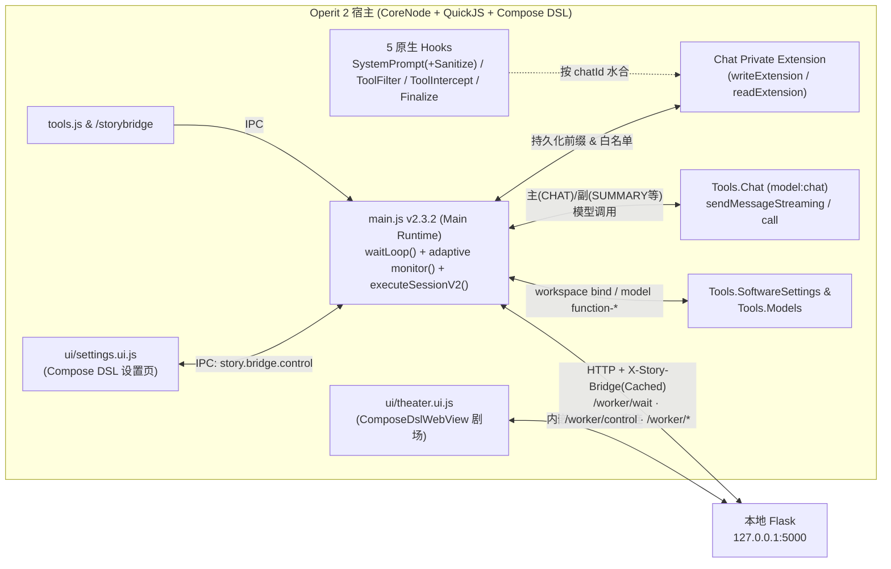

# 06 · Operit 2 桥接插件架构

> **非数据源声明**：本文件为开发者架构参考文档，严禁作为 AI 剧情运行时提示词或世界书注入。
> **源码唯一入口**：[`scene_chat_dev/local.story.operit_bridge/`](../../scene_chat_dev/local.story.operit_bridge/)（版本 **2.3.2**，Operit API `2.0.0`，插件 ID `local.story.operit_bridge`，子包 `story_bridge`，**零外部插件依赖**）。
> **成品与构建**：[`scene_chat_dev/build.py`](../../scene_chat_dev/build.py) → `scene_chat_dev/artifacts/故事桥接-continuous-2.3.2.toolpkg`（含零 `character_cards` 依赖与全量 JS 语法门禁，验包通过后自动清理旧版 `.toolpkg`）。

---

## 1. Operit 2 平台官方参考与宿主运行时机制

本桥接插件构建于开源跨设备 AI Agent 平台 **Operit 2**（Rust Core + Flutter App + 平台 Host + ToolPkg 扩展运行时，AGPL-3.0）之上。Operit 2 当前处于 **Preview 阶段**，插件契约、宿主 API 与数据格式可能随上游演进调整；开发或排查插件问题时，应以下列官方权威资料与本仓随附类型声明为准。

### 1.1 Operit 2 官方资源与知识库索引

| 资源 | 链接 / 路径 | 用途 |
|---|---|---|
| **官方下载页** | https://operit.app/#/v2/download | 获取各平台最新 Operit 2 安装包与发布说明 |
| **官方源码仓库（GitHub）** | https://github.com/AAswordman/Operit2 （`https://github.com/AAswordman/Operit2.git`） | Rust Core（`core/`）、Flutter 应用（`apps/`）、平台 Host（`hosts/`）与官方插件/SDK 源码（`plugins/`） |
| **官方知识库源码（Wiki 仓库）** | https://github.com/luojiaping/Operit2-wiki | Operit 2 架构、核心模块、ToolPkg/Compose DSL 专题 Wiki 源码 |
| **官方在线知识库（Wiki 网站）** | https://luojiaping.github.io/Operit2-wiki | 在线查阅 Operit 2 架构文档、插件体系、模型与同步指南 |
| **上游插件作者手册（仓库内）** | `AAswordman/Operit2` → `plugins/docs/README.md`、`prompt-hooks.md`、`UI_NAVIGATION.md`、`docs/webview-rendering.md`、`docs/chat-send-api.md`、`docs/chat-summary-cache.md` | ToolPkg 打包、Prompt/Tool 钩子、UI 导航、ComposeDslWebView 与缓存优化权威规范 |
| **本项目离线 SDK 类型镜像** | [`scene_chat_dev/types/`](../../scene_chat_dev/types/)（30 份官方 `.d.ts` 声明，由 `operit-plugin-sdk` Rust 声明生成） | 离线查阅 `ToolPkg`、`Tools.Chat`、`Tools.Models`、`Tools.SoftwareSettings`、`PluginConfig`、`ComposeDslScreen`、`RuntimeContext`、`QuickJS` 全局接口（目录根置 `.nomedia` 防止安卓相册误扫） |

### 1.2 Operit 2 宿主权限边界与工作区 / VFS 路径隔离

- **四层由外向内收紧的权限模型**：
  `0. App Runtime Sandbox（应用沙箱/容器）` → `1. Host Authorization（操作系统实际授予的文件/终端/网络权限）` → `2. AI Capability Limit（ReadOnly / WorkspaceWrite / Full）` → `3. User Tool Approval（单次工具调用的 allow/ask/deny）`。
- **工作区 ID、VFS 与终端路径隔离**：
  - Operit 2 新版将工作区建模为一等持久化实体（含 `id` UUID、`name`、`folders[]`）；`workspace bind <chatId> <workspaceId>` **仅接受已创建的工作区 ID**（不再接受原始目录路径）；
  - `Tools.Files` 与工作区挂载目录使用 Operit 2 **VFS 虚拟路径**（如 `/virtual/android/documents/...`、`<nodeId>:/virtual/...`、`/operitapp/data/...`）；
  - 终端 Shell（Termux / proot）与 Pydroid 3 使用操作系统真实路径（如 `/storage/emulated/0/互动对话项目/Gemini网页版`）；
  - 本插件通过 `bindWorkspaceToChat()` 透明兼容工作区 ID 与目录路径：直接绑定失败时自动经 `workspace list` / `resolve-path` 匹配已有工作区 ID（含安卓 SAF 目录名），未登记时尝试 `workspace create`，并在设置页提供一键工作区选择器。
- **插件安装区与运行缓存（Operit VFS 路径）**：

| Operit VFS 路径 | 用途与维护注意 |
|---|---|
| `/operitapp/data/extensions/device/packages/` | 设备级安装区；本项目 `installation_scope: "device"` 即安装于此（`故事桥接.toolpkg`）。**日常开发切勿直接修改此目录**，须改源码 → `build.py` → 同 ID 覆盖导入 |
| `/operitapp/data/extensions/space/packages/` | 多设备 Space 级共享扩展安装区 |
| `/operitapp/data/cache/toolpkg/` | 运行时按需解压缓存（诊断只读参考，不能用于判断真实安装或启用状态） |

### 1.3 ToolPkg v2 多运行时隔离与零外部依赖设计

Operit 2 通过 `ToolPkgLoader`（`loadToolPkgFromExternalFile`）加载 `.toolpkg` ZIP 归档，校验 `manifest.json` 必填的 `toolpkg_id` / `version` / `api_version`（本插件显式锁定 `"api_version": "2.0.0"`，且 **`requires: []`，彻底零外部插件依赖**）。同一插件内部运行在三个隔离上下文中：

1. **Main Runtime（`main.js`）**：常驻主运行时，承载全局状态、自适应定时器、Long-Polling、IPC 服务端、原生会话扩展注册表及 5 个 Operit 2 原生提示词/工具钩子。
2. **Subpackage Runtime（`tools.js`）**：按工具调用触发的子包入口，经包内私有 `ToolPkg.ipc.call('story.bridge.control', payload, { targetRuntime: 'main' })` 转发控制命令。
3. **Compose DSL UI Runtime（`ui/settings.ui.js` 与 `ui/theater.ui.js`）**：独立 UI 渲染上下文（ABI 4 布局程序），由 `ComposeDslScreen(ctx)` 产出 `ComposeNode` 树（含原生 `UI.WebView` 剧场与 Material 3 设置页），通过 `ToolPkg.ipc.call` 与 Main Runtime 交换快照；异步回调以 `ctx.useRef` 镜像 `ctx.useState` 规避闭包陈旧。

### 1.4 底层原理：v2.3.x 原生自托管如何实现零样板、零漂移纯净 KV 缓存

桥接完全脱离 `com.operit.character_cards`，走 Operit 2 Rust Core 原生管线：

- **纯原生 `model:chat` 会话隔离**：调用 `Tools.Chat.createNew({ setAsCurrentChat: false, input: { 'com.operit.character_cards': { version: 1, selection: 'model:chat' } } })` 并传 `turn: { kind: 'execute', participantId: 'model:chat' }`。若用户未装/停用角色卡插件，Core 静默忽略 `input`；若用户为其他聊天保留角色卡插件，`selection: 'model:chat'` 阻止其自动绑定默认角色卡；旧遗留角色卡绑定会话在首次运行时自动迁移新建干净 `model:chat` 会话。
- **会话私有扩展持久化（`Tools.Chat.writeExtension / readExtension`）**：在 `local.story.operit_bridge` 命名空间下写入 `{ bridge: 'local.story.operit_bridge', role, allowedTools, systemPrefix, zone0Sha, zone1Sha, sanitizeBoilerplate }`；内存表 `bridgeChatRegistry` 与负缓存 `nonBridgeChatCache` 保证普通用户聊天零开销，App 冷重启后由 `resolveBridgeChatState()` 经 `readExtension` 自动水合。
- **5 个原生钩子协同与演播专用样板净化**：
  1. `registerSystemPromptComposeHook`（`compose_system_prompt_sections`）：仅对桥接自有 `chatId` 将冻结前缀 `Zone 0 + "\n\n" + Zone 1` 置于 `systemPrompt` 最前，并调用 `sanitizeOperitCorePrompt()` 剥离无关 `包系统 / PACKAGE SYSTEM`；**当且仅当 `state.role === 'live'` 且开启 `sanitizeOperitBoilerplate`（默认 `true`）时**，进一步精准剥离宿主注入的 `<workspace_rule_file>`（含 8K+ 字 `AGENTS.md`）、`文件同步 / FILE SYNC`、`附件 / ATTACHMENTS` 与泛化助手介绍，完整保留工作区路径与只读工具指引（若异常触发防御性回退，不影响 `scene_chat` 及普通用户聊天）。
  2. `registerToolPromptComposeHook`（`filter_tool_call_tools` / `build_tool_prompt` / `filter_tool_prompt_items`）：将可见工具列表严格裁剪为白名单（正式互动 5 个只读工具 `LIVE_READ_TOOLS`；实验/旧入口 8 个 `FILE_TOOLS`），剔除 `use_package`、写入、终端与 MCP/技能。
  3. `registerToolLifecycleHook`（`tool_call_intercept`）：在真实执行前按同一白名单硬拦截非只读工具调用（返回 `{ action: 'block', reason }`）。
  4. `registerPromptFinalizeHook` & `registerPromptEstimateFinalizeHook`（`before_finalize_prompt`）：仅对桥接自有 `chatId` 剔除外部世界书插件（`com.operit.worldbook`）常驻注入的 `<worldbook>...</worldbook>` 块，保证字节级 KV 前缀纯净与 Token 估算一致，同时 100% 不影响用户其他普通聊天。

### 1.5 本插件使用的 Operit 2 宿主 API 速查表

| 宿主 API | 本插件调用点 | 语义与注意事项 |
|---|---|---|
| `PluginConfig.use(name, defaults)` / `PluginConfig.flush(cfg)` | `settings()`、状态变更落盘 | 关键状态（`inFlight`、`outbox`、`liveSession`）必须 `await PluginConfig.flush(config)` 确保持久化 |
| `Tools.Chat.sendMessageStreaming(req)` | `executeSessionV2()` / `executeSession()` | 提交 `kind: 'submit'`、`turn: { kind: 'execute', participantId: 'model:chat' }`，流式迭代 `part` 与 `completed` 回执 |
| `Tools.Chat.writeExtension` / `readExtension` | `syncBridgeChatContext()`、`resolveBridgeChatState()` | 读写归属 `local.story.operit_bridge` 的会话级私有扩展（返回 `{ extension }`），承载冻结前缀、样板净化标志与只读权限元数据 |
| `Tools.Chat.call({ functionType, turns, recordTokenUsage, enableThinking })` | Stage 2 后台结算、`repairMemory()` | **无状态、不落会话历史**的功能槽模型调用；Operit 2 Core 已内置 `<think>`/`<meta>` 清洗 |
| `Tools.Chat.createNew / listChats / getMessages / agentStatus / switchTo / cancel / updateTitle` | `ensureSession()`、`restoreChat()`、超时取消 | `listChats({ chat_ids: [chatId] })` 走 SQL 精确查窗，配合 `getMessages` 核验落盘回执 |
| `Tools.Models.listSummaries()` | `fetchModelCatalog()` | 读取宿主全部已配置服务商与模型列表 |
| `Tools.SoftwareSettings.exec(args)` | `currentChat()`、`bindWorkspaceToChat()`、`fetchWorkspacesList()`、模型槽读写 | 统一 Core Command 入口：`['chat','current','--json']`、`['workspace','list'|'bind'|'resolve-path'|'create', ...]`、`['model','list'|'show'|'function-list'|'function-show'|'function-set', ...]` |
| `ToolPkg.registerSystemPromptComposeHook` / `registerToolPromptComposeHook` / `registerToolLifecycleHook` / `registerPromptFinalizeHook` / `registerPromptEstimateFinalizeHook` | `registerToolPkg()` | 原生自托管前缀拼装、宿主样板净化、只读工具裁剪/硬拦截与外部世界书隔离 |
| `ToolPkg.registerUiRoute` / `registerNavigationEntry` | `registerToolPkg()` | 注册 `ui/theater.ui.js`（内嵌 WebView 剧场，`order: 158`）与 `ui/settings.ui.js`（桥接设置，`order: 160`）至 `main_sidebar_plugins` 与 `toolbox` |
| `ToolPkg.registerCoreCommand` / `registerChatInputHook` / `registerAppLifecycleHook` | `registerToolPkg()` | 注册 `/storybridge` 命令、免 Token 中文短语消费钩子及应用启动/前台/终止钩子 |

---

## 2. 插件包结构与运行时拓扑

本插件由 6 个文件组成（打包体积 ~53 KB）：

| 文件 | 角色与运行时 | 核心职责 |
|---|---|---|
| [`manifest.json`](../../scene_chat_dev/local.story.operit_bridge/manifest.json) | 包声明 | `toolpkg_id: "local.story.operit_bridge"`、`version: "2.3.2"`、`api_version: "2.0.0"`、`installation_scope: "device"`、**`requires: []`（零外部依赖）**、声明子包 `story_bridge -> tools.js` |
| [`main.js`](../../scene_chat_dev/local.story.operit_bridge/main.js) | Main Runtime（~2,910 行） | `PluginConfig` 持久化、IPC 通道 `story.bridge.control`、`waitLoop()` Long-Polling、`getBridgeToken()` 令牌缓存与 `monitor()` 6s/30s 空闲退避、工作区 UUID 自动匹配/创建绑定、`writeExtension/readExtension` + 5 原生钩子（含 `sanitizeOperitCorePrompt`）、`prefs_epoch` 重卷与 commit-only `session_meta`（透传 `zone1_flags.char_stage` / `unlocked_secrets`）、`buildTailHook()` 剥离未说出口 `｜潜台词` 与 180 字导演括号、`awaiting_review` 洁净标脏切窗、v2 双阶段/单阶段执行、Outbox 抗断网投递与 `/storybridge` 命令 |
| [`tools.js`](../../scene_chat_dev/local.story.operit_bridge/tools.js) | Subpackage Tool Runtime（60 行） | 暴露 `start` / `stop` / `status` / `configure` 给 Operit 工具层，经私有 IPC 转发至 Main Runtime |
| [`ui/theater.ui.js`](../../scene_chat_dev/local.story.operit_bridge/ui/theater.ui.js) | Compose DSL WebView Runtime（~155 行） | 内嵌 `ComposeDslWebView` 全屏剧场入口（默认 `http://127.0.0.1:5000`），加载完成后零多余遮挡，断连时提供「重新连接」与「桥接设置」跳转 |
| [`ui/settings.ui.js`](../../scene_chat_dev/local.story.operit_bridge/ui/settings.ui.js) | Compose DSL UI Runtime（~600 行） | 原生 Material 3 设置界面：顶部含「打开内嵌剧场」快捷按钮，支持 `CHAT` 主模型槽一键改绑、副模型独立选槽/改绑/三档思考自适应、会话策略、防漂移切窗轮数（默认 `10` 及强/弱模型调优指引）、**「净化 Operit 宿主样板」开关**与工作区快捷选择 |
| [`README.md`](../../scene_chat_dev/local.story.operit_bridge/README.md) | 插件说明 | 打包随附版本与协议摘要 |



---

## 3. 配置持久化、双循环调度与双端联动

### 3.1 `PluginConfig` 持久化与内存缓存
- 通过 `PluginConfig.use('story_bridge', defaults)` 落盘：
  - 连接与模式：`enabled`, `endpoint` (`http://127.0.0.1:5000`), `workspacePath`, `dualStageEnabled` (默认 `true`), `liveSessionPolicy` (`'continuous'`), `maxTurnsPerSession` (默认 `10`, 范围 `2..30`), **`sanitizeOperitBoilerplate` (默认 `true`)**。
  - 主/副模型：主模型统一跟随 Operit `CHAT` 功能槽（支持双端直接改绑 `CHAT` 槽），副模型独立配置 `settlementFunctionType` (`'SUMMARY'`)、`settlementThinking` (`false`)、`settlementThinkingMode` (`'auto'`)。
  - 会话与容错：`liveSession`（含 `chatId`, `participantId: 'model:chat'`, `turnCount`, `lastCommittedSeq`, `interactionScope`, `prefsEpoch`, `dirty`, `zone0Sha`, `zone1Sha`, `zone1Flags`（含 `char_stage` 与 `unlocked_secrets`）, `injectedRefs`, `injectedGuides`, `injectedMemoryFps`, `stateHashes`, `syncedPrefixSig`, `generation`, `resetReason`, `serviceEpoch`, `lastRequestId`）、`sceneSession`、`inFlight`、`outbox`、`lastRejection`、`controlAck`/`controlError`。
- **30 秒 TTL 缓存与令牌缓存**：`modelInfo` / `settlementModelInfo` / `modelCatalogCache` 改绑槽位时立即全量失效；`bridgeTokenCache`（`getBridgeToken()`）跨 `monitor()`/`waitLoop()`/`work()` 复用桥接密钥，仅在 `401/403`、端点变动或 `service_epoch` 重启时自动失效重取。

### 3.2 `waitLoop()` 与自适应退避 `monitor()`
1. **`waitLoop()`**：先串行运行 `tick()`（投递残余 `outbox` → 恢复中断 `inFlight` → 领单执行），随后长轮询 `GET /api/story/worker/wait?since=<workerSeq>&timeout=25`（读超时 35s），每次收到任务或控制唤醒立即调用 `markBridgeActivity()` 恢复活跃节拍并经 `syncServiceEpoch()` 对齐服务重启。
2. **`monitor()`（6s 活跃 / 30s 空闲自适应退避）**：由递归 `scheduleMonitor()` 调度，活跃期与任务/控制操作后 60 秒内每 6s 上报 `runtimeReport(config)` 至 `POST /api/story/worker/control`；空闲超过 60 秒自动退避至 30s（服务端 `_bridge_view()` 对应 45s 监控窗 + 40s `worker_wait` 内存保活窗，永不误报离线）；本地改动即时触发并刷新活跃节拍；Node 测试环境下通过 `monitorTimer.unref()` 避免阻止进程正常退出。

---

## 4. `executeSessionV2()` 双阶段流式与单阶段执行流水线

入口位于 [`main.js`](../../scene_chat_dev/local.story.operit_bridge/main.js)（`entry_mode === 'live_interaction' && material_delivery_v2 === 1`），全程受 10 分钟硬超时与 20 秒心跳保护：

1. **取料与前缀同步**：`POST /worker/<id>/material`（`delivery_version: 2`，携带 `synced_zone1_flags`（含 `char_stage` / `unlocked_secrets`）、`injected_refs`、`injected_guides`、`injected_memory_fps`、`prev_state_hashes` 与可选主/副模型自定义系统级 Rule）→ 校验 SHA-256 与 `delivery.id` → 执行 `syncLivePrefixes()`（仅在 `[chatId, model.key, zone0Sha, zone1Sha, sanitizeBoilerplate]` 变化时调用 `writeExtension`）。
2. **分支 A · `dual_stream_v2`（默认）**：
   - **Stage 1（前台流式演播）**：`Tools.Chat.sendMessageStreaming()` 监听 `thinking`/`markdown` 分片，经与 Python 对称的 `parseStreamMessages()` 解析与单槽合并 `pushPreview()` 推往 `/worker/<id>/stream`，结束提取正文并推送 `stage: 'settling'`；`buildTailHook()` 构造尾钩时自动剥离 `｛表层台词｜潜台词｝` 中的 `｜潜台词` 与最宽 180 字导演括号，防止角色未说出口的心声与声学标记泄露为跨轮对话事实。
   - **Stage 2（后台无状态结算与沉浸裁决门禁）**：由副模型槽（默认 `SUMMARY`，未绑定回退 `CHAT`）调用无状态 `Tools.Chat.call`（`auto` 智能自适应思考，失败重试自动提权思考；120s 超时）→ `normalizeSettlementJson()` → `POST /worker/<id>/result` 经 `RoundStore` 原子落盘；遇 `retryable_settlement: true` 推 `settling_retry` 并原地重试 Stage 2（不重跑前台）；若后端命中两级人设/暗线守卫并返回 `status: 'awaiting_review'`，桥接立即执行 `markLiveDirty('awaiting_review')` 且不推进会话计数与 `session_meta`（若玩家在剧场点击「回溯重演」，下一单直接在 100% 洁净新窗重跑，零泄密残影污染）；**仅当响应 `task.status === 'committed'` 时**才调用 `applyCommittedSessionMeta()` 将本轮 `session_meta`（含 `zone1_flags.char_stage` / `unlocked_secrets`）合并持久化。
3. **分支 B · `single_prefix_v2`（单阶段精简备选）**：主模型单次输出 6 键裸 JSON（首错自动追加 1 次 `format_repair`），同样仅在 `deliver()` 确认 `committed` 后持久化 `session_meta`，命中 `awaiting_review` 时同步标脏不落盘。

### 崩溃恢复、自动切窗与旧协议兼容
- **中断保护（`interruptedSession()`）**：Operit 进程被杀重启时自动终止残留会话、标记 `dirty = true` 并写入 `config.outbox` 退还体力，绝不偷跑重试。
- **会话策略与自动切窗（`liveSession()`）**：支持 `continuous`（默认）、`service_restart`、`per_action`；首次连接、身份变更、**`prefs_epoch` 变更（仅 Zone 0 相关偏好）**、`dirty == true`（含 `awaiting_review` 标脏）、场景/阵容变化（`interactionScope`）、达 `maxTurns`（默认 `10`）、策略触发或检测到外部删窗时自动新建干净会话（`isFresh = true`）。

---

## 5. 构建与发布流程（`scene_chat_dev/build.py`）

```bash
# 1. 全套 9 组 Node 桥接回归测试（含自托管钩子、宿主样板净化、潜台词剥离/awaiting_review切窗、session_meta/退避与内嵌 WebView 剧场 UI 测试）
for f in scene_chat_dev/tests/bridge_*.js; do node "$f" || exit 1; done

# 2. 打包为唯一 .toolpkg：自动校验零 character_cards 依赖、全量 JS 语法、ui/theater.ui.js 入包与 zip 完整性，并自动清理旧版 .toolpkg
python3 scene_chat_dev/build.py
# 输出: ARCHIVE_OK .../scene_chat_dev/artifacts/故事桥接-continuous-2.3.2.toolpkg
```

> **版本升级规范**：每次改动桥接源码均须递增 `manifest.json` 的 `version`，同步更新 `main.js` 中的 `PLUGIN_VERSION`、`ui/settings.ui.js` 的兜底版本、`README.md` 与根目录 `.gitignore` 末尾的白名单豁免行（`!/scene_chat_dev/artifacts/故事桥接-continuous-<version>.toolpkg`），执行 `build.py`（自动清理旧包），再在 Operit 2 中同 ID 覆盖导入新包。后端 `story_service._bridge_view()` 会动态透出仓库 `manifest.json` 的 `expected_plugin_version`，前端检测到已连接插件落后于最新版时会自动提示导入路径。
