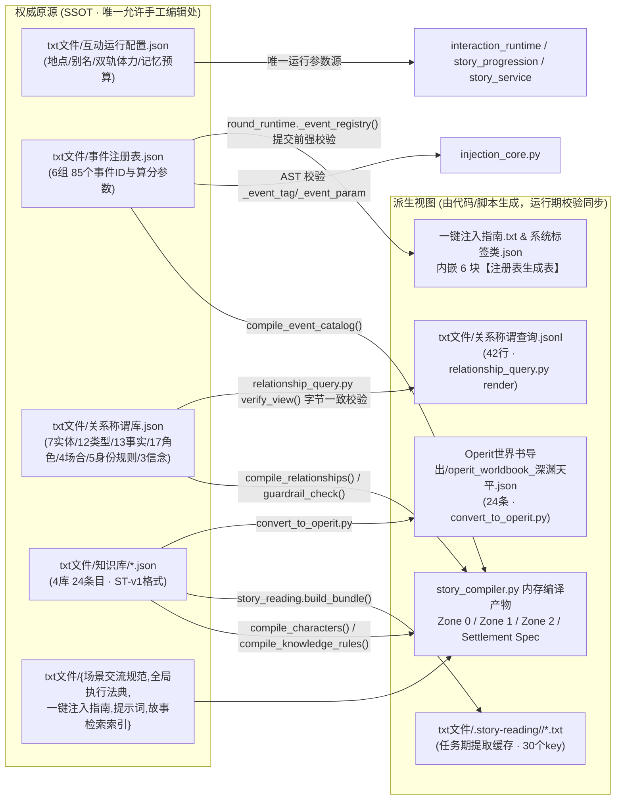

# 07 · 数据模型、SSOT 与文件格式规范

> **非数据源声明**：本文件为开发者架构参考文档，严禁作为 AI 剧情运行时提示词或世界书注入。

---

## 1. 单一事实来源（SSOT）与派生视图依赖图

本项目以严格的 **SSOT + 运行期指纹/逐字核验** 杜绝「改一处漏三处」的规则分裂：



### 修改权威源后的必做同步检查表

| 修改了哪个权威源 | 必须同步的派生文件与校验命令 |
|---|---|
| `txt文件/知识库/*.json` | 1) 运行 `python3 Operit世界书导出/convert_to_operit.py` 重建 `operit_worldbook_深渊天平.json`<br>2) 核对 [`开发者说明/世界书关键字配置.txt`](世界书关键字配置.txt)（若增删条目或改关键词） |
| `txt文件/关系称谓库.json` | 运行 `python3 relationship_query.py render > txt文件/关系称谓查询.jsonl` 后跑 `python3 relationship_query.py check` |
| `txt文件/事件注册表.json` | 同步更新 `txt文件/一键注入指南.txt` 与 `txt文件/知识库/系统标签类.json` 中对应的 `【注册表生成表开始】...【注册表生成表结束】` 块（否则 `round_runtime._event_registry()` 提交前直接拒收），并复检 `injection_core.py` AST 引用 |
| `txt文件/互动运行配置.json` | 校验 `story_progression.config()` 与 `interaction_runtime.location_aliases()` 合法性（尤其 `costs`/`intimate_continuation_costs`/`maximum`/`minimum_action`/`memory`/`shop`/`intel`/`passive`/`director` 键集不可缺） |
| `txt文件/世界变故库.json` | 通过 `story_progression.load_world_beats()` 校验结构与客观外部变故条款（零 AI 禁用套词、不越权代打、不泄密 K01），并跑 `test_living_director_v2.py` 与 `test_adult_systems_v3.py` |
| `txt文件/系统商城目录.json` | 通过 `story_progression.load_shop_catalog()` 校验价格档位区间、唯一 `SHOP-NNN`、`system_effect` 白名单及禁篡改时效红线，并跑 `test_task_shop.py` |
| `txt文件/商业情报目录.json` | 通过 `story_progression.load_intel_catalog()` 校验唯一 `INTEL-NNN`、`min_biz`、`min_su_ab_contacts`、`leverage_min_biz` 与目标 `effects` 合法性，并跑 `test_phase_ab_linkage.py` |

---

## 2. 权威配置文件 JSON Schema 详表

### 2.1 `txt文件/互动运行配置.json`
```json
{
  "version": 2,
  "locations": ["徐家主宅", "市中心顶层公寓", "大学", "工作室", "公司"],
  "operations": ["move_player", "transfer_item", "use_recovery_item", "use_item", "deploy_item", "retrieve_item", "inspect_deployed", "keepsake_action"],
  "resource": {
    "status": "active", "version": 2, "scheme": "fixed_tiers",
    "attribute": "体力",
    "costs": {"A": 5, "B": 10, "C": 15},
    "intimate_continuation_costs": {"A": 1, "B": 2, "C": 3},
    "intimate_stamina_floor": 10,
    "vigor_maximum": 100,
    "vigor_min_floor_guard": 15,
    "vigor_costs": {"A": 2, "B": 4, "C": 7, "release": 12},
    "custom_reserve": 15, "maximum": 100, "minimum_action": 5,
    "item_recovery_percent": 20,
    "recovery_cycle": "between_completed_overnight_sleeps",
    "overnight": "restore_to_maximum"
  },
  "progression": {
    "clock": "game_day_and_HH:MM",
    "close_memory": "cross_midnight_or_final_stamina_below_5",
    "actions": "accepted_paid_story_actions",
    "legacy_timers": "...", "stage_threshold": null, "game_minutes": null
  },
  "secret_disclosure": {"status": "pending", "rule": "..."},
  "memory": {
    "fact_chars": 160, "round_chars": 600, "l2_chars": 240, "l3_chars": 600,
    "l4_chars": 900, "context_chars": 6000, "history_turns": 6,
    "history_chars": 12000, "index_entries": 24
  },
  "location_aliases": {
    "家": "徐家主宅", "家里": "徐家主宅", "家中": "徐家主宅",
    "主宅": "徐家主宅", "徐家": "徐家主宅", "公寓": "市中心顶层公寓",
    "画室": "工作室", "校外画室": "工作室", "念薇画室": "工作室"
  },
  "shop": {
    "status": "active",
    "catalog": "txt文件/系统商城目录.json",
    "cost_stamina": 0
  },
  "intel": {
    "status": "active",
    "catalog": "txt文件/商业情报目录.json",
    "leverage_min_biz": 60,
    "cost_stamina": 0
  },
  "passive": {
    "status": "active",
    "cost_stamina": 0,
    "costs": {"1": 20, "2": 50, "3": 110, "4": 220}
  },
  "director": {
    "status": "active",
    "catalog": "txt文件/世界变故库.json",
    "base_prob": 0.08, "max_prob": 0.85,
    "stagnation_curve": [0.0, 0.07, 0.16, 0.28, 0.44, 0.62],
    "global_cooldown": 1, "soft_cooldown_penalty": 0.25,
    "tier_weights": {"tier1": 50, "tier2": 38, "tier3": 12},
    "scene_exit_threshold": 3,
    "track_weights": {"thread_spark": 45, "offstage_clock": 30, "preset_beat": 25},
    "max_active_threads": 5, "max_thread_age": 12,
    "channel_cooldown_window": 4, "clock_tick_interval": 3
  }
}
```

### 2.2 `txt文件/事件注册表.json`（6 组 85 条）
- 顶层：`{"version": 1, "groups": {<group>: [EventEntry, ...]}}`。
- 6 个事件组规模：`shame_events` (20，含 `SHAME_03` 好感联动、`SHAME_10` 确诊怀孕 `-30` 且锁顶 `<=35`、`SHAME_19` `心理破冰_暧昧试探`、`SHAME_20` `意外撞破_私密自渎`) · `depravity_events` (10，含 `DEPRAVITY_07/08/09` 渐进堕落与 `DEPRAVITY_10` `堕落_私密自渎`) · `ds_events` (18，含 `DS_05` 高潮回落、`DS_12` `恢复_小憩` `+15`、`DS_17` 绝顶体力扣减与 `DS_18` `自慰_暗中纾解`) · `affection_events` (11，含 `AFFECTION_10/11` 60+ 非越界成长) · **`host_events` (16**，含动态正则模板 `HOST_12: 兑换道具_X` 与新增 **`HOST_16: 情欲操控_温水攻心`** `+5分/+3经`) · `vigilance_events` (10)。
- 单条目固定 7 键：`id` (`^[A-Z]+_[0-9]{2}$`)、`tag`、`parameters`（具名数值字典）、`parameter_usage`（同键用途说明）、`description`、`pattern`（`null` 或模板正则）、`shared_parameters`（禁止循环或多级转引）。

### 2.3 `txt文件/关系称谓库.json` 与 `关系称谓查询.jsonl`
- 原库精确 8 键：`version: 1`、`entities`（`{short, status: "active"|"deceased"|"category"}`）、`types`（`{layer: "blood"|"social"|"legal", roles: []|[r1,r2]}`）、`facts`（`{type, subject, object, known_by: "*"|[entity...], text}`，同层无序实体对禁止重复或反向双写）、`roles`（`{label, self:{formal,relaxed,business,intimate}, address:{formal,relaxed,business,intimate}}`）、`title_rules`（支持可选 `target: "self" | "address"` 精准指定合入自称或称呼候选）、`beliefs`（`{holder, text}`）、`selection`（`{optional: true, rule}`）。
- 当前数据基线：7 个实体（5 活跃：沈知韫/苏婉青/徐念薇/徐承邺/徐志北；1 已故：徐家亡父；1 类别：次要NPC）、12 条公开事实 `R01–R12` + 1 条私有绝密 `K01`（`known_by: ["沈知韫"]`）、**5 条身份称谓规则**（`次要NPC → 苏婉青`：`少奶奶`/`苏女士`；`→ 沈知韫`：`沈董`/`董事长`；`→ 徐念薇`：`徐小姐`/`二小姐`；`→ 徐承邺`：`大少爷`/`徐总`/`徐先生`；`→ 徐志北`：`二少爷`/`徐少爷`/`徐先生`）、3 条信念 `B01–B03`，以及针对三女主私密失防语境的 `intimate` 场合专属称谓表。`relationship_query.py` 内置 `ELDER_ROLES` 与 `SENIOR_ADDRESS_ROLES`（纳入养姐/养兄/嫂子），常规场合自动剔除尊长及 `次要NPC` 直呼简称，常规自称仅晚辈面向长辈附带简称，`intimate` 场合保留显式失防称谓且仅对独处/失守的特定对象单独生效。
- 派生 `关系称谓查询.jsonl` 共 **42 行**：第 1 行为含 `source.sha256` 与 `resolver.sha256` 的元数据头；第 2–37 行为 36 条 `lore.称谓.<speaker>.<listener|未明确>`；第 38–42 行为 5 条 `lore.知情.<person>`。

### 2.4 `txt文件/知识库/*.json`（4 库 24 条，ST-v1 格式）
- 容器结构：`{version: 1, type: "lorebook", data: {id, name, description, enabled, entries: [...]}}`。
- 每条固定 13 键：`id`, `name`, `content`, `keywords[]`, `useRegex`, `caseSensitive`, `constantActive`, `enabled`, `priority`, `scanDepth`, `position`, `role`, `injectDepth`。
- 索引 key 通过正文内 `※索引key※ <prefix>.<name>` 声明（缺标时回退 `name.split('（', 1)[0]`）。共 **8 条 `constantActive: true`**（`lore.命名锁`, `lore.驻地`, `narrative.pace`, `narrative.sensory`, `narrative.dialogue_tts`, `sys.breakout`, `sys.task`, `char.徐志北`）+ **16 条按需/门控条目**（含双通道门控条目 `narrative.intimate` 与 `narrative.vigilance`）。

### 2.5 `txt文件/系统商城目录.json`（3 档 3 类 16 件商品 + 动态货架）
- 顶层：`{"version": 1, "tiers": {"low"|"mid"|"high": {"label", "min_price", "max_price"}}, "categories": {"sensual"|"covert"|"daily": {"label"}}, "items": [ShopItem, ...]}`。
- 单商品固定键：`id`（`^SHOP-\d+$` / 动态 `^DYN-\d+$`）、`name`、`tier`（`low: 1–10`、`mid: 11–50`、`high: 60–999999`）、`price`、`type`、`desc`、`duration`、`expire_rule`、`system_effect`（`""` / `host_stamina:<正整数>` / `buff:<名>:<1-4>:<说明>` / `deploy_device:<camera|audio|aroma>`）、`giftable`（布尔）、`max_per_save`（`null` 或正整数）；可选字段 `category`（`sensual`/`covert`/`daily`）、`usage_mode`（`gift`/`consumable_host`/`consumable_target`/`reusable_tool`/`deployable_device`；`SHOP-013` 为带 `buff:感官缚束:2` 的 `reusable_tool`）、`pack_qty`（单次兑换入囊件数）、`unlock_req`（4 轴 `{min_biz, min_any_affection, min_max_depravity, min_charm, mode}` 叠加门槛：`SHOP-011~014` 绑定魅力/最高堕落/嗅觉混合梯队，杜绝高开局好感穿透）。
- **硬红线校验**：`story_progression.load_shop_catalog()` 与 `validate_dynamic_shop_items()` 强制禁止毒品/迷药/催情药剂/烟草/精神控制及篡改时效的文案或效果。

### 2.6 `txt文件/商业情报目录.json`（3 条一次性商业情报）
- 顶层：`{"version": 1, "leverage_min_biz": 60, "items": [IntelItem, ...]}`。
- 单情报固定键：`id`（`^INTEL-\d+$`：`INTEL-001` 深圳账目异常 / `INTEL-002` 苏婉青眼线身份 / `INTEL-003` 徐承邺收购盲区）、`name`、`min_biz`（`10/30/60`）、`min_su_ab_contacts`（`0/3/0`）、`desc`、`effect_summary`（含 60+ 商业杠杆 3 次越界护盾与非目击警惕压制说明）、`effects`（按目标角色映射 `{attr, delta}` 或 `{host_bonus: {积分, 经验值, 商业嗅觉}}`）。

### 2.7 `txt文件/世界变故库.json`（v2 · 活体世界导演统一数据源）
- 顶层：`{"version": 2, "channels": {...}, "spark_matrix": {...}, "sensual_spark_matrix": {...}, "offstage_clocks": {...}, "beats": [WorldBeat, ...]}`。
- `channels`（8 类规范媒介通道）：`phone_msg`、`door_visit`、`object_trace`、`sensory_slip`、`third_party`、`schedule_clash`、`conversation_twist`、`offstage_ripple`。
- `spark_matrix` & `sensual_spark_matrix`：25×25 常规生活张力火花矩阵 + 专属私密情欲张力火花矩阵（由 `load_world_beats()` 透传），配 `moves.soft`（6 条）与 `moves.hard`（5 条）。
- `offstage_clocks`：4 条角色暗钟（`CLK_XCY` / `CLK_SZY` / `CLK_XNW` / `CLK_SWQ`），每条含 `owner`、`max_segments=4`、`soft_at=3`、`k01_guard` 与 2 个循环阶段 `phases[{label, channel_hint, soft_omen, hard_landing}]`。
- `beats`（**75 条**精选支点事件，含常规支点 + 1 条 `covert_risk` 装置风控 + **12 条 Tier-0 `category: "sensual_hook"` 感官契机** + **31 条 `category: "erotic_accident"` 四阶香艳突发意外**）：单条含 `id`、`tier`（`tier0`–`tier4`）、`category`、`channel`、`locations[]`、`required_cast[]`、`time_slots[]`、`min_vigilance`、`min_biz`、可选生理门控与 `requires_door_catch` 防瞬移字段、`weight`、`cooldown`、`once`、`seed_to_add`、`requires_seed`、`objective_event`。

---

## 3. 运行时快照与正式存档文件格式

### 3.1 `data.json`（前端展示与运行态快照）
`data.json` 由 `RoundStore` 每回合**最后覆写**，AI 与维护脚本绝不手写。正式互动（schema v3）落盘结构：
```json
{
  "round": 1,
  "sceneTitle": "徐家主宅",
  "storyNodes": [
    {"type": "narration", "text": "..."},
    {"type": "dialogue", "speaker": "沈知韫", "text": "..."}
  ],
  "presence": {
    "沈知韫": {"location": "徐家主宅", "reason": "周末居家主持家宴"},
    "徐念薇": {"location": "徐家主宅", "reason": "周日在家"},
    "苏婉青": {"location": "徐家主宅", "reason": "周日家庭午餐窗回主宅陪餐"},
    "徐志北": {"location": "徐家主宅", "reason": "在餐厅落座"}
  },
  "state_version": 1,
  "request_id": "prologue-...",
  "options_text": "",
  "prologue": {"request_id": "...", "scenario_id": "zhiyun_sunday_noon", "weekday": "周日", "title": "..."},
  "interaction": {"count": 1, "actions": 0, "last_sequence": 1, "segment_id": "prologue-..."},
  "story_runtime": {
    "version": 1, "clock": {"day": 1, "time": "11:50"},
    "memory_round": 1, "last_closed": 0, "phase": "ready",
    "item_recovered": 0, "action_index": 0, "closed_by": ""
  },
  "last_settlement": { "...": "最近一笔结算变动回执（含 weekday/schedule_moves/leverage_triggered/intel_consumed）" }
}
```

### 3.2 P3 自包含存档真相层（`存档/*.json`）、轻量化档槽与单向只读视图（`save_store.py`）

`存档/` 为完全自包含的累积事实层，单目录迁移即可在无 `.round-runtime/` 与 `data.json` 时零 500 恢复运行态：

- **`存档/save_state.json`（唯一机器状态真相）**：包含 `version: 2`、`panels`（开局默认：沈知韫 `好感 82 / 羞耻 100`、徐念薇 `好感 30 / 羞耻 96`、苏婉青 `好感 40 / 羞耻 92`，无徐承邺面板）、`presence`、`micro_states`、`buffs`、`counters`、**`mechanics`**、**`intimate`（`sub_location`、`privacy`、`clothing_state`、`intimate_beat`、`present_actors`、`active_scene_location`，及 v4 持久化子结构 `host_phys`、`body_dev`、`keepsakes`、`session_charm_gained`）**、`vigilance`、`tasks`（含 `pending_items` 队列）、`items`（`next_seq` + **`active` / `deployed` / `delivered`（封顶 40）/ `history`（封顶 50）四分仓** + `giftable` / `category` / `usage_mode` / `spot` / `hidden` / `installed_clock` / **`detected_risk`**）、`shop`（`redeemed` / `recent` / `echoes` / **`dynamic_catalog`** / `next_dyn_seq`）、`intel`（含 `held` / `consumed` / `su_ab_contacts` / `leverage_armed` / **`leverage_charges` `0..3`**）、`director`（含 **`sensual_drought`** / **`heroine_cd`**）、**`npc_mind`（4 人 `沈知韫/苏婉青/徐念薇/徐承邺` 的持久化暗箱心智：`mood`/`mood_ttl`/`preoccupation`/`impressions[<=2]`/`aff_delta_last`，仅喂给 AI 不暴露至前端）**、`lifecycle`、`runtime` 及 **`rendered_sha256`**（SHA-256 匹配时零解析直读 JSON，仅当遗留引擎沙盒改动 `.txt` 时经窄边界 `harvest_engine_txt_mutations()` 收割变动字段，严格不碰 `memory_store.json` 或 JSON 原生子系统）。
- **`存档/memory_store.json`（v2 三轨结构化记忆真相，取代旧 `存档/四层记忆.json`）**：
  - `version: 2`、`prologue_active`、`next_anchor_seq` / `next_episode_seq` / `next_chronicle_seq`；
  - `anchors`（上限 60）与 `resolved_anchors`（上限 40）：永久事实/约定/转折/线索/秘密锚点，单条含 `id`/`kind`/`importance`/`day`/`entities`/`known_by`/`text`，经 K01 绝密硬守卫自动剥离越权知情者；
  - `episodes`（热窗 24，硬上限 32）+ `pending_buffer`（满 4 条/360 字或地点/知情者/跨日/过夜自动封箱）：单幕含 `id`/`day`/`time_range`/`location`/`sub_location`/`entities`/`known_by`/`tags`/`summary`/`is_prologue`；
  - `chronicle`（上限 16 章）：达到 24 幕时由 Stage 2 搭车将最旧 8 幕折算为 `{id, day_range, episode_range, entities, public, views}` 分视角编年史。
- **`存档/近期演播.json`**：滚动保存最新 **16 幕**（`MAX_RECENT_SEGMENTS`）已接受演播原文与 `playback` 播放游标；刻意置于 `round_runtime.FILES` 之外，避免单纯推进播放进度改变世界版本指纹。
- **轻量化可回档存档槽（`.round-runtime/save-slots/<slot_id>/`）**：由 `存档清理器.py` 管理，单槽仅打包必要核心文件（`meta.json` 含 SHA-256 校验与摘要标签，`存档/{save_state,memory_store,近期演播}.json`、`data.json`、`.round-runtime/interaction/*.json`、`playback.json`），剔除日志、任务凭证与缓存；重置新档时实时生成初始结构并自动清退遗留 `存档/四层记忆.json`。
- **遗留旧档冷启动迁移与窄边界收割**：仅当目录缺失 JSON 时由 `migrate_from_legacy_texts()` 无损升级旧 `.txt`/v1 存档；常态运行零 `.txt` 正则解析。

### 3.3 `存档/全局记忆库.txt`（单向自动渲染的人类/手动只读视图）
由 `save_store.render_memory_txt()` 从 `save_state.json + memory_store.json` 单向渲染供人工与手动入口查阅（已移除冗余的 `▶ 上回合历史快照` 与序幕隐藏标记行），**区块锚点顺序严格固定**：

1. `【实时面板快照】` → `▶ 当前最新数值`（`[系统宿主]`、`[沈知韫]`、`[徐念薇]`、`[苏婉青]`；徐承邺无堕落面板，旧档读取自动兼容）
2. `【人物所在】`（`<角色>：<地点> | 事由：<事由>`）
3. `【当前激活微状态】`（三女主统一按 `momentary_ease | residual_tension | confusion_debt` 顺序渲染）
4. `【当前持久化状态与BUFF】`（`- [分类_名称] 剩余时效: X回合 (效果: ...)` 或 `- 无`）
5. `【回合计数器】`（4 破局计数 + 破局冷却 + 分角色 `空耗_连续未纾解_<名>` + `连续守护回合`）
6. `【情欲与空间态势】`（当前细分空间、隐私档位、着装层级、亲密续演节拍、房内参与者，及非默认的 `host_phys` 欲火/精力/癖好、`body_dev` 身体开发进度与 `keepsakes` 私密珍藏清单）
7. `【监视状态】`（`徐承邺位置：...` + 4 行 `徐承邺_<目标>：警惕 N | 发现 N | 发现几率 N[ | 动因：...]`）
8. `【任务状态】`（`当前任务：`、`最近完成：`、`待发道具：`（支持多行 `pending_items` 队列））
9. `【道具倒计时】`（由 `items.active` 与 `items.deployed` 双源派生：`ITEM-NNN：X回合 | 名称：... | 状态：进行中` 或 `（空）`）
10. `【商城与回响状态】`（`已兑统计：`、`最近兑换：`、`待播回响：`；前台内存中与 `【任务状态】` 一同剥离）
11. `【商业情报与杠杆状态】`（`持有情报：`、`已耗情报：`、`苏婉青AB接触：`、`商业杠杆预备：`；前台内存剥离原文）
12. `【世界导演状态】`（单行紧凑 JSON，前台头部投影自动剥离）
13. `【回合生命周期】`（单行紧凑 JSON：`version/round/micro/ab_streak/scopes/legacy_counters`）
14. 三轨记忆单向投影区（由 `save_store.layer_strings()` 从 `memory_store.json` 投影，仅作只读视图）：
    - `▲ 第一层：【即时运存区】`（最新热幕 + `pending_buffer` 暂存）
    - `▲ 第二层：【回想运存区】`（较早热幕 `episodes`）
    - `▲ 第三层：【近期事实缓存区】`（永久活跃锚点 `anchors`）
    - `▲ 第四层：【深渊纪元浓缩区】`（分视角编年史 `chronicle`）

### 3.4 `存档/徐志北道具图鉴.txt`（V3.0 单向自动渲染；含已部署装置区）
- **道具图鉴 V3.0**：由 `save_store.render_items_txt()` 单向渲染，以 `▼ 活跃道具区 ▼`、`▼ 已部署装置区 ▼`、`▼ 已交付道具区 ▼`、`▼ 已过期/已消耗道具历史区 ▼`、`▼ 格式模板区 ▼` 五锚点切分（含 `【分类】`、`【使用模式】`、`【安装点位】`、`【隐蔽部署】`、`【部署时间】`、`【暴露风险】` 与 `【可赠予】`），兼容 `scene_world.py` 边界识别；已交付道具独立隔离，商城重购同名绝不覆盖历史交付记录。
- **次要 NPC 名册与旧四层 JSON 已退役**：原 `存档/次要NPC名册.txt` 与 `存档/四层记忆.json` 已移除，偶发配角由 `memory_store.json` 与活体导演线头自然承载；`execute_injection(..., npc_entries=...)` 与 `update_npc_roster()` 保留为安全兼容空操作。

### 3.5 `voice_config.json`、`语音仓库/voice_repo.json` 与 `legacy_visibility.json`
- **`voice_config.json`**：顶层 `"__settings__": {"fish_tts_model": "s2.1-pro-free", "voice_tier": "free"}` + 各角色配置（默认 `language: "zh-CN"`、`quality_guard: true`、`normalize_loudness: true`、安全音量 `0.0 dB` / 苏婉青 `-1.0 dB`，`default` 槽位清空女声音色 ID 防错串；Fish 配置保留规范化参数 + `voice_ids` + `tts_model`，Edge 配置仅保留 `voice`/`rate`/`pitch`/`volume`；两侧均强制 `emotion: ""` 且兼容保留未知未来键）。玩家 Fish API Key 独立存于受保护本地缓存 `.cache/fish_api_key.json`（`0600`），绝不写入 `voice_config.json`。
- **`语音仓库/voice_repo.json`**：对象数组 `[{"id", "name", "note", "created_at"}]`，目录在首次收藏时懒创建。
- **`scene_chat_dev/src/legacy_visibility.json`**：`{"schema_version": 1, "entries": {"<sha256_hex>": {"known_by": [...], "basis": {"path", "start_line", "reason"}}}}`（`scene_world.py` 运行时强依赖）。

---

## 4. 保护边界与历史注释澄清

1. **严禁手写或提交的运行态与隐私资产**：根目录 `.git/`（绝对禁改）、`.cache/fish_api_key.json`、`.fish_api_key`、`data.json`、`存档/*`（仅在明确批准刷新仓库默认干净种子档时提交，日常运行态严禁顺带提交）、`voice_config.json`（仅在变更默认模板时显式提交）、`.round-runtime/`、`.scene-chat/`、`语音仓库/`、`txt文件/.story-reading/`、`txt文件/audio/`（玩家本地离线背景音景，受 `.gitignore` 与 `一键同步GitHub.py` 保护）、`日志/`、`vosi/`。
2. **关于 `.backup/` 的代码事实澄清**：`AGENTS.md` 与 `injection_core.py` 部分历史注释仍提及「`.backup/` 自动回滚点」，但**核查全仓代码后确认现役代码已没有任何写入 `.backup/` 的逻辑**——实际事务回滚完全由 `RoundStore` 的 `.round-runtime/journal.json`（与 `work-*` 沙箱）承载，轻量化可回档存档槽由 `存档清理器.py` 的 `.round-runtime/save-slots/`（兼容旧版 `.round-runtime/reset-backups/`）承载，GitHub 同步备份由 `一键同步GitHub.py` 的 `.sync-backup/` 承载。
