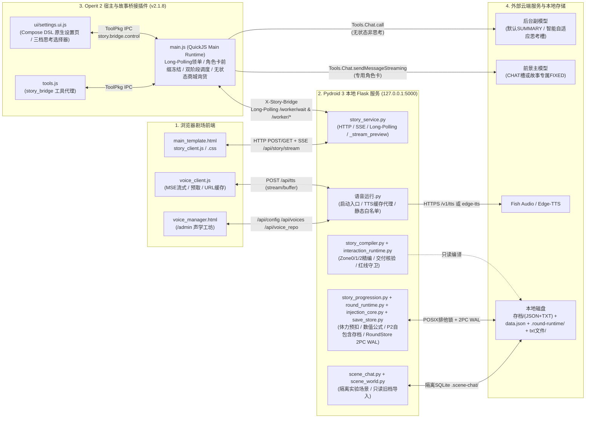
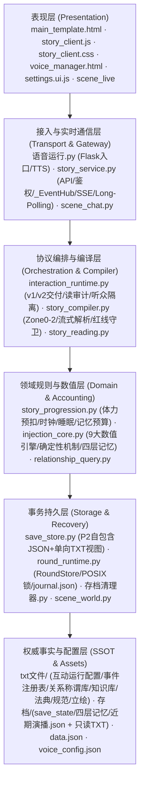
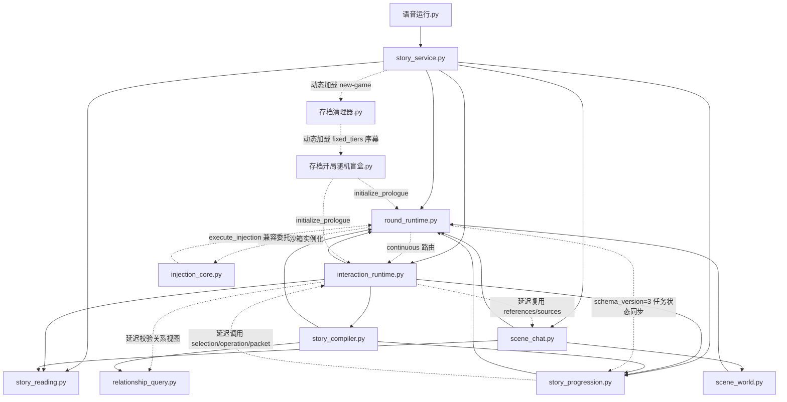
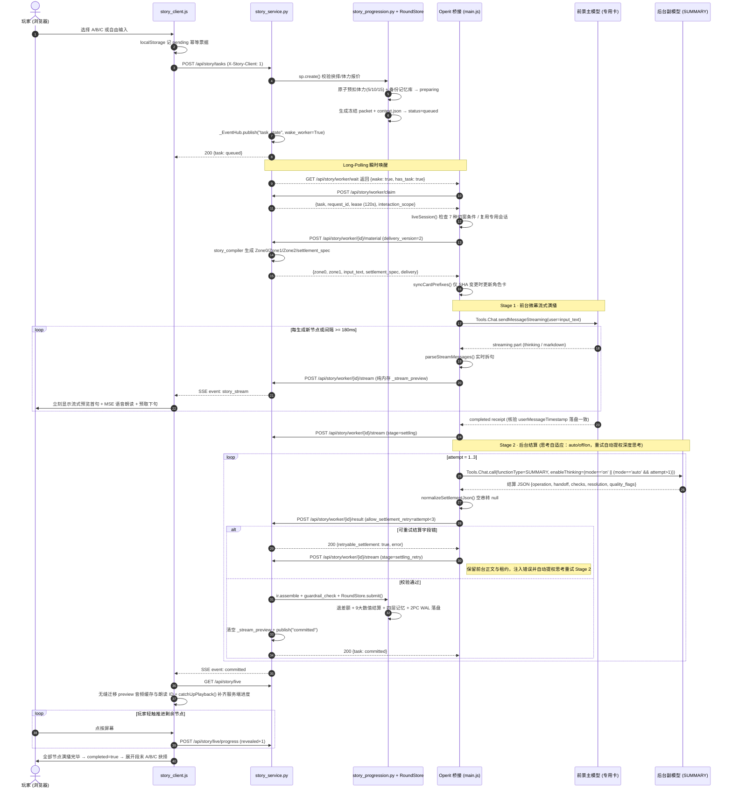

# 01 · 系统总架构与模块依赖

> **非数据源声明**：本文件为开发者架构参考文档，严禁作为 AI 剧情运行时提示词或世界书注入。

---

## 1. 系统运行拓扑（四端协同）

深渊天平引擎运行于单台 Android 设备（或开发用 Linux 桌面），由四个边界清晰的运行实体通过本机回环（`127.0.0.1:5000`）与 Operit 2 内部 IPC 协作：

### 各运行实体职责边界

| 实体 | 运行宿主 | 写权限 | 关键约束 |
|---|---|---|---|
| **浏览器前端** | 手机浏览器（Android 默认唤起雨见浏览器 `com.yjllq.chrome.beta`） | 仅写 `localStorage`（草稿、待发请求幂等票据、UI 偏好） | 剧情写接口须带 `X-Story-Client: 1`、语音配置写接口须带 `X-Voice-Client: 1` 且满足同源/本机回环校验；永不直接写存档 |
| **本地 Python 服务** | Pydroid 3（多线程 Flask `threaded=True`） | **唯一合法存档写者**（经 `RoundStore` 锁与 WAL） | `127.0.0.1:5000` 仅监听回环；启动时加载 `voice_config.json` 并注册全部路由 |
| **Operit 2 桥接插件** | Operit 2 QuickJS Main Runtime + Compose DSL UI | 仅写插件自身 `PluginConfig` 与专有 `ROLE_MARK` 角色卡 | 模型输出视为纯数据；工具访问白名单严格锁定只读文件工具（禁写文件、禁命令、禁 MCP） |
| **外部 LLM / TTS** | 云端 API（由 Operit 2 或本地 Fish Key 代理） | 无本地写权限 | Fish API Key 优先由玩家通过首页系统设定或 `/admin` 写入本地受保护缓存 `.cache/fish_api_key.json`（`0600`，`.gitignore` 与一键同步脚本双保护），回退进程环境变量 `FISH_API_KEY`，服务端绝不回显明文给浏览器 |

---

## 2. 软件分层架构

---

## 3. 全仓 Python 模块依赖图

下列依赖关系严格核对自各文件 `import` 语句（含运行时延迟导入）：

### 关键架构设计亮点：隔离实例化 `injection_core.py`
注意 `round_runtime._engine(root, base)`（[`round_runtime.py:117-139`](../round_runtime.py#L117-L139)）并**不**直接 `import injection_core` 修改全局路径，而是：
1. 新建独立 `types.ModuleType` 模块对象，将 `__file__` 指向临时暂存目录 `stage/injection_core.py`（从而自动将 `BASE_DIR`/`DATA_DIR`/`MEMORY_FILE`/`ITEM_FILE`/`DATA_JSON_FILE` 重定向到暂存目录）。
2. 在 `exec` 编译执行后，用 Python `ast.walk()` 静态扫描 `injection_core.py` 中每一处 `_event_tag(id)` 与 `_event_param(id, param)` 调用，确保每个引用都指向 `txt文件/事件注册表.json` 中存在的合法常量 ID 与参数键。
3. 如此既保证了 `injection_core.py` 内部逻辑的零侵入复用，又实现了**暂存沙箱隔离**与**注册表防漂移门禁**。

---

## 4. 五大入口模式全景对比

项目历史上经历了「手动脚本 → 完整回合桥接 → 隔离场景实验 → 正式连续互动 v1 → 双阶段前缀冻结 v2」的演进，当前代码清晰区隔了五种入口模式：

| 入口模式 | `entry_mode` / 交付标识 | 适用入口 | 资料交付方式 | 模型输出格式 | 事务落盘与数值结算 |
|---|---|---|---|---|---|
| **1. 正式双阶段流式（默认）** | `live_interaction` / `dual_stream_v2` | 首页 `/` + Operit 插件 v2.x | `story_compiler` 冻结 Zone 0/1 写入角色卡，每轮只发极小 Zone 2 delta | **前台**：`[N]`/`[A:名]`/`[D:名]` + `---DECISION---` **后台 `SUMMARY`**：裸 JSON `{operation, handoff, checks, resolution, quality_flags}` | `RoundStore` 原子落盘（schema v3）；三档体力预扣退款、时钟、睡眠、记忆预算、红线守卫 |
| **2. 正式单阶段精简（v2 备选）** | `live_interaction` / `single_prefix_v2` | 首页 `/`（桥接面板切换「单阶段」） | 同上 Zone 0/1（Zone 1 附带系统标签规则与事件白名单）+ Zone 2 delta | 单次裸 JSON `{messages, decision, operation, handoff, checks, resolution}` | 同上单一 `RoundStore` 事务；跳过 `/preflight`，支持 1 次 JSON 格式纠错 |
| **3. 正式程序直送 / 工具读（v1 兼容）** | `live_interaction` / `program_inline_v1` 或工具读 | 旧版桥接兼容 | v1 将完整 packet + 补读源内联至 user（≤2 MiB）；旧工具读用 `LIVE_READ_TOOLS` 分段读取 | 同上 6 键裸 JSON | 同上单一 `RoundStore` 事务；支持 1 次 `/preflight` 缺页补读 |
| **4. 隔离实验场景聊天** | `scene_chat` | `/scene-live`（候选页）与 `/scene-chat`（极简页） | 生成 `.scene-chat/<id>.txt`，模型用文件工具读全行；可选导入只读旧档快照 | 4 键裸 JSON `{messages (1-8), facts_delta: [], needs: [], handoff}` | 仅写 `.scene-chat/state.sqlite3`；**永不改正式存档**、无体力/道具/任务结算、上限 24 轮 |
| **5. 旧完整回合 / 手动世界书入口** | `story_bridge` 或手动对话 | 旧 `/api/story/snapshot` 或无桥接手动聊天 | 强制顺序读取三件套（记忆库→指南→法典）+ `story_reading.py` 提取包或世界书注入 | `story_semantics_v1` 裸 JSON 或调用 `execute_injection()` 的 Python 代码块 | 经 `RoundStore.submit()`（schema v1）落盘，写 7 段 `SYSTEM_LOG` 到 `日志/` |

---

## 5. 一次正式双阶段互动的端到端时序图

下图完整描绘了玩家在首页点击一个选项（或输入自由文本）到最终演播完成、消费抉择的全生命周期（`dual_stream_v2` 默认路径）：

---

## 6. 安全与隔离边界总览

虽然本项目部署在单机本地回环，服务端仍实现了纵深防御边界，防止浏览器跨站脚本、局域网误访问、外部并发编辑和提示词越权造成存档损坏：

1. **网络与同源边界（[`story_service.py`](../story_service.py) & [`语音运行.py`](../语音运行.py)）**：
   - 绑定 `127.0.0.1:5000`，同时在 `before_request` 中核验 `request.host` 仅限 `127.0.0.1` / `localhost` / `::1`。
   - 校验 `Origin` 必须精确等于 `request.host_url.rstrip('/')`，拒绝 `Sec-Fetch-Site: cross-site`。
   - 剧情浏览器写接口强制要求 `X-Story-Client: 1` 与 `application/json`；语音与配置写接口（`/api/fish_key`、`/api/voice_tier`、`/api/config`、`/api/voice_repo`）强制要求 `X-Voice-Client: 1`；Worker 接口强制校验请求头 `X-Story-Bridge` 与 `.round-runtime/story/bridge-key.json` 令牌（常量时间比对 `hmac.compare_digest`）。
   - Fish API Key 优先存于受保护的 `.cache/fish_api_key.json`（`0600` 原子写入，列入 `.gitignore` 与 `一键同步GitHub.py` `LOCAL_ONLY_FILES`），接口仅返掩码且上游报错自动脱敏。
2. **静态文件最小白名单（[`语音运行.py:770-795`](../语音运行.py#L770-L795)）**：
   - 禁用 Flask 默认 `static_folder`，`/<path:filename>` 仅放行 8 个明确枚举的公开文件与 `txt文件/image/` 下的合法图片扩展名，拒绝任何 `..` 或以 `.` 开头的路径段（阻断 `.env`、`.round-runtime/`、`bridge-key.json`、源码文件泄露）。
3. **桥接工具沙箱（[`main.js:21-23, 50-69`](../scene_chat_dev/local.story.operit_bridge/main.js#L21-L69)）**：
   - 专用角色卡 `toolAccessConfig` 强制清空 `allowedPackages` / `allowedSkills` / `allowedMcpServers`，仅允许白名单只读文件工具（正式互动仅 5 个：`read_file`, `read_file_full`, `read_file_part`, `file_info`, `grep_code`）。
   - 服务端在 `interaction_runtime.verify()` 二次审计实际工具调用记录，若出现任何越权工具或非本任务许可路径则直接拒收并退款。
4. **重置保护锁（`_reset_guard`）**：
   - 一旦检测到 `.round-runtime/reset-journal.json` 存在，说明上次新档重置意外中断，所有 `/api/story/*` 接口立即熔断返回 `RecoveryError`，防止在损坏半态继续写入。
