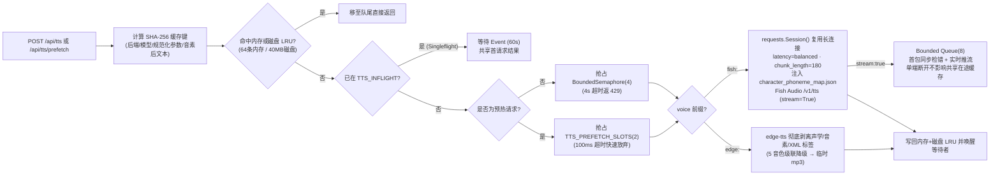

# 05 · 前端剧场与语音引擎架构

> **非数据源声明**：本文件为开发者架构参考文档，严禁作为 AI 剧情运行时提示词或世界书注入。
> **覆盖模块**：[`main_template.html`](../main_template.html)、[`story_client.js`](../story_client.js)、[`story_client.css`](../story_client.css)、[`voice_client.js`](../voice_client.js)、[`语音运行.py`](../语音运行.py)（TTS 子系统）、[`voice_manager.html`](../voice_manager.html)、[`scene_chat.html`](../scene_chat.html)、[`scene_chat_dev/src/scene_live/`](../scene_chat_dev/src/scene_live/)。

---

## 1. 正式剧场前端架构（`main_template.html` + `story_client.js` + `story_client.css`）

正式剧场采用零构建依赖的原生 HTML5 `<dialog>` + Vanilla ES2020 + CSS 自定义属性架构，单套页面自适应手机竖屏/横屏软键盘与桌面双栏布局。

### 1.1 DOM 分层与模态浮层

```text
<html data-theme="noir|ivory" data-time-of-day="dawn|day|dusk|night" data-font="normal|large" data-mood="calm|intimate|vigilance">
├── #ambientStage (z=0)          # 动态氛围层：当前场景空镜柔化幕布 + 氛围雨丝 (#ambientRain) + 建筑矢量 SVG (#sceneVectorLayer) + 光尘粒子
├── #tapRippleLayer (z=6)        # 点按星芒波纹层
├── header#topbar                # 顶部超薄 HUD（46px 移动 / 50px 桌面）：天平倾斜横梁 (#hudScalesBeam) / 地点与星期时钟 / 移动「凝视」胶囊 / 体力双环 / 音浪 / 设置
├── #topPeekDrawer               # 移动端顶栏下滑微抽屉（快速窥视当前在场主角剧照或场景空镜，软键盘弹起自动收起）
├── .layout
│   ├── aside.scene-info         # 桌面侧边栏（>=860px，320px 宽）：翻转焦点卡 (#sideFocusCard，有图展 3:4 剧照、无图/独处翻空镜档案卡)、零 404 在场人物表、快捷操作
│   ├── main#stream              # 主阅读舞台：分页加载 (#older)、空档星盘卡 (#empty)、暗金沉浸星盘幕布 (#stageCurtain)、剧情消息流 (#messages，含 21:9 空镜/16:9 角色电影插页与焦点景深阅读)
│   ├── section#settlement       # 悬浮非阻塞结算条（数值变动 / 体力退差 / 委托达成·领奖·新委托高亮胶囊）
│   └── footer#composer          # 情境底栏：状态条 / 强制休息卡 / 演播进度条 / 折叠抉择舱（悬停按压触发天平倾斜预演） / #bracketChips 快捷括号与情报亮牌芯片 / 自由输入框 / 移动 5 键 Dock
├── #gazeLens (z=90)             # 按住凝视 / 场景空镜 / 无图人物暗金档案卡浮层（按住速览、松手即回正文；轻触锁定细赏）
└── 原生 <dialog> 模态层
    ├── #worldDialog             # 六大档案中心（host 主角档案·商业情报杠杆 | roster 人物羁绊·BUFF·被动升级·警惕监测 | map 城市坐标 | bag 委托·行囊分栏 | shop 系统商城 | system 系统设定含 Fish 语音密钥缓存、三档音质切换、电影插页与景深开关、演播偏好忠实演绎/仅动作感官与幕布/流式显式切换）
    ├── #actionDialog            # 快捷行动抽屉（出行移动 move_player + 道具整组赠予 transfer_item）
    ├── #historyDialog           # 剧情编年史（全部 / 仅看对白 / 结算回执 三态过滤，纯紧凑文字不含插页）
    ├── #portraitDialog          # 全屏立绘查看器（#portraitOutfits 动态按后端 visual_assets 生成全部装束/情绪槽位按钮）
    ├── #connectionDialog        # 连接与桥接双端控制面板（主模型 / 副模型与功能槽改绑 / 思考自适应三档选择 / 切窗轮数 / 原始诊断 JSON）
    └── #newGameDialog           # 新档重置确认窗（幂等调用 POST /api/story/new-game）
```

### 1.2 前端状态模型与同步生命周期（`story_client.js`）

- **持久化状态（`localStorage`）**：
  - `abyss_official_live_v1`：`{epoch, draft, pending, voice}`。`pending` 在发送前先落盘，用于断网/刷新后通过 `GET /api/story/tasks/<request_id>` 核对是否已入队（404 开放重发或修改，避免重复扣费）。
  - `abyss_ui_prefs_v1`：`{theme: "noir"|"ivory", font: "normal"|"large", haptics: true, backdrop: true, cinemaPlates: true, readingDof: true, displayMode: "curtain"|"stream"}`。
- **服务端偏好持久化（`.round-runtime/story/prefs.json`）**：
  - 通过 `POST /api/story/preferences` 双端同步：`protagonist_style`（`faithful` 忠实演绎 / `silent` 仅动作感官）与 `settlement_thinking_mode`（`auto` 智能自适应 / `off` 常关 / `on` 常开）。
- **实时通道与降级（[`connectSSE()`](../story_client.js)）**：
  - 启动建立 `EventSource('/api/story/stream')`；收到 `story_stream` 直接调用 `applyStreamPreview()`（零额外请求），收到 `committed` / `task_state` / `bridge_state` / `save_reset` 防抖拉取 `GET /api/story/live`。
  - SSE 断线 3s 自动重连，并启用 **15 秒降级轮询**（仅在 `!document.hidden && !sseOpen` 时触发）。
  - 监听 `visibilitychange`（切后台停语音并断开 SSE，回前台重连刷新）与 `pagehide`（释放全部 Blob Object URL）。
- **代际隔离与五大零体力确定性交易**：一旦检测到 `fresh.save_epoch !== cache.epoch`（新档重置），自动清空本地草稿、`pending`、历史列表、流式预览与商城缓存 `shopCatalog`；在线、空闲且本段演播完毕时放行 `redeemShopItem()`、`claimTaskReward()`（支持 `pending_items` 多奖励队列逐条领取）、`upgradePassiveSkill()`、`acquireIntel()` 与 `toggleBusinessLeverage()`，提交后直接 `absorb(res.snapshot)` 刷新全部六大档案卡片（`worldSigFor()` 同步纳入 `weekday`、`buffs`、`vigilance`、`intel`、`micro_states`、`delivered_items`、`visual_assets` 与道具倒计时；行囊与赠予下拉框自动屏蔽 `giftable: false` 宿主专用物品）。

### 1.3 沉浸星盘暗金幕布、增量 DOM 补丁与零闪烁接管（`applyStreamPreview()` & `patchMessageTimeline()` & `absorb()`）

1. **暗金沉浸星盘幕布（`#stageCurtain`，默认开启）**：
   - 当任务进入 `settling` / `settling_retry` / `settling_failed` 时，`updateStageCurtain()` 自动升起带磨砂微光与旋转星盘的暗金帷幕，将正文舞台柔和遮罩并展示沉浸态势（如「命途结算中 · 正在编织因果」或重试提权提示「正在提权深度思考重试」）。
   - 副模型结算完成且正式段落就绪后幕布优雅渐隐，**彻底消除副模型结算时的屏幕闪烁、重刷跳动与结算失败返回时的出戏感**；玩家亦可在系统设置中自由切回 `stream`（原始实时流式预览）模式。
2. **`patchMessageTimeline()` 增量 DOM 补丁（消除全量重刷与跳变）**：
   - 彻底废弃暴力 `innerHTML = ''` 清屏重绘；基于 `dataset.renderKey` 逐一比对已存节点与新节点。
   - 对已有节点仅就地更新预览角标（`syncPreviewChrome()`），保持 DOM 元素身份与滚动位置完全稳定；
   - 进场动画 `.msg.is-fresh-enter` 仅对全新插入的末尾节点触发，杜绝已有节点在重新吸纳快照时反复触发 `msg-arrive` 动画闪烁。
3. **首句即播即读与滑动预热**：
   - 首条预览节点到达即自动置 `revealed = 1` 并启动语音朗读（ID 为 `preview:<request_id>:0`），同时触发 3 句滑动预取窗口（`schedulePrefetchWindow()`）；流式 TTS 遇 `400/401/403/413/429/503` 错误时直接止损，不再二次请求 `playBuffered`。
4. **落盘瞬间零中断无闪白接管**：
   - 当 SSE `committed` 带来正式 `segment_id` 时，`absorb()` 将 `audioCache` 中所有 `preview:<request_id>:<idx>` 键平滑映射为 `<segment_id>:<idx>`，避免重复请求 TTS；
   - 若当前正在朗读某条预览句，直接原地重写 `speakingMessageId` 与 `audioMessage.id`，设置 `seamlessVoiceHandoff = true` 跳过 `stopVoice()`，**音频连续不断档**；
   - 若玩家在流式预览期间已提前点按读到第 $k$ 句（$k > \text{server.revealed}$），`absorb()` 持有 `handoffPreview` 在 DOM 中保持已读句数不回缩闪白，并将 `catchingUp` 纳入 `baseBlocked()` 防 409 竞态，同时由 `catchUpPlayback()` 附带 `catchup: true` 单请求补发 `POST /api/story/live/progress` 对齐服务端游标（跳过中间预热）后再平滑交接。

### 1.4 玩家输入、括号硬输入、Fish 声学动态排版、五维属性映射与六大档案联动

- **逐句点按演播（`advance()`）**：轻触 `#stream`、按 `Enter`/`Space` 或点 `#advance`（防抖 250ms/300ms），触发触觉微振、星芒波纹与移动端静音 WAV 自动播放解锁（`unlock()`），步进 `POST /api/story/live/progress`；读完末句后才再点一次将 `completed` 置为 `true` 并升起段末 A/B/C 抉择舱。
- **括号硬输入与快捷筹码**：`textarea#input` 原文零损耗提交至 `POST /api/story/tasks`；玩家消息内的 `（...）`/`(...)` 通过 `appendPlayerRichText()` 渲染为 `.player-bracket` 暗金斜体高亮；输入框上方 `#bracketChips` 提供「＋（）括号动作」「＋（）内心想法」及已持有商业情报的「◆ 亮牌：…」一键填词芯片（在档案面板点击「带入对话亮牌」时自动展开折叠的 `deckCollapsed` 面板并保存草稿）。
- **Fish 声学标签 → 视觉动态排版（Kinetic Typography）与感官微高亮（`classifyVoiceTag()` & `appendNpcRichText()`）**：
  - 将原本仅用于 TTS 的 `[trembling]`、`[near whisper]`、`[breath catches]`、`[soft sobbing, exhausted]`、`[calm executive tone]` 等声学标签转化为行首情绪胶囊（`.voice-mood-tag`：`声线微颤 / 微距气音 / 呼吸急顿 / 失力余韵 / 冷冽克制`）与动态排版样式（`.fx-tremble` 设为 `inline-block` 使微幅颤栗动画生效、`.fx-whisper` 微距气音柔光、`.fx-catch` 呼吸急顿、`.fx-exhausted` 失力余韵、`.fx-restrained` 冷冽克制）；`appendNpcRichText()` 仅剥离英文 ASCII Fish 标签；
  - `[N]` 旁白在 `entry()` 中自动继承当前在场焦点女主的 `cStats` 生理氛围，高欲/高潮/体液锁定态下对拟声词（`.fx-moan`，仅高欲或带波浪/省略号时激活）、湿热体液词元（`.fx-fluid`，波纹柔光）、痉挛战栗词元（`.fx-spasm`，微幅脉颤）与角色敏感部位锚点词（`.sensory-anchor`，单条消息上限 3 处）施加精细视觉高亮；**历史回合（`!isLastTurn` / `inHistory`）严格隔离，绝不倒贴当前实时生理热度或微状态**。
- **五维沉浸式属性-文字互动映射**：
  1. **属性响应式消息卡片与生理/微状态胶囊（`entry()` & `getLiveCharStats()`）**：仅对当前活跃回合在场女主挂载 `data-arousal="high|peak"` 与 `data-defense="guarded|melted|blackout"` 动态改变气泡左缘边框与暖绯内光晕；并在说话人栏渲染 `.micro-state-chip` 胶囊（`孕期敏感` / `早孕微兆` / `危险期` / `体液锁定` / `生理断电` / `高潮 X%` / `自渎余韵` / `欲求未平` / `戒备微松` / `心绪失守` / `余韵未平`）。
  2. **按住凝视（`#gazeLens`）四维微缩 HUD（`buildGazeVitalsHud()`）**：在角色剧照底部叠加毛玻璃四维进度条（`好感 / 羞耻 / 欲望 / 高潮%`）及当前被动技能等级、体力、`已确诊怀孕 / 早孕微兆 / 危险期`、`内射 X次`、`体液锁定 ≥85/72/58`、`自渎余韵 / 欲求未平` 与微状态标签。
  3. **《极乐迪斯科》式被动与生理检定横幅（`buildDiscoCheckBanners()`）**：在最新段落流末尾内联插入 `.disco-check-banner` 叙事检定卡（`[洞察之瞳 Lv.1~4 · 检定成功]`、`[孕期本能 · 防线坍缩]`、`[生命微兆 · 潜伏着床]`、`[暗中自渎 · 把柄余韵]`、`[体液锁定 · 激素共振]`、`[认知欺诈 · 合理化闭环]`、`[疲劳诱导 Lv.3 · 躯体代偿]`、`[暗流渗漏 · 被动触发]`）。
  4. **`<ruby>` 双层潜台词（对白与动作双通道可视）**：前台提示词支持在 `[D:角色姓名]` 台词与 `[A:角色姓名]` 动作行中使用 `｛表面言行｜真实潜台词/生理失控破绽｝` 语法，前端自动渲染为 `<ruby class="subtext-ruby">` 双层注音，并通过 `stripSubtextForTts()`、`stripVoiceTags()` 及服务端 `语音运行.py:tts_api()` 双端剥离潜台词，确保 `/api/tts` 仅朗读表层文本。
  5. **绝顶/内射/确诊怀孕/破锁/失守舞台脉冲与选项属性共鸣徽章（`checkTurnStageEffects()` & `deriveOptionResonance()`）**：后端 `panel_values()` 同步追踪布尔 `怀孕` 状态变化，当结算回执出现确诊怀孕、内射注入、高潮清算、堕落破锁或防线崩溃时触发 `#ambientStage`（`.fx-stage-climax / .fx-stage-unlock / .fx-stage-meltdown`）剧场光晕脉冲；段末 A/B/C 抉择卡头部动态展示当前态势共鸣徽章（`.option-resonance-badge`）。
- **文字优先触感交互闭环**：
  - **单句一键引用（`quoteLineToInput()`）**：每条 NPC 对白提供「引用」按钮，点击自动展开折叠面板并把精简摘录带括号视角填入输入框。
  - **按住凝视 / 轻触细赏（`bindHoldGaze()`）**：在角色微头像、说话人姓名、头栏「凝视 ◉ / 档案 ◈」或角色插页上按住（> 190ms，带 10px 滑动防误触与松手防重触发）唤出 `#gazeLens` 速览（含四维微缩 HUD），松手即回正文；轻触有图角色进全屏 `#portraitDialog`，轻触无图角色（徐承邺 / 次要 NPC / AI 动态路人）自然展露「同场景电影空镜 + 暗金人物档案卡」。
  - **抉择天平倾斜预演与显式转场徽标（`previewChoiceWeight()` & 方案 2B）**：悬停/聚焦/按压 A/B/C 抉择卡时，顶栏 `#hudScalesBeam` 按档位倾斜（`-5° / 0° / +9°`）并实时预演扣后体力圆环；若选项携带 `opt.operation = {code: 'move_player', destination}`，卡片头部同步渲染鎏金 `前往 · 地点` 徽标（`.option-head` / `.option-move-badge`），点击直接调用 `enqueue(opt.text, opt.operation || null, opt.id)` 触发转场。
  - **焦点景深阅读（`applyReadingFocus()`）**：处于对话流底部时最新一段保持全清晰，上文轻柔退远（`opacity: 0.72`），向上回翻自动解除，可在系统设定随时开关。
- **六大档案中心与结算明细全链路联动**：
  - **主角档案（`host`）**：「积分」直达「商城」，「经验值」直达「人物羁绊」被动升级；含「商业嗅觉与一次性情报」面板（4 档进度、3 条情报入库、商业杠杆武装/解除与亮牌填词）。
  - **人物羁绊（`roster`）**：按 `hasCharacterPortrait()` 动态识别立绘，分角色精确锁定居家装束（`苏婉青 → 市中心顶层公寓`、`沈知韫/徐念薇 → 徐家主宅`，`工作室` 恒用外出装 `fullbody`）；`worldSigFor()` 与名册完整呈现 `world.physiology`（生理周期/早孕倒计时 `latent_days_left`/体液锁定/欲求积压/自渎余韵）、活跃 BUFF、女主经验被动升级卡与徐承邺警惕监测卡（严格隐藏 `发现几率`）；`settlementCard` 补齐 `schedule_moves`、`leverage_triggered`、`intel_consumed` 明细展示。
  - **委托·行囊（`bag`）**：奖励预览、待领奖励零体力一键领取卡、商城入口，以及「随身持有（带倒计时徽章）」/「已赠予纪念」分栏。
  - **系统商城（`shop`）与系统设定（`system`）**：三档货架 0 体力兑换与结算条高亮胶囊；系统设定涵盖主题、字号、触感微振、场景氛围光影、电影插页、焦点景深阅读 6 项开关，以及 **Fish Audio 密钥受保护缓存管理（掩码状态/保存/清除）与三档语音模型切换（免费默认 `s2.1-pro-free` / 高并发 `s2.1-pro` / 旗舰 `drama-3`）**。
- **网页 ↔ Operit 桥接面板双端联动**：`#connectionDialog` 所有开关/下拉框向 `POST /api/story/bridge/control` 发令，Operit 侧变更经 `/api/story/worker/control` → SSE `bridge_state` 实时回刷网页。

### 1.5 视觉设计系统、统一排版规则与零配置图包发现（`story_client.css` + `visual_assets`）

- **单一统一气泡规则与动作/对白结构化视觉分流（根治动作与台词混淆）**：
  - **动作与对白结构化分流**：非主角动作（`.msg.action:not(.player)`）彻底移除大头像肖像与沉重的「凝视 ◉」按钮，采用通栏点线舞台带（`.action-strip`）+ `18px` 行内微头像徽章（`.action-mini-avatar`）+ 纯正宋体 Serif 排版（杜绝 CJK 伪斜体硬倾斜导致的文字变畸）；角色对白（`.msg.dialogue`）保留 `38×46` 独立头像肖像、实心气泡、左侧 `3px` 角色专属重音条与轻量 `「」` 引号线索；玩家角色动作与发言（`.player`）独立采用暗金边框与斜体括号高亮；
  - **纯台词硬锁**：`[D:角色名]` 严格只允许角色真实说出口的纯台词（及行首/句中 Fish 声学标签），严禁夹带 Markdown 外层引号或“她端起杯子抿了一口：”等动作神态叙述；
  - **微头像与纯文学竖线**：三大女主（`沈知韫`、`苏婉青`、`徐念薇`）、主角（`徐志北`）及任何后续在 `txt文件/image/<角色名>/` 放入图片的角色自动渲染竖版圆角微头像；徐承邺、次要 NPC 及 AI 动态路人自动采用 `.msg.no-avatar` 全宽纯文学竖线排版，绝不出现空白头像列或 404 请求。
- **电影插页与自动图包发现**：后端 `interaction_runtime.scan_visual_assets()` 扫描 `txt文件/image/scenes/`（5 大地点 8 张 `1600×900 WebP` 无人空镜占位图，含 `.nomedia`）与 `txt文件/image/<角色名>/`，同槽位多扩展名时按**最新 `mtime` 优先**并附 `?v=<mtime>` 配合服务端 `max-age=86400` 缓存；切场自动插入 `21:9` 空镜横幅，有图角色同场首现或状态切换插入 `16:9` 剧照横幅（带滚动轻视差 `updatePlateParallax()`），且按地点/昼夜/微状态/欲望/羞耻/警惕自动优先匹配可选情绪图（`mood_blush` / `mood_desire` / `mood_cold` / `mood_sleep`）。现有 10 张 4K PNG 立绘原样保留。
- **双主题、时辰情绪光影与响应式**：`noir`（深黑暖金）与 `ivory`（暖纸墨金）；按游戏时钟（`data-time-of-day`）与场内态势（`data-mood="calm|intimate|vigilance"`）动态渲染背景空镜幕布、雨丝与光晕；`window.visualViewport` 软键盘高度 > `120px` 时自动挂 `.kb-open` 并收起 `#topPeekDrawer`；`>=860px` 切换为 `320px + 1fr` 桌面双栏并启用右侧 `#sideFocusCard` 翻转焦点卡，完整支持 `prefers-reduced-motion`。

---

## 2. 语音引擎与声学工坊架构

### 2.1 服务端双后端、Singleflight 去重与流式代理（`语音运行.py`）



- **核心工程细节**：
  - **Fish Audio 提速、Session 连接池与极速参数**：全局通过 `_FISH_HTTP_SESSION = requests.Session()` 复用长连接池（`pool_connections=4, pool_maxsize=6`，通过 `_fish_http_post`/`_fish_http_get` 保持测试 monkeypatch 兼容），彻底避免重复 TCP/TLS 握手（单次提速 300~500ms）；默认启用 `latency: "balanced"` 与分块长度 `chunk_length: 180`（旁白 200），首包响应延迟显著压低；429 限流时自动触发指数退避冷却（`_record_fish_429`，4s~32s），冷却恢复前安全快速降级保护账号。
  - **40MB 本地磁盘 LRU 缓存（`.cache/tts_audio/`）**：在原 64 条内存 LRU 基础上接入持久化磁盘 LRU，跨进程重启不丢热点音频；自动控制总量 ≤ 40MB，LRU 淘汰。
  - **闲置滑动窗口预合成（`POST /api/tts/prefetch` + `schedulePrefetchWindow()`）**：演播推进或流式到达时，前端调用 `VoiceClient.prefetchBatch()` 向后批量预取接下来 3 句台词；服务端分配独立的 `TTS_PREFETCH_SLOTS=2` 信号量并发合成，若 100ms 内无法获取槽位立即安全跳过，绝不抢占前台正在播放句子的实时带宽与并发。
  - **支持后端与默认分档**：Fish Audio 支持三档快捷切换（`POST /api/voice_tier`）：**免费默认 `free`（`s2.1-pro-free`）** / 高并发 `pro`（`s2.1-pro`） / 旗舰 `drama`（`drama-3`），同时兼容 `s2-pro`；默认开启 `language: "zh-CN"`、`quality_guard: true` 与 `normalize_loudness: true`（安全音量 `0.0 dB` / 苏婉青 `-1.0 dB`）；`s2.1-pro*` 显式省略无效参数 `repetition_penalty`，非 `drama-3` 自动剥离 `<...>` XML 标签；Edge-TTS 作为免费降级，自动剥离全部声学/音素/XML 标记并将已下线的 `YunzeNeural`/`XiaozhenNeural` 映射为 `YunyangNeural`。
  - **密钥安全与本地受保护缓存**：源码彻底移除硬编码密钥；动态解析顺序为 `X-Fish-Api-Key` 请求头 → 本地受保护缓存 `.cache/fish_api_key.json`（`0600` 原子写入，受 `.gitignore`、`一键同步GitHub.py` 与 `存档清理器.py` 三重保护）→ 进程环境变量 `FISH_API_KEY`。通过 `GET/POST/DELETE /api/fish_key` 管理且仅返回掩码与来源，上游异常日志自动脱敏；未配置时 `/api/voices` 返回提示，`/api/tts` 返回 `503`。
  - **角色多音字音素表自动接入**：`语音引擎升级方案/character_phoneme_map.json` 已由 `_apply_fish_phonemes()` 正式接入 `语音运行.py`，仅对 Fish 后端按 `speaker` 精准注入角色多音字音素，Edge 路径绝不透传 `<|phoneme_start|>` 标记。
  - **流式首包同步检错与单端断开解耦（[`_stream_cached_tts()`](../语音运行.py)）**：后台线程拉取音频塞入 `Queue(maxsize=8)`，Flask 视图先同步等待首条队列消息（最多 60s）；若上游直接返回 429/502/504，浏览器收到准确的 HTTP 错误 JSON 而非损坏的 `200 audio/mpeg` 流；单客户端切句中止时不再毒化共享的 Singleflight 在途缓存。
  - **配置损坏零覆写（[`_load_config()`](../语音运行.py)）**：`voice_config.json` 若手工改坏，GET 返 `503`、POST 返 `409`，绝不自动重置覆盖；每次保存强制清空 `emotion: ""`（情绪只来自对白内标签或试听临时参数），且 `default` 槽位清空女声音色 ID 杜绝错串。

### 2.2 前端共享传输库（`voice_client.js`）、4 角色发声白名单与播放编排分工

| 层次 | 文件 | 职责 |
|---|---|---|
| **底层传输库** | [`voice_client.js`](../voice_client.js) (`window.VoiceClient`) | 参数镜像钳位 `normalizeFish()`（默认 `s2.1-pro-free`、`latency: 'balanced'`、`chunk_length: 180`、`language: 'zh-CN'`、`quality_guard: true`）、批量滑动预热 `prefetchBatch(items)`、请求载荷构造 `buildPayload()`（透传 `speaker`）、统一附带 `X-Voice-Client: 1` CSRF 头的 `requestJson()`、导出 `getFishKeyStatus`/`saveFishKey`/`clearFishKey`/`setVoiceTier`、命名取消通道（`'live'`/`'prefetch'`/`'preview'`/`'scene'`）、有界字节读取 `requestAudio({maxBytes})`、**MSE `audio/mpeg` 边下边播 `requestStream()`**、带当前播放固定保护（`pin()`）的 LRU `AudioUrlStore` |
| **剧场编排层** | [`story_client.js`](../story_client.js) | **严格 4 角色发声白名单**（`VOICED_SPEAKERS` + `resolveVoiceSpeaker()`：仅 `沈知韫`、`苏婉青`、`徐念薇`、`旁白` 允许发声，三大女主的 `[A:]` 动作节点经 `旁白` 朗读；`徐志北`、`徐承邺` 及所有次要 NPC 严格静音、不渲染重听按钮且发出 **0 次** `/api/tts` 请求）；演播推进或流式到达自动触发 3 句滑动预取（`schedulePrefetchWindow()`）；首页系统设定内嵌 Fish Key 缓存管理、三档音质切换卡片与演播风格/幕布切换；移动端首次手势静音 WAV 解锁（`unlock()`）、逐句点按播报、`AudioUrlStore(8, 16MiB)` 有界池、MSE 失败自动降级缓冲播放（4xx/503 不重复发包）、预览转正零断音无闪白交接 |
| **调音台界面** | [`voice_manager.html`](../voice_manager.html) (`/admin`) | 顶栏 Fish API Key 受保护缓存管理、三档语音模型快捷切换与 4 角色发声白名单提示；试听文本自动剥离 `｛表层｜潜台词｝`、内联属性与 `testVoice` 按钮查找经 `escapeJsStr()` + `data-test-char` 安全转义；角色分页参数调优（试听透传 `speaker`、S2.1 自动禁用 `repetition_penalty`、取消勾选 `normalize_loudness` 时自动提醒音量钳位防爆音）；所有写请求统一经 `VoiceClient.requestJson` 携带 `X-Voice-Client: 1` |

> **`语音引擎升级方案/` 落地状态说明**：目录内调研的 `s2.1-pro-free` / `s2.1-pro` / `drama-3` / `s2-pro`、`normalize_loudness`、编码/码率/采样率、`language`/`normalize`、`max_new_tokens`/`early_stop_threshold`/`quality_guard`/`pronunciation_dictionary` 以及 **`character_phoneme_map.json` 角色音素映射** 均**已正式集成到现役主程序**；目录内的 `01~04_*.md` 进阶设计稿与独立脚本 `voice_design_generator.py`（`/v1/voice-design`）仍保留为离线参考/造音工具。

---

## 3. 三套前端页面定位对比

| 维度 | 正式剧场 `/` (`main_template.html`) | 同席候选页 `/scene-live` (`scene_chat_dev/src/scene_live/`) | 极简实验页 `/scene-chat` (`scene_chat.html`) |
|---|---|---|---|
| **后端命名空间与存储** | `live_interaction` · `RoundStore` 正式事务 | `scene_chat` · `.scene-chat/` 隔离 SQLite | `scene_chat` · `.scene-chat/` 隔离 SQLite |
| **实时同步** | SSE `/api/story/stream` + 15s 降级轮询 | 2.5s 轮询 | 2.5s 轮询 |
| **流式预览与演播** | 双阶段流式预览 + 逐句点按 + 段末 A/B/C 与自由输入 | 整段展示 + 自由输入（上限 24 轮） | 整段展示 + 自由输入（上限 24 轮） |
| **语音能力** | MSE 自动流式 + 缓冲降级 + 250ms 有界预取 + 单句重听 | 无语音 | 手动单句缓冲播放按钮 |
| **世界状态与控制** | 六大档案中心（含商城/情报杠杆/被动升级/警惕监测）、SVG 结算条、新档重置、完整双端桥接面板 | 只读导入正式存档快照（`legacy_visibility.json`）+ 场景列表 | 仅新建临时 1–2 人场景与只读连接 JSON |
