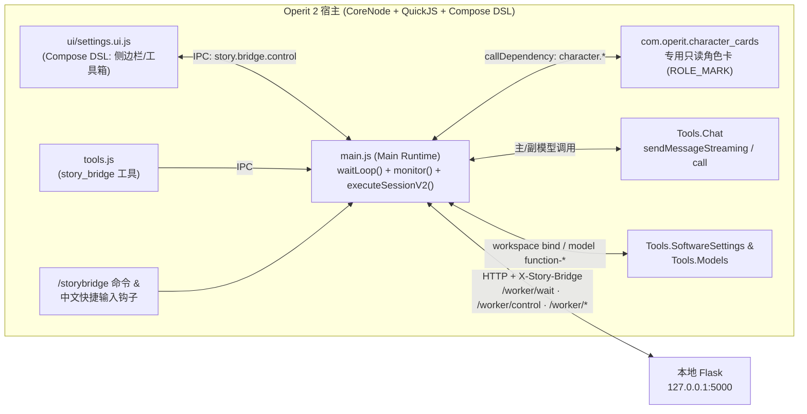

# 06 · Operit 2 桥接插件架构

> **非数据源声明**：本文件为开发者架构参考文档，严禁作为 AI 剧情运行时提示词或世界书注入。
> **源码唯一入口**：[`scene_chat_dev/local.story.operit_bridge/`](../scene_chat_dev/local.story.operit_bridge/)（版本 **2.1.4**，Operit API `2.0.0`，插件 ID `local.story.operit_bridge`，子包 `story_bridge`）。
> **成品与构建**：[`scene_chat_dev/build.py`](../scene_chat_dev/build.py) → `scene_chat_dev/artifacts/故事桥接-continuous-2.1.4.toolpkg`（验包通过后自动清理旧版 `.toolpkg`）。

---

## 1. Operit 2 平台官方参考与宿主运行时机制

本桥接插件构建于开源跨设备 AI Agent 平台 **Operit 2**（Rust Core + Flutter App + 平台 Host + ToolPkg 扩展运行时，AGPL-3.0）之上。Operit 2 当前处于 **Preview 阶段**，插件契约、宿主 API 与数据格式可能随上游演进调整；开发或排查插件问题时，应以下列官方权威资料与本仓随附类型声明为准。

### 1.1 Operit 2 官方资源与知识库索引

| 资源 | 链接 / 路径 | 用途 |
|---|---|---|
| **官方下载页** | https://operit.app/#/v2/download | 获取各平台最新 Operit 2 安装包与发布说明 |
| **官方源码仓库（GitHub）** | https://github.com/AAswordman/Operit2 （`https://github.com/AAswordman/Operit2.git`） | Rust Core（`core/`）、Flutter 应用（`apps/`）、平台 Host（`hosts/`）与官方插件/SDK 源码（`plugins/`） |
| **官方知识库源码（Wiki 仓库）** | https://github.com/luojiaping/Operit2-wiki | Operit 2 架构、核心模块、角色卡、ToolPkg/Compose DSL 专题 Wiki 源码 |
| **官方在线知识库（Wiki 网站）** | https://luojiaping.github.io/Operit2-wiki | 在线查阅 Operit 2 架构文档、插件体系、模型与同步指南 |
| **上游插件作者手册（仓库内）** | `AAswordman/Operit2` → `plugins/docs/README.md`、`PUBLIC_API.md`、`UI_NAVIGATION.md`、`package_builder/PLUGIN_CREATION_WORKFLOW.md`、`worldbook-regex.md`、`core/crates/plugin/sdk/README.md` | ToolPkg 打包、前置依赖公共 API、UI 导航、工作流与世界书正则权威规范 |
| **本项目离线 SDK 类型镜像** | [`scene_chat_dev/types/`](../scene_chat_dev/types/)（30 份官方 `.d.ts` 声明，由 `operit-plugin-sdk` Rust 声明生成） | 离线查阅 `ToolPkg`、`Tools.Chat`、`Tools.Models`、`Tools.SoftwareSettings`、`PluginConfig`、`ComposeDslScreen`、`RuntimeContext`、`QuickJS` 全局接口（目录根置 `.nomedia` 防止安卓相册误扫） |

### 1.2 Operit 2 宿主权限边界与 VFS 路径隔离

- **四层由外向内收紧的权限模型**：
  `0. App Runtime Sandbox（应用沙箱/容器）` → `1. Host Authorization（操作系统实际授予的文件/终端/网络权限）` → `2. AI Capability Limit（ReadOnly / WorkspaceWrite / Full）` → `3. User Tool Approval（单次工具调用的 allow/ask/deny）`。
- **VFS 与终端路径隔离**：
  - `Tools.Files` 与 `workspace bind` 使用 Operit 2 **VFS 虚拟路径**（如 `/virtual/android/documents/...`、`/operitapp/data/...`）；
  - 终端 Shell（Termux / proot）与 Pydroid 3 使用操作系统真实路径（如 `/storage/emulated/0/互动对话项目/Gemini网页版`）；两者不可混传。
- **插件安装区与运行缓存（Operit VFS 路径）**：

| Operit VFS 路径 | 用途与维护注意 |
|---|---|
| `/operitapp/data/extensions/device/packages/` | 设备级安装区；本项目 `installation_scope: "device"` 即安装于此（`故事桥接.toolpkg`）。**日常开发切勿直接修改此目录**，须改源码 → `build.py` → 同 ID 覆盖导入 |
| `/operitapp/data/extensions/space/packages/` | 多设备 Space 级共享扩展安装区 |
| `/operitapp/data/cache/toolpkg/` | 运行时按需解压缓存（诊断只读参考，不能用于判断真实安装或启用状态） |

### 1.3 ToolPkg v2 多运行时隔离与通信边界

Operit 2 通过 `ToolPkgLoader`（`loadToolPkgFromExternalFile`）加载 `.toolpkg` ZIP 归档，校验 `manifest.json` 必填的 `toolpkg_id` / `version` / `api_version`（**省略 `api_version` 会默认降级 `1.0.0`**，因此本插件显式锁定 `"api_version": "2.0.0"`）。同一插件内部运行在三个隔离的 QuickJS / UI 上下文中：

1. **Main Runtime（`main.js`）**：常驻主运行时，承载全局状态、定时器、Long-Polling、事件监听、IPC 服务端与依赖调用。
2. **Subpackage Runtime（`tools.js`）**：按工具调用触发的子包入口，不与 Main Runtime 共享 JS 内存，通过包内私有 `ToolPkg.ipc.call(channel, payload, { targetRuntime: 'main' })` 通信（原生 IPC 禁止跨包直调）。
3. **Compose DSL UI Runtime（`ui/settings.ui.js`）**：独立 UI 渲染上下文（ABI 4 布局程序），由 `ComposeDslScreen(ctx)` 产出 `ComposeNode` 树，通过 `ToolPkg.ipc.call` 与 Main Runtime 交换 JSON 快照；异步回调须用 `ctx.useRef` 镜像 `ctx.useState` 以规避闭包陈旧。
4. **跨插件公共 API（`requires` + `ToolPkg.callDependency`）**：
   - 依据 Operit 2 `PUBLIC_API.md` 规范，跨包不允许 `require` 或私有 IPC，必须先在 `manifest.json` 的 `requires` 声明前置包与最低版本（本插件声明 `com.operit.character_cards >= 0.2.0`），运行时通过 `ToolPkg.callDependency(pkgId, method, payload)` 经 JSON 边界异步调用提供方通过 `ToolPkg.registerApi` 显式暴露的公开方法（单次超时 **60s**，且禁止在 `registerToolPkg()` 注册阶段调用）。

### 1.4 底层原理：为什么 Zone 0 / Zone 1 冻结前缀能精确命中 KV 缓存

Operit 2 内置角色卡插件 `com.operit.character_cards` 的底层实现决定了本项目的两区冻结策略：
- **会话绑定机制**：一次会话的绑定选择串只有三种形态：`card:<id>`、`group:<id>` 或 `model:chat`。调用 `Tools.Chat.createNew({ setAsCurrentChat: false, input: { 'com.operit.character_cards': { version: 1, selection: 'card:' + participantId } } })` 时，角色卡插件经 `beforeChatCreate` 预写草稿绑定并提交到插件自身存储，使专用会话独立于用户主聊天。
- **固定顺序提示词组装（`combineCharacterPrompt`）**：执行 `CHAT` 对话时，`com.operit.character_cards` 按**严格固定顺序**拼装系统提示词 `introPrompt`（各段以 `\n\n` 连接）：
  1. `characterSetting`（← **本项目写入全局不变的 Zone 0**）
  2. `otherContentChat`（← **本项目写入场景级半静态 Zone 1**）
  3. `attachedTagIds` 对应标签内容（← **本插件强制锁死 `[]`**）
  4. 高级自定义提示词（空）
- **缓存收益**：由于 `characterSetting` 位于最前且全局不变、`otherContentChat` 仅在切换场景或阵容时更新，底层发往 LLM 的系统提示词前缀可实现**字节级完全稳定**，从而最大化 Gemini / DeepSeek 隐式前缀 KV 缓存命中。

### 1.5 本插件使用的 Operit 2 宿主 API 速查表

| 宿主 API | 本插件调用点 | 语义与注意事项 |
|---|---|---|
| `PluginConfig.use(name, defaults)` / `PluginConfig.flush(cfg)` | `settings()`、状态变更落盘 | 内存映射 JSON 配置；属性赋值仅调度异步写盘，**关键状态（`inFlight`、`outbox`、`liveSession`）必须 `await PluginConfig.flush(config)` 确保持久化** |
| `Tools.Chat.sendMessageStreaming(req)` | `executeSessionV2()` / `executeSession()` | 提交 `kind: 'submit'` 到专用会话，异步迭代 `part`（`thinking`/`reasoning`/`markdown`/`tool_call`/`tool_result`）与 `completed` 回执 |
| `Tools.Chat.call({ functionType, turns, recordTokenUsage, enableThinking })` | Stage 2 后台结算、`repairMemory()` | **无状态、不落会话历史**的功能槽模型调用；`enableThinking: false` 是后台 `SUMMARY` 低延迟低费用的关键 |
| `Tools.Chat.createNew / listChats / getMessages / agentStatus / switchTo / cancel / updateTitle` | `ensureSession()`、`restoreChat()`、超时取消 | 管理专用会话生命周期，并核验用户消息落盘内容与 `userMessageTimestamp` |
| `Tools.Models.listSummaries()` | `fetchModelCatalog()` | 直接从宿主模型管理器读取全部已配置模型（`providerId`、`modelId`、能力标志与计费元数据） |
| `Tools.SoftwareSettings.exec(args)` | `currentChat()`、`ensureSession()`、模型槽读写 | 统一 Core Command 入口（非终端 shell，参数数组**不含 `operit2` 可执行名**）；本插件使用 `['chat','current','--json']`、`['workspace','bind', chatId, vfsPath]`、`['model','list'|'show'|'function-list'|'function-show'|'function-set', ...]` |
| `ToolPkg.callDependency('com.operit.character_cards', ...)` | `ownedStoryCard()`、`ensureSession()`、`syncCardPrefixes()` | 调用 `character.list` / `character.get` / `character.create` / `character.update` / `chat.configuration.binding.read` |
| `ToolPkg.registerUiRoute` / `registerNavigationEntry` | `registerToolPkg()` | 注册 `compose_dsl` 页面路由并挂载到 `main_sidebar_plugins` 与 `toolbox` 导航表面 |
| `ToolPkg.registerCommand` / `registerChatInputHook` / `registerAppLifecycleHook` | `registerToolPkg()` | 注册 `/storybridge` 命令、免 Token 中文短语消费钩子（`action: 'Consume'`）及应用启动/前台/终止钩子 |

> **与 Operit 2 世界书的关系**：Operit 2 世界书（1.3.0+ 支持正则关键词激活与 `markdownOnly`/`promptOnly` 替换规则，详见上游 `plugins/docs/worldbook-regex.md`）仅用于本项目**手动入口**（由 `Operit世界书导出/convert_to_operit.py` 生成并通过 `import_entries` 导入）；正式首页 v2 桥接通道通过 `story_compiler.py` 冻结前缀直接投递，**不依赖手动世界书**，且专用角色卡的 `attachedTagIds: []` 避免与外部世界书叠加重复。

---

## 2. 插件包结构与运行时拓扑

本插件由 5 个文件组成（打包体积 ~39 KB）：

| 文件 | 角色与运行时 | 核心职责 |
|---|---|---|
| [`manifest.json`](../scene_chat_dev/local.story.operit_bridge/manifest.json) | 包声明 | `toolpkg_id: "local.story.operit_bridge"`、`version: "2.1.4"`、`api_version: "2.0.0"`、`installation_scope: "device"`、依赖 `com.operit.character_cards >= 0.2.0`、声明子包 `story_bridge -> tools.js` |
| [`main.js`](../scene_chat_dev/local.story.operit_bridge/main.js) | Main Runtime（1,975 行） | `PluginConfig` 持久化、IPC 通道 `story.bridge.control`、`waitLoop()` Long-Polling、`monitor()` 6s 远控同步、专用角色卡与前缀冻结、v2 双阶段/单阶段执行、Outbox 抗断网投递、模型槽绑定、`/storybridge` 命令与输入钩子 |
| [`tools.js`](../scene_chat_dev/local.story.operit_bridge/tools.js) | Subpackage Tool Runtime（60 行） | 暴露 `start` / `stop` / `status` / `configure`（12 个可选参数）给 Operit 工具层，全部经 `ToolPkg.ipc.call('story.bridge.control', ..., { targetRuntime: 'main' })` 转发 |
| [`ui/settings.ui.js`](../scene_chat_dev/local.story.operit_bridge/ui/settings.ui.js) | Compose DSL UI Runtime（603 行） | 原生 Material 3 设置界面，挂载到 Operit 侧边栏「插件」与「工具箱」，通过 IPC 实时驱动并同步网页端面板 |
| [`README.md`](../scene_chat_dev/local.story.operit_bridge/README.md) | 插件说明 | 打包随附版本与协议摘要 |



---

## 3. 配置持久化、双循环调度与双端联动

### 3.1 `PluginConfig` 持久化与内存缓存
- 通过 `PluginConfig.use('story_bridge', defaults)`（[`main.js:1170-1180`](../scene_chat_dev/local.story.operit_bridge/main.js#L1170-L1180)）落盘，关键字段：
  - 连接与模式：`enabled`, `endpoint` (`http://127.0.0.1:5000`), `workspacePath`, `dualStageEnabled` (默认 `true`), `liveSessionPolicy` (`'continuous'`), `maxTurnsPerSession` (默认 `10`, 范围 `2..30`)。
  - 主/副模型：`functionType` (`'CHAT'`), `primaryModelMode` (`'slot'|'fixed'`), `primaryProviderId`, `primaryModelId`, `settlementFunctionType` (`'SUMMARY'`), `settlementThinking` (`false`)。
  - 会话与容错：`liveSession`（含 `chatId`, `participantId`, `turnCount`, `lastCommittedSeq`, `interactionScope`, `dirty`, `zone0Sha`, `zone1Sha`, `syncedCardSig`, `generation`, `resetReason`, `serviceEpoch`, `lastRequestId`）、`sceneSession`、`inFlight`、`outbox`、`lastRejection`、`controlAck`/`controlError`。
- **30 秒 TTL 缓存**：`modelInfo` / `settlementModelInfo` / `modelCatalogCache`（最多 120 模型、32 功能槽），改绑槽位时立即全量失效；`verifiedCardCache` 与 `boundChatCache` 避免重复 IPC 查询。

### 3.2 `waitLoop()` 与 `monitor()` 双协程
1. **`waitLoop()`（[`main.js:1589-1625`](../scene_chat_dev/local.story.operit_bridge/main.js#L1589-L1625)）**（仅 `running == true` 时活跃）：
   - 先串行运行一次 `tick()`（投递残余 `outbox` → 恢复中断 `inFlight` → 领单执行）。
   - 随后长轮询 `GET /api/story/worker/wait?since=<workerSeq>&timeout=25`（读超时 35s）；每次收到响应、状态或任务载荷时先经 [`syncServiceEpoch()`](../scene_chat_dev/local.story.operit_bridge/main.js#L18-L24) 比对 `service_epoch`，若 Python 后端重启导致 `service_epoch` 变更则立即归零 `workerSeq = 0`，避免长轮询卡死在旧服务序号。
   - 若服务端返回 `has_control: true`，立即触发 `monitor()` 响应网页端控制指令；若 `has_task: true`，立刻回到 `tick()` 领单；若网络异常则清除令牌缓存并退避休眠 `2500ms`。
2. **`monitor()`（[`main.js:1514-1567`](../scene_chat_dev/local.story.operit_bridge/main.js#L1514-L1567)）**（6s 定时 + 任意本地修改后即时触发，**暂停态仍持续运行**）：
   - 上报完整 `runtimeReport(config)`（含当前运行态、主/副模型、会话轮次、`available_models`、`function_bindings`）与上次指令确认 `ack_id`/`ack_error` 至 `POST /api/story/worker/control`。
   - 收到服务端下发的 `response.command` 后，在本地调用 `receive({ ...command, _fromMonitor: true })` 执行并立刻补发一次 ACK；由此实现 **网页面板 ↔ Operit 原生设置页** 双向无感同步。

---

## 4. 专用角色卡安全管理与 Zone 0/1 前缀冻结

### 4.1 角色卡安全认领与零误删（[`ownedStoryCard()`](../scene_chat_dev/local.story.operit_bridge/main.js#L79-L89) / [`ensureSession()`](../scene_chat_dev/local.story.operit_bridge/main.js#L91-L164)）
- 三类入口使用三张命名隔离的专用卡，均带专属印记 `marks: "local.story.operit_bridge:readonly"`、固定模型模式 `chatModelBindingMode: "FIXED_MODEL"` 与封闭工具权限（清空全部包/技能/MCP）：
  - 正式互动 (`scene === 'live'`)：`同席互动·项目只读`，仅允许 `LIVE_READ_TOOLS`（5 个只读文件工具）。
  - 实验场景 (`scene === true`)：`场景交流·项目只读`，允许 `FILE_TOOLS`（8 个只读文件工具）。
  - 旧完整回合 (`scene === false`)：`故事生成·项目只读`，允许 `FILE_TOOLS`。
- **重装安全复用**：配置清空或重装后若缺失 `participantId`，插件会遍历 `character.list` 认领与目标同名**且** `marks === ROLE_MARK` 的自有角色卡；若存在同名但无 `ROLE_MARK` 的用户自建卡，**直接报错中止，绝不覆盖或删除用户角色卡**。
- **独立会话绑定与外部删窗实时核验**：通过 `Tools.Chat.createNew({ setAsCurrentChat: false, ... })` 创建专用会话、绑定 `workspacePath`，每次生成结束在 `finally` 中通过 `restoreChat()` 切回用户原本所在的聊天窗口。即便命中 `boundChatCache`，`ensureSession()` 仍会调用 `Tools.Chat.listChats({ chat_ids: [config.chatId] })` 实时核验该会话未被用户在 Operit 侧手动删除；一旦缺失立即清理缓存、清空 `chatId` 并重建干净会话。

### 4.2 Zone 0 / Zone 1 SHA-256 增量同步（[`syncCardPrefixes()`](../scene_chat_dev/local.story.operit_bridge/main.js#L166-L183)）
- 计算复合签名 `targetSig = JSON.stringify([participantId, model.key, zone0Sha, zone1Sha])`。
- 若与本地 `liveSession.syncedCardSig` 及内存 `verifiedCardCache` 一致则**零 IPC 跳过**；仅当签名变化（首次启动、切场景、阵容变更、模型变更或规则/提示词更新）时，先确认会话空闲，再通过 `character.update` 将 `zone0Global` 写入 `characterSetting`、`zone1Scene` 写入 `otherContentChat`。

---

## 5. `executeSessionV2()` 双阶段流式与单阶段执行流水线

入口位于 [`main.js`](../scene_chat_dev/local.story.operit_bridge/main.js)（当 `task.entry_mode === 'live_interaction' && task.material_delivery_v2 === 1` 时触发），全程受 **10 分钟硬超时（`SESSION_TIMEOUT = 600000ms`）**、**20 秒心跳（`pulse()`，遇 HTTP `409` 立即停止并调用 `Tools.Chat.cancel(session.chatId)` 止损）** 及 **控制流加固（`cancelWaitSleep()` 立即 resolve 防死锁、`waitLoop()` 针对未消费 `has_task` / 异常执行指数退避防 0ms 热自旋、`http()` 先判状态码再 `JSON.parse` 避免 HTML 500 掩盖状态码、`workspace bind --json` 经 `cliData` 校验）** 保护：

1. **取料与前缀同步**：`POST /worker/<id>/material`（`delivery_version: 2`，带 `synced_zone0_sha256`、`synced_zone1_sha256`、`last_committed_sequence`、`is_fresh_session`）→ 校验三个 64 位 hex SHA-256 与 48 位 `delivery.id` → 执行 `syncCardPrefixes()`。
2. **分支 A · `dual_stream_v2`（默认）**：
   - **Stage 1（前台流式演播）**：调用 `Tools.Chat.sendMessageStreaming()` 提交 `material.input_text`。流式监听 `part` 事件：
     - 收到 `thinking`/`reasoning` 部分 → 推送一次 `stage: 'thinking'` 预览；
     - 收到 `markdown` → 调用 `parseStreamMessages(md, allowedSpeakers, false, allowPlayerDialogue)`（与 Python `parse_stream_story` 正则、单节点 ≤4000 字防呆上限、保留无 `[N]` 头开场旁白、主角忠实演绎允许最多 3 句短台词且保持静音、101 实测 `[D:角色]` 混入第三人称动作+引号自动拆分为 `[A:]+[D:]`、外层引号与 `[A:]` Fish 标签剥离及折行 `---\nDECISION---` 识别完全对称，且移除正文中间误触发 `提示：/抉择：` 截断）；每逢节点数增长或间隔 `>= 180ms` 通过**单槽合并（coalescing）** `pushPreview()` 推往 `POST /worker/<id>/stream`，慢请求自动覆盖旧快照绝不堆积拖慢 Stage 2；
     - 结束后查 `Tools.Chat.getMessages(session.chatId, { order: 'desc', limit: 12 })` 核验用户消息落盘内容与 `material.input_text` 逐字一致（支持多行 `<workspace_attachment>[\s\S]*?</workspace_attachment>`），经 `extractRawForeground()` 提取最终正文与只读工具审计，推送并等待 `stage: 'settling'`。
   - **Stage 2（后台无状态结算，思考自适应与重试自动提权）**：
     - 解析副模型槽（默认 `SUMMARY`，未绑定则自动回退主功能槽 `CHAT` 并标 `fallback: true`）。
     - 计算思考开关：`enableThinking = (mode === 'on') || (mode === 'auto' && attempt > 1)`（默认 `auto` 智能自适应模式下首跑极速无思考，若遇格式或规则校验错误，第 2/3 次重试自动升权开启深度思考；亦可切为 `off` 常关或 `on` 常开）。
     - 调用无状态 `Tools.Chat.call({ functionType, recordTokenUsage: true, enableThinking, turns: [system_prompt, user_json] })`（附 **120s 硬超时 `Promise.race`** 保护；入参键名对齐 `{ context, foreground_script, foreground_messages }`，重试时注入 `previous_settlement_error` 与 `retry_attempt`）。
     - 经 `normalizeSettlementJson()` 剥离 `<think>...</think>` 与代码围栏、提取首个平衡 `{...}` 合法 JSON 后，利用 `jsonMemberSpan()` 精确将 5 条白名单路径的合法空串 `""` 转为 `null`（绝不修补残缺 JSON 或覆盖重复键）。
     - 打包 `{dual_stage_version: 1, foreground_text, settlement}` + `conversation_audit`（含 `settlement_audit`）+ `timing` 交 `POST /worker/<id>/result`（第 1、2 次附带 `allow_settlement_retry: true`）。
     - 若服务端返 `{retryable_settlement: true}` 则推送 `stage: 'settling_retry'`（触发网页端暗金幕布与状态提示）并在 `auto` 提权下原地重试 Stage 2；若 `committed` 则 `turnCount += 1`、`lastCommittedSeq = actualSeq`、`dirty = false`；若遇网络/5xx 故障则返回给 `work()` 写入 `config.outbox`，下次 tick 原样重投绝不重跑模型。
3. **分支 B · `single_prefix_v2`（单阶段精简备选）**：
   - 跳过 `/preflight`，由主模型单次输出 6 键裸 JSON（`finalMessage()` 支持剥离 `<think>` 与代码围栏）；若首次回复报 JSON/字段错误且不含工具调用，自动在同会话追加 **1 次 `format_repair` 格式纠正**（不改剧情内容，只修正 JSON 合法性）。

### 崩溃恢复、手动重置与旧协议兼容
- **中断保护（[`interruptedSession()`](../scene_chat_dev/local.story.operit_bridge/main.js)）**：若 Operit 在 `config.inFlight` 期间被系统杀进程，重启时自动取消残留聊天、把显式中断错误写入 `config.outbox` 通知服务端退款，**绝不偷偷重跑付费生成**；若中断的是 v2 正式会话，同时标记 `outbox.meta = { isV2: true }` 并置 `liveSession.dirty = true`，确保下一次行动强制开启干净新窗。
- **手动重建会话（`reset_session`）**：执行 `resetLiveSession(config, '玩家手动重建')` 归零正式会话计数并推进 `generation`，同时清空旧完整回合遗留的顶层 `config.chatId` 及其 `boundChatCache`。
- **v1 与旧完整回合兼容（`executeSession()`）**：保留 `program_inline_v1`、`/preflight` 缺页一次补读（`read_repair`）、`scene_chat`（累计 120,000 字符换窗）及旧完整回合的 `repairMemory()`（当 `l1_new_round` 超 280 非空白字符时调用一次压缩模型收至 150–220 字）。

---

## 6. 会话策略与自动切窗条件（[`liveSession()`](../scene_chat_dev/local.story.operit_bridge/main.js#L233-L277)）

支持三种策略：`continuous`（默认，最大化 KV 缓存）、`service_restart`（Python 进程重启时新建）、`per_action`（每新 `request_id` 新建，重试沿用）。满足以下 **7 种策略条件** 之一，或检测到 **外部删窗重建兜底** 时自动开启干净新会话（保留旧聊天记录，复用同一 `participantId` 与前缀缓存签名）：

1. 首次连接（`!state`）；
2. 身份变更（`[workspacePath, save_epoch, model.key, protocolTag]` 任一变化）；
3. v2 脏标记（`state.dirty == true`：上轮发生异常/拒收/超时/崩溃中断，下轮强制干净切窗防污染）；
4. v2 场景/阵容变化（`state.interactionScope !== task.interaction_scope`）；
5. v2 防漂移轮次满额（`turnCount >= maxTurns` 且不是同一 `request_id` 重试，`maxTurns ∈ [2, 30]` 默认 `10`）；
6. `policy === 'service_restart'` 且 `serviceEpoch !== task.service_epoch`；
7. `policy === 'per_action'` 且 `lastRequestId !== task.request_id`；
8. **外部删窗兜底（`session.chatId !== prevChatId`）**：若 `ensureSession()` 发现原 `chatId` 已被手动删除并新建窗口，`liveSession()` 强制 `isFresh = true`、归零 `turnCount` / `lastCommittedSeq` / `observedChars`、清 `dirty = false` 并记录 `resetReason = '外部窗口已重建'`，保证服务端按全新窗口下发完整热重启上下文（L1–L4 + 滚动近期演播原话），避免新窗仅收到增量包而失忆。

---

## 7. 模型目录、功能槽改绑与原生设置页（`ui/settings.ui.js`）

- **模型发现与功能槽改绑（[`main.js:968-1168`](../scene_chat_dev/local.story.operit_bridge/main.js#L968-L1168)）**：
  - 优先调用 `Tools.Models.listSummaries()`（降级 `model list --json`）与 `model function-list --json`（降级遍历 7 个已知槽位：`CHAT`, `SUMMARY`, `TRANSLATION`, `TITLE_GENERATION`, `MEMORY`, `GREP`, `ROLE_RESPONSE_PLANNER`）。
  - **主模型双模式**：`slot` 跟随指定功能槽；`fixed` 设为**故事专属固定模型**（只写入专用角色卡的 `chatProviderId`/`chatModelId`，**不改 Operit 全局 `CHAT` 槽**）。
  - **直接改绑功能槽**：`bindFunctionSlot(slot, providerId, modelId)` 执行 `Tools.SoftwareSettings.exec(['model', 'function-set', slot, prov, mod, '--json'])`，可直接从插件设置页或网页端改绑 Operit 的 `SUMMARY`/`CHAT` 等全局槽位。
- **Compose DSL 原生设置页（[`ui/settings.ui.js`](../scene_chat_dev/local.story.operit_bridge/ui/settings.ui.js)）**：
  - 在 `registerToolPkg()`（`main.js:1931-1968`）通过 `ToolPkg.registerUiRoute` 注册路由 `toolpkg:local.story.operit_bridge:ui:settings`（`runtime: 'compose_dsl'`, `keepAlive: true`），并经 `ToolPkg.registerNavigationEntry` 同时挂载到 `main_sidebar_plugins`（「故事桥接」）与 `toolbox`（「故事桥接设置」）。
  - 页面使用 `useState` + `useRef` 规避异步 IPC 闭包陈旧，呈现 5 张卡片：运行状态速控、主模型配置、副模型与双阶段/三档思考自适应选择器（`auto` 智能自适应 / `off` 常关 / `on` 常开）、会话与防漂移步进器（Presets `6/10/15/20`）、可折叠高级连接（`workspacePath`/`endpoint`）。
- **免 Token 快捷指令与中文短语钩子（`main.js:1879-1929`）**：
  - 斜杠命令：`/storybridge start|stop|status|reset-session`、`/storybridge session <policy>`、`/storybridge mode dual|single`、`/storybridge settlement <SLOT>`、`/storybridge thinking <auto|off|on>`、`/storybridge max-turns <2-30>`。
  - 输入钩子（`registerChatInputHook`）：直接拦截「启动/暂停故事桥接」「查看故事桥接状态」「重建故事会话」等中文指令，返回 `{action: 'Consume'}`，**绝不消耗模型 Token**。

---

## 8. 构建与发布流程（`scene_chat_dev/build.py`）

```bash
# 1. 语法与全部 8 组 Node 桥接回归测试
node --check scene_chat_dev/local.story.operit_bridge/main.js
node --check scene_chat_dev/local.story.operit_bridge/tools.js
node --check scene_chat_dev/local.story.operit_bridge/ui/settings.ui.js
for f in scene_chat_dev/tests/bridge_*.js; do node "$f"; done

# 2. 打包为唯一 .toolpkg、自动校验 manifest 版本与 zip 完整性，并自动清理旧版 .toolpkg
python3 scene_chat_dev/build.py
# 输出: CLEANED_OLD 故事桥接-continuous-2.1.3.toolpkg
#       ARCHIVE_OK .../scene_chat_dev/artifacts/故事桥接-continuous-2.1.4.toolpkg
```

> **版本升级规范**：每次改动桥接源码均须递增 `manifest.json` 的 `version`，并同步更新 `main.js` 中的 `PLUGIN_VERSION`、根目录 `.gitignore` 末尾的白名单豁免行（`!/scene_chat_dev/artifacts/故事桥接-continuous-<version>.toolpkg`），执行 `build.py`（自动清理旧包），再在 Operit 2 中同 ID 覆盖导入新包。后端 `story_service._bridge_view()` 会动态透出仓库 `manifest.json` 的 `expected_plugin_version`，前端 `story_client.js` 检测到已连接插件落后于本地最新版时会自动提示导入路径。若 Operit 2 宿主版本升级导致插件 API 变化，优先对照 [Operit 2 官方源码](https://github.com/AAswordman/Operit2) 与 [Operit 2 官方在线知识库](https://luojiaping.github.io/Operit2-wiki) 同步更新 [`scene_chat_dev/types/`](../scene_chat_dev/types/) 类型声明后再调整 `main.js` / `ui/settings.ui.js`。
