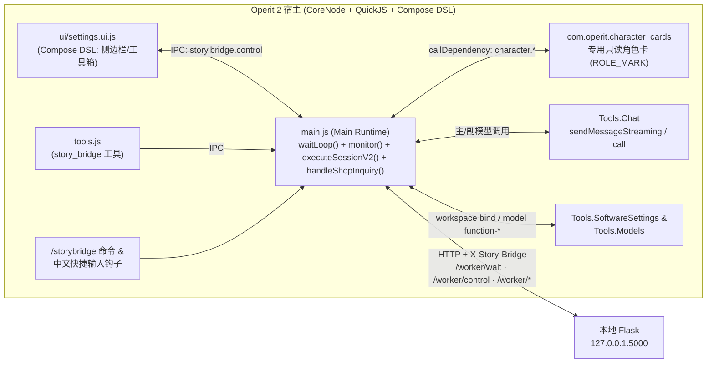

# 06 · Operit 2 桥接插件架构

> **非数据源声明**：本文件为开发者架构参考文档，严禁作为 AI 剧情运行时提示词或世界书注入。
> **源码唯一入口**：[`scene_chat_dev/local.story.operit_bridge/`](../scene_chat_dev/local.story.operit_bridge/)（版本 **2.1.8**，Operit API `2.0.0`，插件 ID `local.story.operit_bridge`，子包 `story_bridge`）。
> **成品与构建**：[`scene_chat_dev/build.py`](../scene_chat_dev/build.py) → `scene_chat_dev/artifacts/故事桥接-continuous-2.1.8.toolpkg`（验包通过后自动清理旧版 `.toolpkg`）。

---

## 1. Operit 2 平台官方参考与宿主运行时机制

本桥接插件构建于开源跨设备 AI Agent 平台 **Operit 2**（Rust Core + Flutter App + 平台 Host + ToolPkg 扩展运行时，AGPL-3.0）之上。Operit 2 当前处于 **Preview 阶段**，插件契约、宿主 API 与数据格式可能随上游演进调整；开发或排查插件问题时，应以下列官方权威资料与本仓随附类型声明为准。

### 1.1 Operit 2 官方资源与知识库索引

| 资源 | 链接 / 路径 | 用途 |
|---|---|---|
| **官方下载页** | https://operit.app/#/v2/download | 获取各平台最新 Operit 2 安装包与发布说明 |
| **官方源码仓库（GitHub）** | https://github.com/AAswordman/Operit2 （`https://github.com/AAswordman/Operit2.git`） | Rust Core（`core/`）、Flutter 应用（`apps/`）、平台 Host（`hosts/`）与官方插件/SDK 源码（`plugins/`） |
| **官方知识库源码（Wiki 仓库）** | https://github.com/luojiaping/Operit2-wiki | Operit 2 架构、核心模块、角色卡、ToolPkg/Compose DSL 专题 Wiki 源码 |
| **官方在线知识库（Wiki 网站）** | https://luojiaping.github.io/Operit2-wiki | 在线查阅 Operit 2 架构文档、插件体系、模型与同步指南 |
| **上游插件作者手册（仓库内）** | `AAswordman/Operit2` → `plugins/docs/README.md`、`PUBLIC_API.md`、`UI_NAVIGATION.md`、`package_builder/PLUGIN_CREATION_WORKFLOW.md`、`worldbook-regex.md`、`core/crates/plugin/sdk/README.md` | ToolPkg 打包、前置依赖公共 API、UI 导航、工作流与世界书正则权威规范 |
| **本项目离线 SDK 类型镜像** | [`scene_chat_dev/types/`](../scene_chat_dev/types/)（30 份官方 `.d.ts` 声明，由 `operit-plugin-sdk` Rust 声明生成） | 离线查阅 `ToolPkg`、`Tools.Chat`、`Tools.Models`、`Tools.SoftwareSettings`、`PluginConfig`、`ComposeDslScreen`、`RuntimeContext`、`QuickJS` 全局接口（目录根置 `.nomedia` 防止安卓相册误扫） |

### 1.2 Operit 2 宿主权限边界与 VFS 路径隔离

- **四层由外向内收紧的权限模型**：
  `0. App Runtime Sandbox（应用沙箱/容器）` → `1. Host Authorization（操作系统实际授予的文件/终端/网络权限）` → `2. AI Capability Limit（ReadOnly / WorkspaceWrite / Full）` → `3. User Tool Approval（单次工具调用的 allow/ask/deny）`。
- **VFS 与终端路径隔离**：
  - `Tools.Files` 与 `workspace bind` 使用 Operit 2 **VFS 虚拟路径**（如 `/virtual/android/documents/...`、`/operitapp/data/...`）；
  - 终端 Shell（Termux / proot）与 Pydroid 3 使用操作系统真实路径（如 `/storage/emulated/0/互动对话项目/Gemini网页版`）；两者不可混传。
- **插件安装区与运行缓存（Operit VFS 路径）**：

| Operit VFS 路径 | 用途与维护注意 |
|---|---|
| `/operitapp/data/extensions/device/packages/` | 设备级安装区；本项目 `installation_scope: "device"` 即安装于此（`故事桥接.toolpkg`）。**日常开发切勿直接修改此目录**，须改源码 → `build.py` → 同 ID 覆盖导入 |
| `/operitapp/data/extensions/space/packages/` | 多设备 Space 级共享扩展安装区 |
| `/operitapp/data/cache/toolpkg/` | 运行时按需解压缓存（诊断只读参考，不能用于判断真实安装或启用状态） |

### 1.3 ToolPkg v2 多运行时隔离与通信边界

Operit 2 通过 `ToolPkgLoader`（`loadToolPkgFromExternalFile`）加载 `.toolpkg` ZIP 归档，校验 `manifest.json` 必填的 `toolpkg_id` / `version` / `api_version`（**省略 `api_version` 会默认降级 `1.0.0`**，因此本插件显式锁定 `"api_version": "2.0.0"`）。同一插件内部运行在三个隔离的 QuickJS / UI 上下文中：

1. **Main Runtime（`main.js`）**：常驻主运行时，承载全局状态、定时器、Long-Polling、事件监听、IPC 服务端与依赖调用。
2. **Subpackage Runtime（`tools.js`）**：按工具调用触发的子包入口，不与 Main Runtime 共享 JS 内存，通过包内私有 `ToolPkg.ipc.call(channel, payload, { targetRuntime: 'main' })` 通信（原生 IPC 禁止跨包直调）。
3. **Compose DSL UI Runtime（`ui/settings.ui.js`）**：独立 UI 渲染上下文（ABI 4 布局程序），由 `ComposeDslScreen(ctx)` 产出 `ComposeNode` 树，通过 `ToolPkg.ipc.call` 与 Main Runtime 交换 JSON 快照；异步回调须用 `ctx.useRef` 镜像 `ctx.useState` 以规避闭包陈旧。
4. **跨插件公共 API（`requires` + `ToolPkg.callDependency`）**：
   - 依据 Operit 2 `PUBLIC_API.md` 规范，跨包不允许 `require` 或私有 IPC，必须先在 `manifest.json` 的 `requires` 声明前置包与最低版本（本插件声明 `com.operit.character_cards >= 0.2.0`），运行时通过 `ToolPkg.callDependency(pkgId, method, payload)` 经 JSON 边界异步调用提供方通过 `ToolPkg.registerApi` 显式暴露的公开方法（单次超时 **60s**，且禁止在 `registerToolPkg()` 注册阶段调用）。

### 1.4 底层原理：为什么 Zone 0 / Zone 1 冻结前缀能精确命中 KV 缓存

Operit 2 内置角色卡插件 `com.operit.character_cards` 的底层实现决定了本项目的两区冻结策略：
- **会话绑定机制**：一次会话的绑定选择串只有三种形态：`card:<id>`、`group:<id>` 或 `model:chat`。调用 `Tools.Chat.createNew({ setAsCurrentChat: false, input: { 'com.operit.character_cards': { version: 1, selection: 'card:' + participantId } } })` 时，角色卡插件经 `beforeChatCreate` 预写草稿绑定并提交到插件自身存储，使专用会话独立于用户主聊天。
- **固定顺序提示词组装（`combineCharacterPrompt`）**：执行 `CHAT` 对话时，`com.operit.character_cards` 按**严格固定顺序**拼装系统提示词 `introPrompt`（各段以 `\n\n` 连接）：
  1. `characterSetting`（← **本项目写入全局不变的 Zone 0**）
  2. `otherContentChat`（← **本项目写入场景级半静态 Zone 1**）
  3. `attachedTagIds` 对应标签内容（← **本插件强制锁死 `[]`**）
  4. 高级自定义提示词（空）
- **缓存收益**：由于 `characterSetting` 位于最前且全局不变、`otherContentChat` 仅在切换场景或阵容时更新，底层发往 LLM 的系统提示词前缀可实现**字节级完全稳定**，从而最大化 Gemini / DeepSeek 隐式前缀 KV 缓存命中。

### 1.5 本插件使用的 Operit 2 宿主 API 速查表

| 宿主 API | 本插件调用点 | 语义与注意事项 |
|---|---|---|
| `PluginConfig.use(name, defaults)` / `PluginConfig.flush(cfg)` | `settings()`、状态变更落盘 | 内存映射 JSON 配置；属性赋值仅调度异步写盘，**关键状态（`inFlight`、`outbox`、`liveSession`）必须 `await PluginConfig.flush(config)` 确保持久化** |
| `Tools.Chat.sendMessageStreaming(req)` | `executeSessionV2()` / `executeSession()` | 提交 `kind: 'submit'` 到专用会话，异步迭代 `part`（`thinking`/`reasoning`/`markdown`/`tool_call`/`tool_result`）与 `completed` 回执 |
| `Tools.Chat.call({ functionType, turns, recordTokenUsage, enableThinking })` | Stage 2 后台结算、`repairMemory()` | **无状态、不落会话历史**的功能槽模型调用；`enableThinking: false` 是后台 `SUMMARY` 低延迟低费用的关键 |
| `Tools.Chat.createNew / listChats / getMessages / agentStatus / switchTo / cancel / updateTitle` | `ensureSession()`、`restoreChat()`、超时取消 | 管理专用会话生命周期，并核验用户消息落盘内容与 `userMessageTimestamp` |
| `Tools.Models.listSummaries()` | `fetchModelCatalog()` | 直接从宿主模型管理器读取全部已配置模型（`providerId`、`modelId`、能力标志与计费元数据） |
| `Tools.SoftwareSettings.exec(args)` | `currentChat()`、`ensureSession()`、模型槽读写 | 统一 Core Command 入口（非终端 shell，参数数组**不含 `operit2` 可执行名**）；本插件使用 `['chat','current','--json']`、`['workspace','bind', chatId, vfsPath]`、`['model','list'|'show'|'function-list'|'function-show'|'function-set', ...]` |
| `ToolPkg.callDependency('com.operit.character_cards', ...)` | `ownedStoryCard()`、`ensureSession()`、`syncCardPrefixes()` | 调用 `character.list` / `character.get` / `character.create` / `character.update` / `chat.configuration.binding.read` |
| `ToolPkg.registerUiRoute` / `registerNavigationEntry` | `registerToolPkg()` | 注册 `compose_dsl` 页面路由并挂载到 `main_sidebar_plugins` 与 `toolbox` 导航表面 |
| `ToolPkg.registerCommand` / `registerChatInputHook` / `registerAppLifecycleHook` | `registerToolPkg()` | 注册 `/storybridge` 命令、免 Token 中文短语消费钩子（`action: 'Consume'`）及应用启动/前台/终止钩子 |

> **与 Operit 2 世界书的关系**：Operit 2 世界书（1.3.0+ 支持正则关键词激活与 `markdownOnly`/`promptOnly` 替换规则，详见上游 `plugins/docs/worldbook-regex.md`）仅用于本项目**手动入口**（由 `Operit世界书导出/convert_to_operit.py` 生成并通过 `import_entries` 导入）；正式首页 v2 桥接通道通过 `story_compiler.py` 冻结前缀直接投递，**不依赖手动世界书**，且专用角色卡的 `attachedTagIds: []` 避免与外部世界书叠加重复。

---

## 2. 插件包结构与运行时拓扑

本插件由 5 个文件组成（打包体积 ~39 KB）：

| 文件 | 角色与运行时 | 核心职责 |
|---|---|---|
| [`manifest.json`](../scene_chat_dev/local.story.operit_bridge/manifest.json) | 包声明 | `toolpkg_id: "local.story.operit_bridge"`、`version: "2.1.8"`、`api_version: "2.0.0"`、`installation_scope: "device"`、依赖 `com.operit.character_cards >= 0.2.0`、声明子包 `story_bridge -> tools.js` |
| [`main.js`](../scene_chat_dev/local.story.operit_bridge/main.js) | Main Runtime（~2,440 行） | `PluginConfig` 持久化、IPC 通道 `story.bridge.control`、`waitLoop()` Long-Polling、`monitor()` 6s 远控同步、专用角色卡与前缀冻结、v2 双阶段/单阶段执行、无状态商城询货 `handleShopInquiry()`、Outbox 抗断网投递、模型槽绑定、`/storybridge` 命令与输入钩子 |
| [`tools.js`](../scene_chat_dev/local.story.operit_bridge/tools.js) | Subpackage Tool Runtime（60 行） | 暴露 `start` / `stop` / `status` / `configure`（12 个可选参数）给 Operit 工具层，全部经 `ToolPkg.ipc.call('story.bridge.control', ..., { targetRuntime: 'main' })` 转发 |
| [`ui/settings.ui.js`](../scene_chat_dev/local.story.operit_bridge/ui/settings.ui.js) | Compose DSL UI Runtime（612 行） | 原生 Material 3 设置界面，挂载到 Operit 侧边栏「插件」与「工具箱」，通过 IPC 实时驱动并同步网页端面板 |
| [`README.md`](../scene_chat_dev/local.story.operit_bridge/README.md) | 插件说明 | 打包随附版本与协议摘要 |



---

## 3. 配置持久化、双循环调度与双端联动

### 3.1 `PluginConfig` 持久化与内存缓存
- 通过 `PluginConfig.use('story_bridge', defaults)`（[`main.js`](../scene_chat_dev/local.story.operit_bridge/main.js)）落盘，关键字段：
  - 连接与模式：`enabled`, `endpoint` (`http://127.0.0.1:5000`), `workspacePath`, `dualStageEnabled` (默认 `true`), `liveSessionPolicy` (`'continuous'`), `maxTurnsPerSession` (默认 `10`, 范围 `2..30`)。
  - 主/副模型：`functionType` (`'CHAT'`), `primaryModelMode` (`'slot'|'fixed'`), `primaryProviderId`, `primaryModelId`, `settlementFunctionType` (`'SUMMARY'`), `settlementThinking` (`false`), `settlementThinkingMode` (`'auto'`)。
  - 会话与容错：`liveSession`（含 `chatId`, `participantId`, `turnCount`, `lastCommittedSeq`, `interactionScope`, `dirty`, `zone0Sha`, `zone1Sha`, `syncedCardSig`, `generation`, `resetReason`, `serviceEpoch`, `lastRequestId`）、`sceneSession`、`inFlight`、`outbox`、`lastRejection`、`controlAck`/`controlError`。
- **30 秒 TTL 缓存**：`modelInfo` / `settlementModelInfo` / `modelCatalogCache`（最多 120 模型、32 功能槽），改绑槽位时立即全量失效；`verifiedCardCache` 与 `boundChatCache` 避免重复 IPC 查询。

### 3.2 `waitLoop()`、`monitor()` 与无状态商城询货 `handleShopInquiry()`
1. **`waitLoop()`**：
   - 先串行运行一次 `tick()`（投递残余 `outbox` → 恢复中断 `inFlight` → 领单执行）；当队列中无剧情或实验任务时，执行 **`handleShopInquiry()`**：向 `POST /api/story/worker/shop-inquiry/claim` 认领待进货询单，使用副模型槽位（默认 `SUMMARY`）以无状态 `Tools.Chat.call({ enableThinking: false, turns: [system_prompt, user_prompt] })`（90s 超时）生成候选商品并提交至 `POST /api/story/worker/shop-inquiry/<iq_id>/complete`，**全程绝不触碰 `liveSession`、角色卡或切换当前聊天窗口**。
   - 随后长轮询 `GET /api/story/worker/wait?since=<workerSeq>&timeout=25`（读超时 35s）；每次收到响应先经 `syncServiceEpoch()` 比对 `service_epoch`，若服务重启则归零 `workerSeq = 0`。
2. **`monitor()`**（6s 定时 + 任意本地修改后即时触发，**暂停态仍持续运行**）：
   - 上报完整 `runtimeReport(config)` 与上次指令确认 `ack_id`/`ack_error` 至 `POST /api/story/worker/control`，收到 `response.command` 后立即执行并 ACK，实现双端无感同步。

---

## 4. 专用角色卡安全管理与 Zone 0/1 前缀冻结

### 4.1 角色卡安全认领与零误删（`ownedStoryCard()` / `ensureSession()`）
- 三类入口使用三张命名隔离的专用卡，均带专属印记 `marks: "local.story.operit_bridge:readonly"`、固定模型模式 `chatModelBindingMode: "FIXED_MODEL"` 与封闭工具权限（清空全部包/技能/MCP）：
  - 正式互动 (`scene === 'live'`)：`同席互动·项目只读`，仅允许 `LIVE_READ_TOOLS`（5 个只读文件工具）。
  - 实验场景 (`scene === true`)：`场景交流·项目只读`，允许 `FILE_TOOLS`（8 个只读文件工具）。
  - 旧完整回合 (`scene === false`)：`故事生成·项目只读`，允许 `FILE_TOOLS`。
- **重装安全复用**：配置清空或重装后若缺失 `participantId`，插件会遍历 `character.list` 认领与目标同名**且** `marks === ROLE_MARK` 的自有角色卡；若存在同名但无 `ROLE_MARK` 的用户自建卡，**直接报错中止，绝不覆盖或删除用户角色卡**。
- **写卡保留用户标签（v2.1.7+）**：更新角色卡时读取并合并现有标签与配置，保留用户在 Operit 侧手动勾选的额外标签。
- **独立会话绑定与外部删窗实时核验**：通过 `Tools.Chat.createNew({ setAsCurrentChat: false, ... })` 创建专用会话、绑定 `workspacePath`，每次生成结束在 `finally` 中通过 `restoreChat()` 切回用户原本所在的聊天窗口，并经 `Tools.Chat.listChats` 实时核验防外部删窗失忆。

### 4.2 Zone 0 / Zone 1 SHA-256 增量同步（`syncCardPrefixes()`）
- 计算复合签名 `targetSig = JSON.stringify([participantId, model.key, zone0Sha, zone1Sha])`，一致则跳过；变化时经 `character.update` 增量写入 `characterSetting` 与 `otherContentChat`。

---

## 5. `executeSessionV2()` 双阶段流式与单阶段执行流水线

入口位于 [`main.js`](../scene_chat_dev/local.story.operit_bridge/main.js)（`entry_mode === 'live_interaction' && material_delivery_v2 === 1`），全程受 10 分钟硬超时与 20 秒心跳保护：

1. **取料与前缀同步**：`POST /worker/<id>/material`（`delivery_version: 2`，放行 `continuity_hook`）→ 校验 SHA-256 与 `delivery.id` → 执行 `syncCardPrefixes()`。
2. **分支 A · `dual_stream_v2`（默认）**：
   - **Stage 1（前台流式演播）**：`Tools.Chat.sendMessageStreaming()` 监听 `thinking`/`markdown` 分片，经与 Python 对称的 `parseStreamMessages()` 解析与单槽合并 `pushPreview()` 推往 `/worker/<id>/stream`，结束提取正文并推送 `stage: 'settling'`。
   - **Stage 2（后台无状态结算）**：由副模型槽（默认 `SUMMARY`，未绑定回退 `CHAT`）调用无状态 `Tools.Chat.call`（`auto` 智能自适应思考，失败重试自动提权思考；120s 超时）→ `normalizeSettlementJson()` → `POST /worker/<id>/result` 经 `RoundStore` 原子落盘；遇 `retryable_settlement: true` 推 `settling_retry` 并原地重试 Stage 2。
3. **分支 B · `single_prefix_v2`（单阶段精简备选）**：主模型单次输出 6 键裸 JSON（首错自动追加 1 次 `format_repair`）。

### 崩溃恢复、手动重置与旧协议兼容
- **中断保护（`interruptedSession()`）**：Operit 被杀进程重启时自动终止残留会话、标记 `dirty = true` 并写入 `config.outbox` 退还体力，绝不偷跑重试。
- **手动重建会话（`reset_session`）**与 **v1 兼容**：保留 `program_inline_v1`、`/preflight` 补读及 `scene_chat` 兼容。

---

## 6. 会话策略与自动切窗条件（`liveSession()`）

支持 `continuous`（默认）、`service_restart`、`per_action` 三策略；首次连接、身份变更、`dirty == true`、场景/阵容变化（`interactionScope`）、达 `maxTurns`（默认 `10`）、策略触发或检测到外部删窗时自动新建干净会话（`isFresh = true`）。

---

## 7. 模型目录、功能槽改绑与原生设置页（`ui/settings.ui.js`）

- **模型发现与功能槽改绑**：支持 `Tools.Models.listSummaries()` 与 `model function-list/function-set`，主模型双模式（`slot`/`fixed`）及 7 功能槽改绑。
- **Compose DSL 原生设置页（`ui/settings.ui.js`）**：注册于 `main_sidebar_plugins` 与 `toolbox`，提供运行速控、主/副模型与三档思考自适应选择器、切窗轮数步进器与高级连接配置。
- **免 Token 指令**：`/storybridge start|stop|status|reset-session|session|mode|settlement|thinking|max-turns` 与中文聊天输入钩子。

---

## 8. 构建与发布流程（`scene_chat_dev/build.py`）

```bash
# 1. 语法与全部 9 组 Node 桥接回归测试
node --check scene_chat_dev/local.story.operit_bridge/main.js
node --check scene_chat_dev/local.story.operit_bridge/tools.js
node --check scene_chat_dev/local.story.operit_bridge/ui/settings.ui.js
for f in scene_chat_dev/tests/bridge_*.js; do node "$f"; done

# 2. 打包为唯一 .toolpkg、自动校验 manifest 版本与 zip 完整性，并自动清理旧版 .toolpkg
python3 scene_chat_dev/build.py
# 输出: ARCHIVE_OK .../scene_chat_dev/artifacts/故事桥接-continuous-2.1.8.toolpkg
```

> **版本升级规范**：每次改动桥接源码均须递增 `manifest.json` 的 `version`，并同步更新 `main.js` 中的 `PLUGIN_VERSION`、`ui/settings.ui.js` 的兜底版本、`README.md` 与根目录 `.gitignore` 末尾的白名单豁免行（`!/scene_chat_dev/artifacts/故事桥接-continuous-<version>.toolpkg`），执行 `build.py`（自动清理旧包），再在 Operit 2 中同 ID 覆盖导入新包。后端 `story_service._bridge_view()` 会动态透出仓库 `manifest.json` 的 `expected_plugin_version`，前端 `story_client.js` 检测到已连接插件落后于本地最新版时会自动提示导入路径。若 Operit 2 宿主版本升级导致插件 API 变化，优先对照 [Operit 2 官方源码](https://github.com/AAswordman/Operit2) 与 [Operit 2 官方在线知识库](https://luojiaping.github.io/Operit2-wiki) 同步更新 [`scene_chat_dev/types/`](../scene_chat_dev/types/) 类型声明后再调整 `main.js` / `ui/settings.ui.js`。
